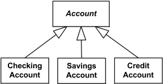
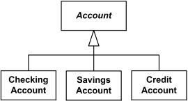
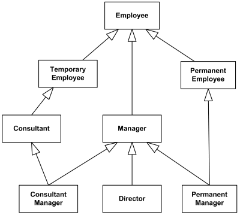
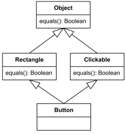
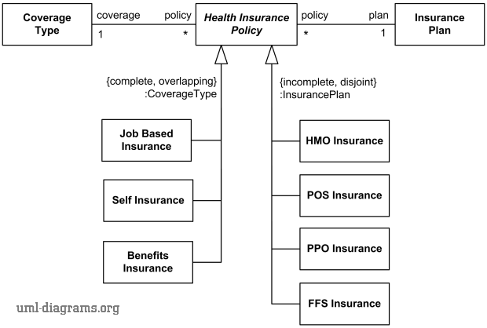
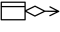

Title: UML generalization is binary taxonomic relationship between a more general classifier (superclass) and a more specific classifier (subclass).

URL Source: https://www.uml-diagrams.org/generalization.html

Warning: Target URL returned error 400: Bad Request

Markdown Content:
Menu►
*   [UML diagrams](https://www.uml-diagrams.org/ "UML graphical notation overview, examples, and reference.")
*   [UML and OOAD](https://www.uml-diagrams.org/uml-object-oriented-concepts.html "Object-oriented development concepts in UML")
*   [UML core elements](https://www.uml-diagrams.org/uml-core.html "UML core elements")
*   [Frame](https://www.uml-diagrams.org/frame.html "UML frame")
*   [Namespace](https://www.uml-diagrams.org/namespace.html "UML namespace")
*   [Type](https://www.uml-diagrams.org/uml-core.html#type "UML type")
*   [Classifier](https://www.uml-diagrams.org/classifier.html "UML classifier")
*   [Property](https://www.uml-diagrams.org/property.html "UML property")
*   [Multiplicity](https://www.uml-diagrams.org/multiplicity.html "UML multiplicity")
*   [Visibility](https://www.uml-diagrams.org/visibility.html "UML visibility")
*   [Constraint](https://www.uml-diagrams.org/constraint.html "UML constraint")
*   [Association](https://www.uml-diagrams.org/association.html "UML association")
*   [Aggregation](https://www.uml-diagrams.org/aggregation.html "UML aggregation")
*   [Composition](https://www.uml-diagrams.org/composition.html "UML composition")
*   [Generalization](https://www.uml-diagrams.org/generalization.html "UML generalization")
*   [Dependency](https://www.uml-diagrams.org/dependency.html "UML dependency")
*   [Abstraction](https://www.uml-diagrams.org/abstraction.html "UML abstraction")
*   [Realization](https://www.uml-diagrams.org/realization.html "UML realization")
*   [Template](https://www.uml-diagrams.org/template.html "UML template")
*   [UML core reference](https://www.uml-diagrams.org/uml-core-reference.html "UML core elements graphical notation reference")
*   [UML Index](https://www.uml-diagrams.org/index-references.html "Index of UML Elements")

# Generalization in UML

A **generalization** is a binary taxonomic (i.e. related to classification) [directed relationship](https://www.uml-diagrams.org/uml-core.html#directed-relationship) between a more general [classifier](https://www.uml-diagrams.org/classifier.html) (superclass) and a more specific classifier (subclass).

Each instance of the specific classifier is also an indirect instance of the general classifier, so that we can say "Patient is a Person", "Savings account is an Account", etc. Because of this, **generalization** relationship is also informally called "**Is A**" relationship.

Generalization is **owned by** the specific classifier.

A **generalization** is shown as a line with a hollow triangle as an arrowhead between the symbols representing the involved classifiers. The arrowhead points to the symbol representing the general classifier. This notation is referred to as the **"separate target style."**

Checking, Savings, and Credit Accounts are **generalized** by Account

Generalization relationships that reference the same general classifier can also be connected together in the **"shared target style."**

Checking, Savings, and Credit Accounts are **generalized** by Account

## Inheritance

In OOAD **inheritance** is usually defined as a mechanism by which more specific classes (called subclasses or derived classes) incorporate structure and behavior of more general classes (called superclasses or base classes).

Inheritance was explained in **UML 1.4.2** using the concepts of a **full descriptor** and a **segment descriptor**. A full descriptor contains a description of all of the attributes, associations, operations, and constraints that the object contains, and is usually implicit because it is built out of incremental segments combined together using inheritance.

In an object-oriented language, the description of an object is built out of incremental segments that are combined using inheritance to produce a full descriptor for an object. The segments are the modeling elements that are actually declared in a model. They include elements such as class and other generalizable elements. Each generalizable element contains a list of features and other relationships that it adds to what it inherits from its ancestors.

Each kind of generalizable element has a set of inheritable features. For any model element, these include constraints. For classifiers, these include features ( attributes, operations, signal receptions, and methods) and participation in associations. [[UML 1.4.2 Specification](https://www.uml-diagrams.org/references.html#ref-uml-142 "UML 1.4.2 Specification")]

If a generalizable element has more than one parent (**multiple inheritance**), then its full descriptor contains the union of the features from its own segment descriptor and the segment descriptors of all of its ancestors.

Attributes in UML 1.4 could not be [redefined](https://www.uml-diagrams.org/redefining-property.html) but a method may be declared in more than one subclass. A method declared in any segment supersedes and replaces a method with the same signature declared in any ancestor.

**UML 2.4** and the newest **UML 2.5** specifications provide no definition for **inheritance**. UML 2.x specifications say that with generalization specializing classifier **inherits**[features](https://www.uml-diagrams.org/uml-core.html#feature) of the more general classifier. Also, any [constraint](https://www.uml-diagrams.org/class.html#constraint) applying to instances of the general classifier also applies to instances of the specific classifier.

**UML 2.5** provides some vague and incomplete explanation of how **inheritance** works in UML:

When a Classifier is generalized, certain members of its generalizations are inherited, that is they behave as though they were defined in the inheriting Classifier itself. For example, an inherited member that is an attribute has a value or collection of values in any instance of the inheriting Classifier, and an inherited member that is an Operation may be invoked on an instance of the inheriting Classifier. [UML 2.5 Specification]

### Multiple Inheritance

**Multiple inheritance** is implicitly allowed by UML standard, while the standard provides no definition of what it is.

[Classifier](https://www.uml-diagrams.org/classifier.html) in UML can have zero, one or many generalization relationships to more general classifiers. In OOAD **multiple inheritance** refers to the ability of a class to inherit behaviors and features from more than one superclass.

Multiple inheritance for Consultant Manager and Permanent Manager - both inherit from two classes

The origin of multiple inheritance could be in orthogonal taxonomies combined together. For example, the diagram above combines two different classifications of employees - one is based on whether employee is permanent or temporary, and another one is based on the position employee holds.

Though UML standard implicitly allows **multiple inheritance**, it provides no explicit resolutions or recommendations for well known issues and ambiguities, such as the **diamond problem**.

Diamond problem example - Button inherits 2 implementations of equals()

In the multiple inheritance **diamond problem** example above Button class inherits two different implementations of equals() while it has no own implementation of the operation. When button.equals() is called, it is unknown which implementation - from Rectangle or from Clickable - will be used.

UML [profiles](https://www.uml-diagrams.org/profile.html) allow to specialize the semantics of generalization. For example, in the **Java** language profile, generalization of classes should be restricted to single inheritance.

## Generalization Set

**Generalization set** is a [packageable element](https://www.uml-diagrams.org/package-diagrams.html#packageable-element) that allows us to define classification hierarchies by combining some generalizations of a particular general classifier into (sub)sets. Each generalization set may be also associated with a [classifier](https://www.uml-diagrams.org/classifier.html) called its **powertype**.

Each generalization set has two properties - **isCovering** (**complete** or **incomplete** constraint) and **isDisjoint** (**disjoint** or **overlapping** constraint), to clarify what kind of set it is.

The **isCovering** property of generalization set specifies whether the set of specific classifiers in that generalization set is complete. For the covering (**{complete}**) generalization set, every instance of the general classifier is also an instance of (at least) one of the specific classifiers. If the set is not covering (**{incomplete}**), there could be some instances of the general classifier that could not be classified as any of the specific classifiers from the generalization set.

The **isDisjoint** property specifies whether the specific classifiers of the generalization set may overlap. Generalization set constrained as **{disjoint}** has no instance of any specific classifier may also be an instance of another specific classifier (i.e there is no overlapping of classifiers). If generalization set is **{overlapping}**, some or all of its specific classifiers could share common instances.

By default, in **UML 2.0** to **UML 2.4.1** generalization set is **{incomplete, disjoint}**, while in **UML 2.5** default was changed to **{incomplete, overlapping}**.

A generalization set may optionally be associated with a classifier called its **power type**. The power type instances in this case may be treated as semantically equivalent to each of the corresponding specializing classifiers in every generalization in the generalization set. UML specification does not mandate how this semantic equivalence is implemented and how its integrity is maintained.

On the diagram, the generalization set constraints are placed next to the sets, close to the common arrowhead of the generalization set or near the dashed line for the generalization set.

**Power type** specification is shown as colon followed by the name of the power type classifier near the corresponding generalization set.

Health insurance policy generalization sets and powertypes example -  
 Coverage type is complete and overlapping while insurance plan is incomplete and disjoint.

The complete example can be found here: [Health insurance policy generalization sets and powertypes example](https://www.uml-diagrams.org/examples/health-insurance-policy-domain-diagram-example.html).

[Dependency](https://www.uml-diagrams.org/dependency.html "UML dependency")

This document describes **UML 2.5** and is based on **OMG™ Unified Modeling Language™ (OMG UML®) 2.5** specification [[UML 2.5 FTF - Beta 1]](https://www.uml-diagrams.org/references.html#ref-uml-25-b1 "UML 2.5 Specification FTF Beta 1"). All UML diagrams were created in **Microsoft Visio** 2007-2016 using [UML 2.2 stencils](http://softwarestencils.com/uml/index.html "Visio Stencil and Template for UML 2.2"). You can send your comments and suggestions to [webmaster](mailto:webmaster@uml-diagrams.org). [Privacy policy](https://www.uml-diagrams.org/privacy-policy.html).

_Copyright © 2009-2026 uml-diagrams.org. All rights reserved. Authored by Kirill Fakhroutdinov._

[Your Free Gold and Silver Kit Heritage Metals | [Sponsored](https://popup.taboola.com/en/?template=colorbox&utm_source=uml-diagrams&utm_medium=referral&utm_content=next-up-a-delta:Next%20Up:)[Sponsored](https://popup.taboola.com/en/?template=colorbox&utm_source=uml-diagrams&utm_medium=referral&utm_content=next-up-a-delta:Next%20Up:) Read Next Story](https://northledgerfinance.com/money/1-10/5DaJAXgsLhJG3DT6W8DhPl3qN1RzqEgfcmCXr5qF8h4IS1yeHT9w9CjqABmDvw "Your Free Gold and Silver Kit")
