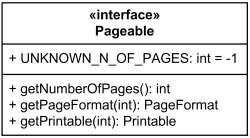
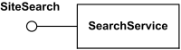
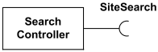
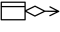

Title: UML interface is a classifier that declares of a set of coherent public features and obligations (contract).

URL Source: https://www.uml-diagrams.org/interface.html

Warning: Target URL returned error 400: Bad Request

Markdown Content:
Menu►
*   [UML diagrams](https://www.uml-diagrams.org/ "UML graphical notation overview, examples, and reference.")
*   [Class diagrams overview](https://www.uml-diagrams.org/class-diagrams-overview.html "UML class diagrams overview")
*   [Class](https://www.uml-diagrams.org/class.html "UML class")
*   [Interface](https://www.uml-diagrams.org/interface.html "UML interface")
*   [Data type](https://www.uml-diagrams.org/data-type.html "UML data type")
*   [Property](https://www.uml-diagrams.org/property.html?context=class-diagrams "UML property")
*   [Operation](https://www.uml-diagrams.org/operation.html "UML operation")
*   [Multiplicity](https://www.uml-diagrams.org/multiplicity.html?context=class-diagrams "UML multiplicity")
*   [Visibility](https://www.uml-diagrams.org/visibility.html?context=class-diagrams "UML visibility")
*   [Constraint](https://www.uml-diagrams.org/constraint.html?context=class-diagrams "UML constraint")
*   [Object](https://www.uml-diagrams.org/object.html "UML object")
*   [Association](https://www.uml-diagrams.org/association.html?context=class-diagrams "UML association")
*   [Aggregation](https://www.uml-diagrams.org/aggregation.html?context=class-diagrams "UML aggregation")
*   [Composition](https://www.uml-diagrams.org/composition.html?context=class-diagrams "UML composition")
*   [Generalization](https://www.uml-diagrams.org/generalization.html?context=class-diagrams "UML generalization")
*   [Dependency](https://www.uml-diagrams.org/dependency.html?context=class-diagrams "UML dependency")
*   [Abstraction](https://www.uml-diagrams.org/abstraction.html?context=class-diagrams "UML abstraction")
*   [Nested classifiers](https://www.uml-diagrams.org/nested-classifier.html "Nested Classifiers in UML")
*   [Reference](https://www.uml-diagrams.org/class-reference.html "UML class diagrams reference")
*   [Examples](https://www.uml-diagrams.org/class-diagrams-examples.html "UML class diagrams examples")
*   [UML index](https://www.uml-diagrams.org/index-references.html "Index of UML elements")

# Interface

An **interface** is a [classifier](https://www.uml-diagrams.org/classifier.html) that declares of a set of coherent public features and obligations. An interface specifies a **contract**. Any instance of a classifier that **realizes** (implements) the interface must fulfill that contract and thus provides **services** described by contract.

Since interfaces are declarations, they are not instantiable. Instead, an interface specification is implemented by an instance of an instantiable classifier, which means that the instantiable classifier presents a public facade that conforms to the interface specification.

Any given classifier may implement more than one interface. Interface may be implemented by a number of different classifiers.

An [association](https://www.uml-diagrams.org/association.html?context=class-diagrams) between an interface and any other classifier implies that a conforming association must exist between any implementation of that interface and that other classifier. In particular, an association between interfaces implies that a conforming association must exist between implementations of the interfaces.

#### Notation

An interface may be shown using a rectangle symbol with the keyword **«interface»** preceding the name.

**Interface** SiteSearch

The obligations that may be associated with an interface are in the form of various kinds of constraints (such as pre- and postconditions) or protocol specifications, which may impose ordering restrictions on interactions through the interface.

**Interface** Pageable

Interfaces realized by a classifier are its [provided interfaces](https://www.uml-diagrams.org/class.html#provided-interface), and represent the obligations that instances of that classifier have to their clients. They describe the **services** that the instances of that classifier offer to their clients.

Interface participating in the **interface realization** dependency is shown as a circle or ball, labeled with the name of the interface and attached by a solid line to the classifier that realizes this interface.

**Interface** SiteSearch is **realized** (implemented) by SearchService.

**Required interface** specifies services that a classifier needs in order to perform its function and fulfill its own obligations to its clients. It is specified by a **usage dependency** between the [classifier](https://www.uml-diagrams.org/classifier.html) and the corresponding interface.

The [usage dependency](https://www.uml-diagrams.org/dependency.html#usage) from a classifier to an interface is shown by representing the interface by a half-circle or socket, labeled with the name of the interface, attached by a solid line to the classifier that **requires** this interface.

**Interface** SiteSearch is **used** (required) by SearchController.

It is often the case in practice that two or more interfaces are mutually coupled through application-specific dependencies. In such situations, each interface represents a specific role in a multi-party “protocol.” These types of protocol role couplings can be captured by associations between interfaces.

An interface in the UML could be used as a [namespace](https://www.uml-diagrams.org/namespace.html) for other [classifiers](https://www.uml-diagrams.org/classifier.html) including classes, interfaces, use cases, etc. [Nested classifiers](https://www.uml-diagrams.org/nested-classifier.html) are visible only within the namespace of the containing interface.

#### Revisions

In **UML 1.4** interface was formally equivalent to an [abstract class](https://www.uml-diagrams.org/class.html#abstract-class) with no attributes and no methods and only [abstract operations](https://www.uml-diagrams.org/operation.html#abstract-operation).

[Data type](https://www.uml-diagrams.org/data-type.html "UML data type")

  

This document describes UML versions up to **[UML 2.5](https://www.uml-diagrams.org/references.html#ref-uml-25 "UML 2.5 Specification")** and is based on the corresponding **OMG™ Unified Modeling Language™ (OMG UML®)** specifications. UML diagrams were created in **Microsoft® Visio®** 2007-2016 using **[UML 2.x Visio Stencils](http://softwarestencils.com/uml/index.html "Visio Stencil and Template for UML 2.5")**. You can send your comments and suggestions to [webmaster](mailto:webmaster@uml-diagrams.org). [Privacy policy](https://www.uml-diagrams.org/privacy-policy.html).

_Copyright © 2009-2026 uml-diagrams.org. All rights reserved. Authored by Kirill Fakhroutdinov._

[How NF1 Command Center Unifies Whole Teams NF1 (NeuroForce One) | [Sponsored](https://popup.taboola.com/en/?template=colorbox&utm_source=uml-diagrams&utm_medium=referral&utm_content=next-up-a-delta:Next%20Up:)[Sponsored](https://popup.taboola.com/en/?template=colorbox&utm_source=uml-diagrams&utm_medium=referral&utm_content=next-up-a-delta:Next%20Up:) Read Next Story](https://commandcenter.neuroforceone.com/ "How NF1 Command Center Unifies Whole Teams")
