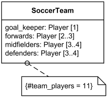
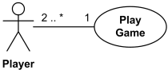
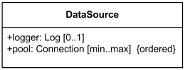

Title: UML Multiplicity and Collections - defining and using multiplicity and collections in UML

URL Source: https://www.uml-diagrams.org/multiplicity.html

Warning: Target URL returned error 400: Bad Request

Markdown Content:
Menu►
*   [UML diagrams](https://www.uml-diagrams.org/ "UML graphical notation overview, examples, and reference.")
*   [UML and OOAD](https://www.uml-diagrams.org/uml-object-oriented-concepts.html "Object-oriented development concepts in UML")
*   [UML core elements](https://www.uml-diagrams.org/uml-core.html "UML core elements")
*   [Frame](https://www.uml-diagrams.org/frame.html "UML frame")
*   [Namespace](https://www.uml-diagrams.org/namespace.html "UML namespace")
*   [Type](https://www.uml-diagrams.org/uml-core.html#type "UML type")
*   [Classifier](https://www.uml-diagrams.org/classifier.html "UML classifier")
*   [Property](https://www.uml-diagrams.org/property.html "UML property")
*   [Multiplicity](https://www.uml-diagrams.org/multiplicity.html "UML multiplicity")
*   [Visibility](https://www.uml-diagrams.org/visibility.html "UML visibility")
*   [Constraint](https://www.uml-diagrams.org/constraint.html "UML constraint")
*   [Association](https://www.uml-diagrams.org/association.html "UML association")
*   [Aggregation](https://www.uml-diagrams.org/aggregation.html "UML aggregation")
*   [Composition](https://www.uml-diagrams.org/composition.html "UML composition")
*   [Generalization](https://www.uml-diagrams.org/generalization.html "UML generalization")
*   [Dependency](https://www.uml-diagrams.org/dependency.html "UML dependency")
*   [Abstraction](https://www.uml-diagrams.org/abstraction.html "UML abstraction")
*   [Realization](https://www.uml-diagrams.org/realization.html "UML realization")
*   [Template](https://www.uml-diagrams.org/template.html "UML template")
*   [UML core reference](https://www.uml-diagrams.org/uml-core-reference.html "UML core elements graphical notation reference")
*   [UML Index](https://www.uml-diagrams.org/index-references.html "Index of UML Elements")

# UML Multiplicity and Collections

[Multiplicity](https://www.uml-diagrams.org/multiplicity.html#multiplicity) in UML allows to specify **cardinality** - i.e. **number of elements** - of some collection of elements.

[Multiplicity element](https://www.uml-diagrams.org/multiplicity.html#multiplicity-element) defines some collection of elements, and includes both multiplicity as well as specification of order and uniqueness of the collection elements.

**Note**, that [[UML 2.4.1 Specification]](https://www.uml-diagrams.org/references.html#ref-uml-24-super "UML 2.4.1 - Superstructure") does not separate **multiplicity** from **multiplicity element**, mingling and using these two interchangeably and causing some confusion in understanding the specification.

## Multiplicity

**Multiplicity** is a definition of **cardinality** - i.e. **number of elements** - of some collection of elements by providing an inclusive interval of non-negative integers to specify the allowable number of instances of described element. Multiplicity interval has some **lower bound** and (possibly infinite) **upper bound**:

multiplicity-range ::= [lower-bound'..']upper-bound  
lower-bound ::= natural-value-specification  
upper-bound ::= natural-value-specification|'*'

Lower and upper bounds could be natural constants or constant expressions evaluated to natural (non negative) number. Upper bound could be also specified as asterisk '*' which denotes unlimited number of elements. Upper bound should be greater than or equal to the lower bound.

**Note**, that [[UML 2.4.1 Specification]](https://www.uml-diagrams.org/references.html#ref-uml-24-super "UML 2.4.1 - Superstructure") is not very consistent describing multiplicity. For example, it says that the lower bound must be a non-negative integer literal, and later - that it may be specified by value specification, such as (side-effect free, constant) expression. Another issue is that asterisk as upper bound in one place means unlimited (and not infinity) number of elements while in the other you can read the (possibly infinite) upper bound. You can feel the difference in the two sentences: "Doctor may have unlimited number of patients." and "Doctor may have infinite number of patients."

Some typical examples of multiplicity:

| Multiplicity | Option | Cardinality |
| --- | --- | --- |
| 0..0 | 0 | Collection must be empty |
| 0..1 |  | No instances or one instance |
| 1..1 | 1 | Exactly one instance |
| 0..* | * | Zero or more instances |
| 1..* |  | At least one instance |
| 5..5 | 5 | Exactly 5 instances |
| m..n |  | At least m but no more than n instances |

If the multiplicity is associated with an element whose notation is a text string (such as a [class attribute](https://www.uml-diagrams.org/property.html#classifier-attribute)), the multiplicity range is placed within square brackets as part of that text string.

Multiplicity of Players for Soccer Team class

If the multiplicity is associated with an element that appears as a symbol (such as [use case](https://www.uml-diagrams.org/use-case.html) or class), the multiplicity range is displayed without square brackets.

Two or more Player **actors** are required  
 to initiate Play Game **use case**.

## Multiplicity Element

Multiplicity element defines some **collection** of elements, and includes both [multiplicity](https://www.uml-diagrams.org/multiplicity.html#multiplicity) as well as a specification of order and uniqueness of the collection elements.

Some subclasses of multiplicity element are [structural feature](https://www.uml-diagrams.org/uml-core.html#structural-feature), [operation](https://www.uml-diagrams.org/operation.html), **parameter**, **pin**.

Collection properties could be described with the following non-normative syntax rules:

collection-type ::= multiplicity-range ['{'collection-options'}']

Collection options specify whether the values in an instantiation of the element should be **unique** and/or **ordered**:

collection-options ::= order-designator[','uniqueness-designator]|uniqueness-designator[','order-designator]   
order-designator::='ordered'|'unordered'   
uniqueness-designator::='unique'|'nonunique'

| Collection Type | isOrdered | isUnique |
| --- | --- | --- |
| Multiset, bag | false | false |
| Sequence, array | true | false |
| Set | false | true |
| Ordered set | true | true |

If multiplicity element is multivalued and specified as **ordered**, then the collection of values in an instantiation of this element is sequentially ordered. By default, collections are **not ordered**.

If multiplicity element is multivalued and specified as **unique**, then each value in the collection of values in an instantiation of this element must be unique. By default, each value in collection is **unique**.

Data Source could have a Logger and has ordered pool  
 of min to max Connections. Each Connection is unique (by default)

Customer has none to many purchases.  
 Purchases are in specific order and each one is unique (by default)

[Visibility](https://www.uml-diagrams.org/visibility.html "UML visibility")

This document describes **UML 2.4** and is based on **OMG™ Unified Modeling Language™ (OMG UML®) 2.4** specification [[UML 2.4 - Superstructure]](https://www.uml-diagrams.org/references.html#ref-uml-24-super "UML 2.4 - Superstructure"). All UML diagrams were created in **Microsoft Visio** 2007-2016 using [UML 2.2 stencils](http://softwarestencils.com/uml/index.html "Visio Stencil and Template for UML 2.2"). You can send your comments and suggestions to [webmaster](mailto:webmaster@uml-diagrams.org). [Privacy policy](https://www.uml-diagrams.org/privacy-policy.html).

_Copyright © 2009-2026 uml-diagrams.org. All rights reserved. Authored by Kirill Fakhroutdinov._

[Young Indian Bettors Shift To MelBet App [Sponsored](https://popup.taboola.com/en/?template=colorbox&utm_source=uml-diagrams&utm_medium=referral&utm_content=next-up-a-delta:Next%20Up:)[Sponsored](https://popup.taboola.com/en/?template=colorbox&utm_source=uml-diagrams&utm_medium=referral&utm_content=next-up-a-delta:Next%20Up:) Read Next Story](https://mariatrainingacademy.com/ "Young Indian Bettors Shift To MelBet App")
