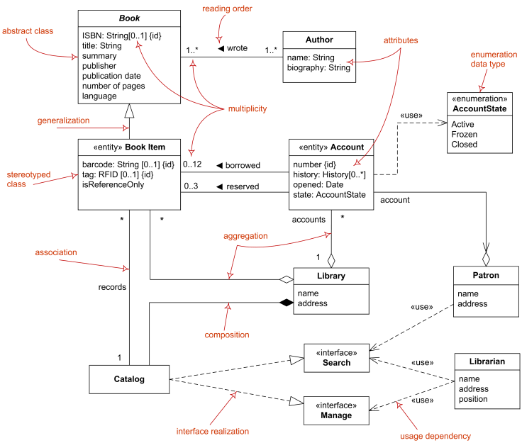
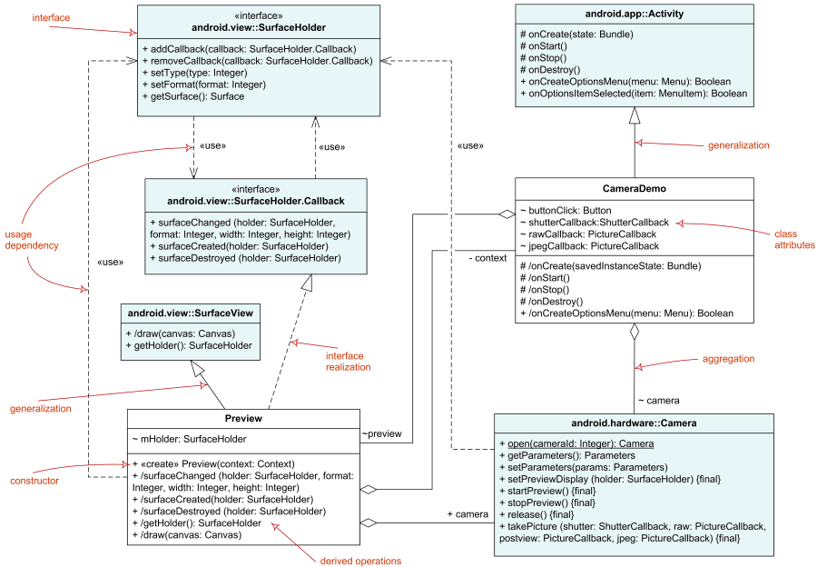
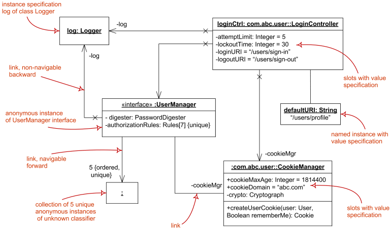

Title: UML Class and Object Diagrams Overview

URL Source: https://www.uml-diagrams.org/class-diagrams-overview.html

Markdown Content:
Menu►
*   [UML diagrams](https://www.uml-diagrams.org/ "UML graphical notation overview, examples, and reference.")
*   [Class diagrams overview](https://www.uml-diagrams.org/class-diagrams-overview.html "UML class diagrams overview")
*   [Class](https://www.uml-diagrams.org/class.html "UML class")
*   [Interface](https://www.uml-diagrams.org/interface.html "UML interface")
*   [Data type](https://www.uml-diagrams.org/data-type.html "UML data type")
*   [Property](https://www.uml-diagrams.org/property.html?context=class-diagrams "UML property")
*   [Operation](https://www.uml-diagrams.org/operation.html "UML operation")
*   [Multiplicity](https://www.uml-diagrams.org/multiplicity.html?context=class-diagrams "UML multiplicity")
*   [Visibility](https://www.uml-diagrams.org/visibility.html?context=class-diagrams "UML visibility")
*   [Constraint](https://www.uml-diagrams.org/constraint.html?context=class-diagrams "UML constraint")
*   [Object](https://www.uml-diagrams.org/object.html "UML object")
*   [Association](https://www.uml-diagrams.org/association.html?context=class-diagrams "UML association")
*   [Aggregation](https://www.uml-diagrams.org/aggregation.html?context=class-diagrams "UML aggregation")
*   [Composition](https://www.uml-diagrams.org/composition.html?context=class-diagrams "UML composition")
*   [Generalization](https://www.uml-diagrams.org/generalization.html?context=class-diagrams "UML generalization")
*   [Dependency](https://www.uml-diagrams.org/dependency.html?context=class-diagrams "UML dependency")
*   [Abstraction](https://www.uml-diagrams.org/abstraction.html?context=class-diagrams "UML abstraction")
*   [Nested classifiers](https://www.uml-diagrams.org/nested-classifier.html "Nested Classifiers in UML")
*   [Reference](https://www.uml-diagrams.org/class-reference.html "UML class diagrams reference")
*   [Examples](https://www.uml-diagrams.org/class-diagrams-examples.html "UML class diagrams examples")
*   [UML index](https://www.uml-diagrams.org/index-references.html "Index of UML elements")

# UML Class and Object Diagrams Overview

**Class diagram** is **UML**[structure diagram](https://www.uml-diagrams.org/uml-25-diagrams.html#structure-diagram) which shows structure of the designed system at the level of [classes](https://www.uml-diagrams.org/class.html) and [interfaces](https://www.uml-diagrams.org/interface.html), shows their [features](https://www.uml-diagrams.org/uml-core.html#feature), [constraints](https://www.uml-diagrams.org/constraint.html?context=class-diagrams) and relationships - [associations](https://www.uml-diagrams.org/association.html??context=class-diagrams), [generalizations](https://www.uml-diagrams.org/generalization.html?context=class-diagrams), [dependencies](https://www.uml-diagrams.org/dependency.html), etc.

Some common types of class diagrams are:

*   [domain model diagram](https://www.uml-diagrams.org/class-diagrams-overview.html#domain-model-diagram),
*   [diagram of implementation classes](https://www.uml-diagrams.org/class-diagrams-overview.html#implementation-classes).

[Object diagram](https://www.uml-diagrams.org/class-diagrams-overview.html#object-diagram) could be considered as instance level class diagram which shows [instance specifications](https://www.uml-diagrams.org/uml-core.html#instance-specification-core) of classes and interfaces ([objects](https://www.uml-diagrams.org/object.html)), [slots](https://www.uml-diagrams.org/property.html#slot) with value specifications, and [links](https://www.uml-diagrams.org/association.html#link) (instances of [association](https://www.uml-diagrams.org/association.html)).

## Domain Model Diagram

Domain diagram overview - classes, interfaces, associations, usage, realization, multiplicity.

## Diagram of Implementation Classes

Elements of implementation class diagram - classes, interfaces, associations, usage, realization.

## Object Diagram

**Object diagram** was defined in now obsolete [UML 1.4.2 Specification](https://www.uml-diagrams.org/references.html#ref-uml-142 "UML 1.4.2 Specification") as  "a graph of instances, including objects and data values. A static object diagram is an instance of a class diagram; it shows a snapshot of the detailed state of a system at a point in time."  It also stated that object diagram is "a class diagram with objects and no classes."

**UML 2.4** specification simply provides no definition of **object diagram** except that "the following nodes and edges are typically drawn in an object diagram: Instance Specification and Link (i.e., Association)."

Note, that UML 2.5 standard hierarchy of diagrams (see [UML 2.5 diagrams overview](https://www.uml-diagrams.org/uml-25-diagrams.html)), shows class diagrams and object diagrams as completely unrelated. Some other authoritative UML sources state that [component diagrams](https://www.uml-diagrams.org/component-diagrams.html) and [deployment diagrams](https://www.uml-diagrams.org/deployment-diagrams-overview.html) containing only [instance specifications](https://www.uml-diagrams.org/uml-core.html#instance-specification-core) are also special kinds of object diagrams.

**Object diagram** overview below shows some major elements of object diagram - named and anonymous [instance specifications](https://www.uml-diagrams.org/uml-core.html#instance-specification-core) for [objects](https://www.uml-diagrams.org/object.html), [slots](https://www.uml-diagrams.org/property.html#slot) with value specifications, and [links](https://www.uml-diagrams.org/association.html#link) (instances of [association](https://www.uml-diagrams.org/association.html)).

Object diagram overview - instance specifications, value specifications, slots, and links.

  

This document describes UML versions up to **[UML 2.5](https://www.uml-diagrams.org/references.html#ref-uml-25 "UML 2.5 Specification")** and is based on the corresponding **OMG™ Unified Modeling Language™ (OMG UML®)** specifications. UML diagrams were created in **Microsoft® Visio®** 2007-2016 using **[UML 2.x Visio Stencils](http://softwarestencils.com/uml/index.html "Visio Stencil and Template for UML 2.5")**. You can send your comments and suggestions to [webmaster](mailto:webmaster@uml-diagrams.org). [Privacy policy](https://www.uml-diagrams.org/privacy-policy.html).

_Copyright © 2009-2026 uml-diagrams.org. All rights reserved. Authored by Kirill Fakhroutdinov._

[How to Protect Your Bone Health During Weight Loss GoodRx | [Sponsored](https://popup.taboola.com/en/?template=colorbox&utm_source=uml-diagrams&utm_medium=referral&utm_content=next-up-a-delta:Next%20Up:)[Sponsored](https://popup.taboola.com/en/?template=colorbox&utm_source=uml-diagrams&utm_medium=referral&utm_content=next-up-a-delta:Next%20Up:) Read Next Story](https://www.goodrx.com/conditions/weight-loss/bone-mass-decrease-with-weight-loss "How to Protect Your Bone Health During Weight Loss")
