Title: UML communication diagrams overview - graphical notations for lifeline, message, etc.

URL Source: https://www.uml-diagrams.org/communication-diagrams.html

Markdown Content:
Menu►
*   [UML diagrams](https://www.uml-diagrams.org/ "UML graphical notation overview, examples, and reference.")
*   [Communication diagrams](https://www.uml-diagrams.org/communication-diagrams.html "UML communication diagrams overview of graphical notation")
*   [Interaction](https://www.uml-diagrams.org/interaction.html "UML interaction.")
*   [Reference](https://www.uml-diagrams.org/communication-diagrams-reference.html "UML communication diagrams graphical notation reference")
*   [Communication examples](https://www.uml-diagrams.org/communication-diagrams-examples.html "UML communication diagrams examples")
*   [UML index](https://www.uml-diagrams.org/index-references.html "Index of UML Elements")

# UML Communication Diagrams Overview

**Communication diagram** (called **collaboration diagram** in UML 1.x) is a kind of UML [interaction diagram](https://www.uml-diagrams.org/uml-25-diagrams.html#interaction-diagram) which shows interactions between objects and/or [parts](https://www.uml-diagrams.org/composite-structure-diagrams/part.html) (represented as [lifelines](https://www.uml-diagrams.org/sequence-diagrams.html#lifeline)) using sequenced messages in a free-form arrangement.

**Communication diagram** corresponds (i.e. could be converted to/from or replaced by) to a simple [sequence diagram](https://www.uml-diagrams.org/sequence-diagrams.html) without structuring mechanisms such as interaction uses and combined fragments. It is also assumed that **message overtaking** (i.e., the order of the receptions are different from the order of sending of a given set of messages) will not take place or is irrelevant.

The following nodes and edges are drawn in a UML communication diagrams: **frame**, **lifeline**, **message**. These major elements of the communication diagram are shown on the picture below.

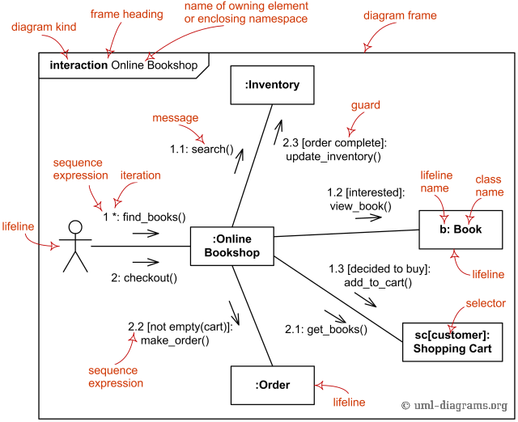
The major elements of UML communication diagram.

## Frame

Communication diagrams could be shown within a rectangular **frame** with the **name** in a compartment in the upper left corner.

There is no specific long form name for communication diagrams heading types. The long form name **interaction** (used for **interaction diagrams** in general) could be used.

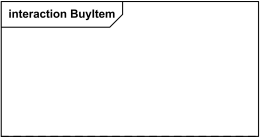
Interaction **Frame** for **Communication Diagram** BuyItem

There is also no specific short form name for **communication diagrams**. Short form name **sd** (which is used for **interaction diagrams** in general) could be used. This **sd** is bit confusing as it looks like abbreviation of **s**equence **d**iagram.

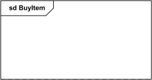
Sd **Frame** for **Communication Diagram** BuyItem

## Lifeline

**Lifeline** is a specialization of [named element](https://www.uml-diagrams.org/uml-core.html#named-element) which represents an **individual participant** in the interaction. While parts and structural features may have multiplicity greater than 1, lifelines represent **only one** interacting entity.

If the referenced connectable element is multivalued (i.e, has a multiplicity > 1), then the lifeline may have an expression (**selector**) that specifies which particular part is represented by this lifeline. If the selector is omitted, this means that an **arbitrary representative** of the multivalued connectable element is chosen.

A **Lifeline** is shown as a rectangle (corresponding to the "head" in sequence diagrams). Lifeline in sequence diagrams does have "tail" representing the **line of life** whereas "lifeline" in **communication diagram** has no line, just "head".

Information identifying the lifeline is displayed inside the rectangle in the following format:

lifeline-ident ::= ([connectable-element-name ['['selector']']] [:class-name][decomposition]) |'**self**'   
selector::= expression  
decomposition::= ‘**ref**’ interaction-ident ['**strict**']

where class-name is type referenced by the represented connectable element. Note that, although the syntax allows it, lifeline-ident cannot be empty.

The lifeline head has a shape that is based on the [classifier](https://www.uml-diagrams.org/classifier.html) for the part that this lifeline represents. Usually the head is a white rectangle containing name of the class after colon.

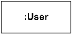
Anonymous lifeline of class User.

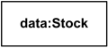
**Lifeline** "data" of class Stock

![Image 6: Lifeline x selected with [k] of class X.](images/communication-lifeline-selector.png)
**Lifeline** "x" of class X is selected with **selector** [k].

If the name is the keyword **self**, then the lifeline represents the object of the classifier that encloses the Interaction that **owns** the Lifeline. **Ports** of the encloser may be shown separately even when self is included.

## Message

**Message** in **communication diagram** is shown as a line with [sequence expression](https://www.uml-diagrams.org/communication-diagrams.html#sequence-expression) and **arrow** above the line. The arrow indicates direction of the communication.

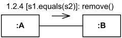
Instance of class A sends remove() message to instance of B if s1 is equal to s2

### Sequence Expression

The **sequence expression** is a dot separated list of **sequence terms** followed by a colon (":") and message name after that:

sequence-expression::=sequence-term'.'...':' message-name

For example,  
**3b.2.2:m5**  
 contains sequence expression **3b.2.2** and message name **m5**.

Each **sequence term** represents a level of **procedural nesting** within the overall interaction. Each sequence-term has the following syntax:

sequence-term::= [integer[name]] [recurrence]

The **integer** represents the **sequential order** of the message within the next higher level of procedural calling (activation). Messages that differ in one integer term are sequential at that level of nesting.

For example,

*   message with sequence 2 follows message with sequence 1,
*   2.1 follows 2
*   5.3 follows 5.2 within activation 5
*   1.2.4 follows message 1.2.3 within activation 1.2.

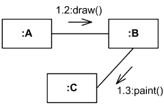
Instance of A sends draw() message to instance of B, and after that B sends paint() to C

The **name** represents a **concurrent thread** of control. Messages that differ in the final name are concurrent at that level of nesting.

For example,

*   messages 2.3a and 2.3b are concurrent within activation 2.3,
*   1.1 follows 1a and 1b,
*   3a.2.1 and 3b.2.1 follow 3.2.

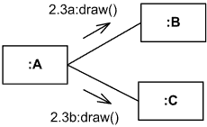
Instance of A sends draw() messages concurrently to instance of B and to instance of C

The **recurrence** defines **conditional** or **iterative** execution of zero or more messages that are executed depending on the specified condition.

recurrence::=branch|loop  
branch::='['guard']'   
loop::='*'['||'] ['['iteration-clause']']

A **guard** specifies condition for the message to be sent (executed) at the given nesting depth. UML does not specify guard syntax, so it could be expressed in pseudocode, some programming language, or something else.

For example,

*   **2.3b[x>y]: draw()** - message draw() will be executed if x is greater than y,
*   **1.1.1[s1.equals(s2)]: remove()** - message remove() will be executed if s1 equals s2.

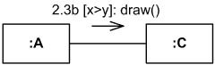
Instance of class A will send message  
 draw() to the instance of C, if x > y

An **iteration** specifies a sequence of messages at the given nesting depth. UML does not specify **iteration-clause** syntax, so it could be expressed in pseudocode, some programming language, or something else. Iteration clause may be omitted, in which case the iteration conditions are unspecified.

The ***** iteration notation specifies that the messages in the iteration will be executed **sequentially**. The ***||** (star followed by a double vertical line) iteration notation specifies **concurrent** (parallel) execution of messages.

For example,

*   **4.2c*[i=1..12]: search(t[i])** - search() will be executed 12 times, one after another
*   **4.2c*||[i=1..12]: search(t[i])** - 12 search() messages will be sent concurrently,
*   **2.2*: notify()** - message notify() will be repeated some unspecified number of times.

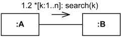
Instance of class A will send search() message to instance of B n times, one by one

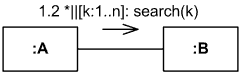
Instance of class A will send n concurrent search() messages to instance of B

Recurrence is not repeated at inner levels in a nested control structure. Each level of structure specifies its own iteration within the enclosing context.

  

This document describes **UML 2.5** and is based on **OMG™ Unified Modeling Language™ (OMG UML®) 2.5** specification [[UML 2.5 FTF - Beta 1]](https://www.uml-diagrams.org/references.html#ref-uml-25-b1 "UML 2.5 Specification FTF Beta 1"). All UML diagrams were created in **Microsoft Visio** 2007-2016 using [UML 2.2 stencils](http://softwarestencils.com/uml/index.html "Visio Stencil and Template for UML 2.2"). You can send your comments and suggestions to [webmaster](mailto:webmaster@uml-diagrams.org). [Privacy policy](https://www.uml-diagrams.org/privacy-policy.html).

_Copyright © 2009-2026 uml-diagrams.org. All rights reserved. Authored by Kirill Fakhroutdinov._

[How to Prevent Bone Mass Decrease with Weight Loss GoodRx | [Sponsored](https://popup.taboola.com/en/?template=colorbox&utm_source=uml-diagrams&utm_medium=referral&utm_content=next-up-a-delta:Next%20Up:)[Sponsored](https://popup.taboola.com/en/?template=colorbox&utm_source=uml-diagrams&utm_medium=referral&utm_content=next-up-a-delta:Next%20Up:) Read Next Story](https://www.goodrx.com/conditions/weight-loss/bone-mass-decrease-with-weight-loss "How to Prevent Bone Mass Decrease with Weight Loss")
