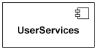
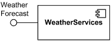
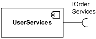
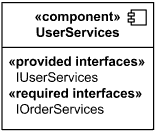
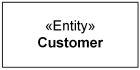
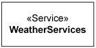
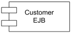
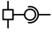
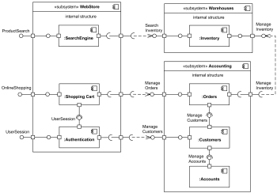
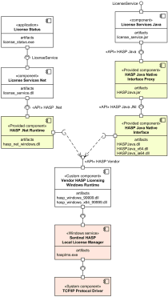

Title: UML component is a class representing a modular part of a system with encapsulated content and whose manifestation is replaceable within its environment.

URL Source: https://www.uml-diagrams.org/component.html

Markdown Content:
Menu►
*   [UML diagrams](https://www.uml-diagrams.org/ "UML graphical notation overview, examples, and reference.")
*   [Component diagrams](https://www.uml-diagrams.org/component-diagrams.html "UML component diagrams overview")
*   [Component](https://www.uml-diagrams.org/component.html "UML component")
*   [Port](https://www.uml-diagrams.org/port.html?context=components "UML port")
*   [Part](https://www.uml-diagrams.org/composite-structure-diagrams/part.html?context=components "UML composite structure diagram part")
*   [Connector](https://www.uml-diagrams.org/composite-structure-diagrams/connector.html?context=components "UML connector")
*   [Component realization](https://www.uml-diagrams.org/component-realization.html "UML component realization")
*   [Component diagrams reference](https://www.uml-diagrams.org/component-diagrams-reference.html "UML component diagrams reference")
*   [Component diagrams examples](https://www.uml-diagrams.org/component-diagrams-examples.html "UML component diagrams examples")
*   [UML index](https://www.uml-diagrams.org/index-references.html "Index of UML elements")

# Component

A _component_ is a [class](https://www.uml-diagrams.org/class.html) representing a modular part of a system with encapsulated content and whose [manifestation](https://www.uml-diagrams.org/deployment-diagrams.html#manifestation) is replaceable within its environment.

A component has its behavior defined in terms of [provided interfaces](https://www.uml-diagrams.org/component.html#provided-interface) and [required interfaces](https://www.uml-diagrams.org/component.html#required-interface) (potentially exposed via **ports**).

Component serves as a type whose conformance is defined by these provided and required interfaces (encompassing both their static as well as dynamic semantics). One component may therefore be substituted by another only if the two are type conformant.

Larger pieces of a system’s functionality may be assembled by reusing components as parts in an encompassing component or assembly of components, and wiring together their required and provided interfaces.

A component is modeled throughout the development life cycle and successively refined into deployment and run-time. A component may be manifested by one or more artifacts.

_Indirectly instantiated component_ is defined at design time but does not exist as addressable object at execution time. Runtime behavior of the component and its ports is defined by the runtime behavior of classifiers or parts realizing it. Several standard stereotypes assume this attribute, e.g., [«Specification»](https://www.uml-diagrams.org/component.html#specification), [«Focus»](https://www.uml-diagrams.org/class.html#focus), [«Subsystem»](https://www.uml-diagrams.org/component.html#subsystem).

Internals of component are hidden and inaccessible other than as provided by its interfaces. Although it may be dependent on other elements in terms of interfaces that are required, a component is encapsulated and its dependencies are designed such that it can be treated as independently as possible.

## Notation

A component is shown as a classifier rectangle with the keyword _«component»_.

WeatherServices component

Optionally, a component icon similar to the **UML 1.4** icon can be displayed in the top right corner of the component rectangle. If the icon symbol is shown, the keyword «component» may be omitted.

UserServices component

A component may be manifested by one or more **artifacts**, and in turn, that artifact may be deployed to its execution environment. A **deployment specification** may define values that parameterize the component’s execution.

### Provided Interface

A **provided interface** is the one that is either

*   [realized](https://www.uml-diagrams.org/realization.html#interface-realization) directly by the component itself, or
*   [realized](https://www.uml-diagrams.org/realization.html#interface-realization) by one of the classifiers realizing component, or
*   is provided by a public port of the component.

Weather Services component provides (implements)  
 Weather Forecast interface

### Required Interface

A **required interface** is either

*   designated by usage dependency from the component itself, or
*   designated by usage dependency from one of the classifiers realizing component, or
*   is required by a public port of the component.

User Services component requires IOrderServices interface

### External View of Component

A component has an **external view** or **"black-box"** view by means of interface symbols sticking out of the component box exposing its publicly visible properties and operations.

Optionally, a behavior such as a protocol state machine may be attached to an interface, port, and to the component itself, to define the external view more precisely by making dynamic constraints in the sequence of operation calls explicit. Other behaviors may also be associated with interfaces or connectors to define the "contract" between participants in a collaboration (e.g., in terms of use case, activity, or interaction specifications).

Alternatively, the interfaces and/or individual operations and attributes can be listed in the compartments of a component box (for scalability, tools may offer a way of listing and abbreviating component properties and behavior).

External view of User Services component - it provides  
 IUserServices interface and requires IOrderServices interface

For displaying the full signature of an interface of a component, the interfaces can also be displayed as typical classifier rectangles that can be expanded to show details of operations and events.

## Standard Component Stereotypes

There are several standard UML stereotypes that apply to components:

Standard UML component stereotypes
| Name | Description |
| --- | --- |
| «BuildComponent» | A collection of elements defined for the purpose of system level development activities, such as compilation and versioning. |
| «Entity» | A persistent information component representing a business concept.  Entity component Customer |
| «Implement» | _Implement_ is a component definition that is not intended to have a specification itself. Rather, it is an implementation for a separate [«Specification»](https://www.uml-diagrams.org/component.html#specification) to which it has a [dependency](https://www.uml-diagrams.org/dependency.html). |
| «Process» | _Process_ is a transaction based component. |
| «Realization» | _Realization_ is a [classifier](https://www.uml-diagrams.org/classifier.html) that specifies a domain of objects and that also defines the physical implementation of those objects. For example, a component stereotyped by «Realization» will only have realizing classifiers that implement behavior specified by a separate [«Specification»](https://www.uml-diagrams.org/component.html#specification) component. This differs from [«ImplementationClass»](https://www.uml-diagrams.org/class.html#implementation-class) because an implementation class is a realization of a class that can have features such as attributes and methods that are useful to system designers. |
| «Service» | _Service_ is a stateless, functional component.  Service component WeatherServices |
| «Specification» | Specification is a [classifier](https://www.uml-diagrams.org/classifier.html) that specifies a domain of objects without defining the physical implementation of those objects. For example, a component stereotyped by «Specification» will only have provided and required interfaces, and is not intended to have any realizing classifiers as part of its definition. This differs from «type» because a «type» can have features such as attributes and methods that are useful to analysts modeling systems. «Specification» and «Realization» are used to model components with distinct specification and realization definitions, where one specification may have multiple realizations. |
| «Subsystem» | _Subsystem_ is a component representing unit of hierarchical decomposition for large systems, and is used to model large scale components. Definitions of subsystems may vary among different domains and software methods. It is expected that domain and method profiles will specialize this element. A subsystem is usually indirectly instantiated. A subsystem may have specification and realization elements. |

## History

Component notation as a classifier rectangle with «component» keyword was introduced in _UML 2.0_.

In the previous versions of _UML 1.x_ notation for component was a rectangle with two small rectangles protruding from its side. For backward compatibility reasons, this notation may still be used in _UML 2.5_.

CustomerEJB component  
 in UML 1.x notation.

In _UML 1.4.2_ stereotype «entity» represented a _passive class_, i.e. class whose objects do not initiate interactions on their own. «Entity» became a persistent information component in _UML 2.0_.

Stereotype «process» specified a classifier representing a heavy-weight flow of control in _UML 1.4.2_. _«Process»_ became a transaction based component in _UML 2.0_.

In _UML 1.4.2_ «subsystem» is a special kind of a [package](https://www.uml-diagrams.org/package-diagrams.html#package) used to represent a behavioral unit in the physical system, and hence in the model, and to serve as a specification unit for the behavior of its contained model elements. «Subsystem» became a _component_ stereotype to represent unit of hierarchical decomposition for large systems in _UML 2.0_.

_UML 2.0_ also introduced standard component stereotypes [«BuildComponent»](https://www.uml-diagrams.org/component.html#build-component), [«Implement»](https://www.uml-diagrams.org/component.html#implement), and [«Service»](https://www.uml-diagrams.org/component.html#service).

## Examples

[Online shopping component diagram](https://www.uml-diagrams.org/examples/online-shopping-uml-component-diagram-example.html?context=cmp-examples)

  

[Sentinel HASP licensing components](https://www.uml-diagrams.org/software-licensing-component-diagram-example.html?context=cmp-examples)

  

[Port](https://www.uml-diagrams.org/port.html?context=components "UML port")

  

This document describes UML versions up to **[UML 2.5](https://www.uml-diagrams.org/references.html#ref-uml-25 "UML 2.5 Specification")** and is based on the corresponding **OMG™ Unified Modeling Language™ (OMG UML®)** specifications. UML diagrams were created in **Microsoft® Visio®** 2007-2016 using **[UML 2.x Visio Stencils](http://softwarestencils.com/uml/index.html "Visio Stencil and Template for UML 2.5")**. You can send your comments and suggestions to [webmaster](mailto:webmaster@uml-diagrams.org). [Privacy policy](https://www.uml-diagrams.org/privacy-policy.html).

_Copyright © 2009-2026 uml-diagrams.org. All rights reserved. Authored by Kirill Fakhroutdinov._

[Savannah James Says It’s Important For Her To Bootstrap Something From The Ground Up — ‘Let Me Figure It Out’Afrotech | [Sponsored](https://popup.taboola.com/en/?template=colorbox&utm_source=uml-diagrams&utm_medium=referral&utm_content=next-up-a-delta:Next%20Up:)[Sponsored](https://popup.taboola.com/en/?template=colorbox&utm_source=uml-diagrams&utm_medium=referral&utm_content=next-up-a-delta:Next%20Up:) Read Next Story](https://afrotech.com/savannah-james-says-its-important-for-her-to-bootstrap-her-business "Savannah James Says It’s Important For Her To Bootstrap Something From The Ground Up — ‘Let Me Figure It Out’")
