Title: UML port is a property of encapsulated classifier that specifies an interaction point between the classifier and its environment or between the classifier and its internal parts.

URL Source: https://www.uml-diagrams.org/port.html

Markdown Content:
Menu►
*   [UML diagrams](https://www.uml-diagrams.org/ "UML graphical notation overview, examples, and reference.")
*   [Composite structure diagrams](https://www.uml-diagrams.org/composite-structure-diagrams.html "UML composite structure diagrams overview of graphical notation")
*   [Structured classifier](https://www.uml-diagrams.org/structured-classifier.html "UML composite structure diagram structured classifier")
*   [Encapsulated classifier](https://www.uml-diagrams.org/encapsulated-classifier.html "UML composite structure diagram encapsulated classifier")
*   [Part](https://www.uml-diagrams.org/composite-structure-diagrams/part.html "UML composite structure diagram part")
*   [Connector](https://www.uml-diagrams.org/composite-structure-diagrams/connector.html "UML composite structure diagram connector")
*   [Port](https://www.uml-diagrams.org/port.html "UML composite structure diagram port")
*   [Collaboration](https://www.uml-diagrams.org/collaboration-diagrams/collaboration.html "UML collaboration, composite structure diagram")
*   [Collaboration use](https://www.uml-diagrams.org/collaboration-diagrams/collaboration-use.html "UML collaboration use, composite structure diagram")
*   [Collaboration template](https://www.uml-diagrams.org/collaboration-diagrams/collaboration-template.html "UML collaboration template, composite structure diagram")
*   [Composite structures reference](https://www.uml-diagrams.org/composite-structure-diagrams-reference.html "UML Composite Structure Diagrams - Graphical Notation Reference")
*   [Composite structures examples](https://www.uml-diagrams.org/composite-structure-examples.html "UML composite structure diagrams examples")
*   [UML index](https://www.uml-diagrams.org/index-references.html "Index of UML elements")

# UML Port

A **port** specifies an _interaction point_ through which a classifier can communicate with its environment, with other classifiers, or with its [internal parts](https://www.uml-diagrams.org/composite-structure-diagrams/part.html). [Encapsulated classifier](https://www.uml-diagrams.org/encapsulated-classifier.html) is defined in UML as [structured classifier](https://www.uml-diagrams.org/structured-classifier.html) with the ability to own ports, and thus port is a property of an encapsulated classifier. Port by default has [public visibility](https://www.uml-diagrams.org/visibility.html#public-visibility).

Port is shown as a small square placed either overlapping the boundary of the rectangle denoting the encapsulated classifier, or it may be shown inside that rectangle symbol. The name of the port is placed near the small square.

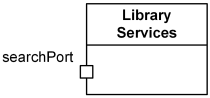
Library Services class has port searchPort.

While UML does not dictate _naming convention_ for ports, common sense is to start port names from lower case, e.g. "_p_", "_port12_", "_searchPort_". It is unclear, whether each port is required to have a name. If port does have a name, it may be suppressed on a diagram. UML 2.5 specification provides some strange clarification that "every depiction of an unnamed Port denotes a different Port from any other Port." If name of a port was simply suppressed, every depiction of that port should be still the same port.

The [type](https://www.uml-diagrams.org/uml-core.html#type) of a port may be shown after the port _name_, separated by colon ":".

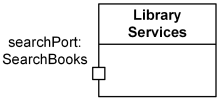
Library Services class has port searchPort with SearchBooks type.

[Multiplicity](https://www.uml-diagrams.org/multiplicity.html) of a port (if any) is shown after the port name in square brackets. Both name and multiplicity of port are optional.

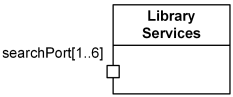
Library Services class has 1 to 6 searchPort ports.

A [provided interface](https://www.uml-diagrams.org/component.html#provided-interface) may be shown using the "lollipop" notation attached to the port. A [required interface](https://www.uml-diagrams.org/component.html#required-interface) may be shown using the "socket" notation attached to the port.

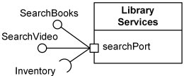
Port searchPort provides SearchBooks and SearchVideo  
 interfaces and requires Inventory interface.

At the search Port, the Library Services class is completely **encapsulated** - it can be implemented without any knowledge of the environment the class will be embedded in.

If there are multiple interfaces associated with a port, these interfaces may be listed separated by comma "," near the single interface icon.

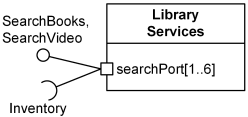
Several searchPort ports provide SearchBooks and SearchVideo  
 interfaces and require Inventory interface.

Port may also be shown as a small square symbol overlapping the boundary of the rectangle symbol denoting a [part](https://www.uml-diagrams.org/composite-structure-diagrams/part.html) typed by that classifier.

## Simple Port

A **simple port** is a port with a single [required](https://www.uml-diagrams.org/component.html#required-interface) or [provided interface](https://www.uml-diagrams.org/component.html#provided-interface). A **complex port** has several provided and/or required interfaces.

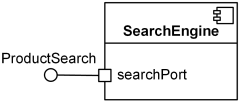
SearchEngine component has simple port searchPort  
 with single provided ProductSearch interface.

Within a [structured classifier](https://www.uml-diagrams.org/structured-classifier.html) UML allows several alternative notations for connecting simple ports on the [parts](https://www.uml-diagrams.org/composite-structure-diagrams/part.html) and roles.

The only mandatory notation for connecting ports in an **internal structure** is when the connector is joined directly to the ports. Optional lollipop and socket could show provided and required interfaces of the connected ports.

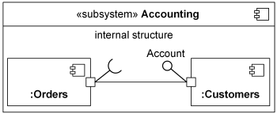
Simple ports joined directly by connector, mandatory UML notation.  
 Customers component part provides Account interface to Orders part.

As an option, UML allows connector line to be attached to the ball and socket instead of ports, as shown below.

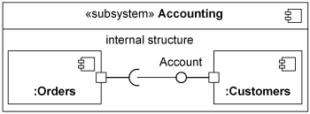
Ball and socket joined by connector, optional UML notation.  
 Customers component part provides Account interface to Orders part.

Assembly connector is not rendered in another optional, "ball-and-socket" notation for simple ports. This notation should not be used to connect complex ports or parts without ports.

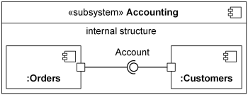
"Ball-and-socket" assembly connection for simple ports, optional UML notation.  
 Customers component part provides Account interface to Orders part.

## Service Port

A port may specify the services an encapsulated classifier _provides_ to its environment as well as the services that an encapsulated classifier _requires_ of its environment. Any port is **service port** by default, which is specified by default _true_ value of **isService** attribute of the port.

The [provided interfaces](https://www.uml-diagrams.org/class.html#provided-interface) of a port describe requests to the classifier that other classifiers may make through this port. The [required interfaces](https://www.uml-diagrams.org/dependency.html#required-interface) of a port describe the requests that may be made from the classifier to its environment through the port.

When **isService** attribute of a port is set to _false_, it means that this port belongs to the implementation of the encapsulated classifier, and it is not part of the service contract or essential externally visible functionality. Such non-service port could be modified or removed without any effects on service contract. UML specification provides no explanation why this attribute is needed, if we can just change default [public visibility](https://www.uml-diagrams.org/visibility.html#public-visibility) of port to e.g. private visibility. Private properties are not part of any externally visible functionality.

UML provides no specific notation to visually distinguish service ports from non-service ports, while it has some convention to render Boolean attributes as property modifiers. For example, _{ordered}_ means that 'isOrdered' attribute is true, while _{unordered}_ means that corresponding property is not ordered. We can probably use the same convention for **isService** attribute of port, rendering it as either _{service}_ or _{nonservice}_.

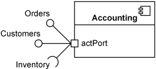
Port actPort is by default a service port providing Orders and  
 Customers interfaces and requiring Inventory interface.

## Behavior Port

**Behavior port** is a port such that requests arriving at this port are sent to the [behavior](https://www.uml-diagrams.org/common-behaviors.html#behavior) of the classifier owning the port, rather than being forwarded to some contained instances. If there is no behavior defined for this classifier, any communication arriving at the behavior port is lost. By default, ports are **not** behavior ports.

A **behavior port** is rendered as a port connected by a solid line to a small state symbol drawn inside the classifier containing the port. The small state symbol denotes the [behavior](https://www.uml-diagrams.org/common-behaviors.html#behavior) of the containing classifier.

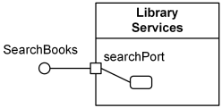
Port searchPort is behavior port with SearchBooks provided interface.

  

This document describes UML versions up to **[UML 2.5](https://www.uml-diagrams.org/references.html#ref-uml-25 "UML 2.5 Specification")** and is based on the corresponding **OMG™ Unified Modeling Language™ (OMG UML®)** specifications. UML diagrams were created in **Microsoft® Visio®** 2007-2016 using **[UML 2.x Visio Stencils](http://softwarestencils.com/uml/index.html "Visio Stencil and Template for UML 2.5")**. You can send your comments and suggestions to [webmaster](mailto:webmaster@uml-diagrams.org). [Privacy policy](https://www.uml-diagrams.org/privacy-policy.html).

_Copyright © 2009-2026 uml-diagrams.org. All rights reserved. Authored by Kirill Fakhroutdinov._

[Discover Innsbruck on One Pass OnTheSnow Magazine | [Sponsored](https://popup.taboola.com/en/?template=colorbox&utm_source=uml-diagrams&utm_medium=referral&utm_content=next-up-a-delta:Next%20Up:)[Sponsored](https://popup.taboola.com/en/?template=colorbox&utm_source=uml-diagrams&utm_medium=referral&utm_content=next-up-a-delta:Next%20Up:) Read Next Story](https://www.onthesnow.com/news/ski-explore-and-experience-innsbruck-all-on-one-pass "Discover Innsbruck on One Pass")
