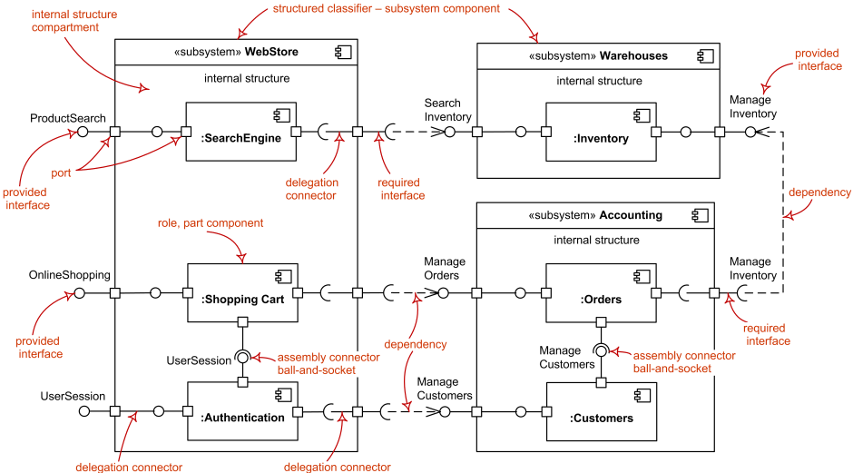
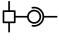

Title: UML component diagram shows components, provided and required interfaces, ports, and relationships between them.

URL Source: https://www.uml-diagrams.org/component-diagrams.html

Warning: Target URL returned error 400: Bad Request

Markdown Content:
Menu►
*   [UML diagrams](https://www.uml-diagrams.org/ "UML graphical notation overview, examples, and reference.")
*   [Component diagrams](https://www.uml-diagrams.org/component-diagrams.html "UML component diagrams overview")
*   [Component](https://www.uml-diagrams.org/component.html "UML component")
*   [Port](https://www.uml-diagrams.org/port.html?context=components "UML port")
*   [Part](https://www.uml-diagrams.org/composite-structure-diagrams/part.html?context=components "UML composite structure diagram part")
*   [Connector](https://www.uml-diagrams.org/composite-structure-diagrams/connector.html?context=components "UML connector")
*   [Component realization](https://www.uml-diagrams.org/component-realization.html "UML component realization")
*   [Component diagrams reference](https://www.uml-diagrams.org/component-diagrams-reference.html "UML component diagrams reference")
*   [Component diagrams examples](https://www.uml-diagrams.org/component-diagrams-examples.html "UML component diagrams examples")
*   [UML index](https://www.uml-diagrams.org/index-references.html "Index of UML elements")

# UML Component Diagrams

**Component diagram** shows components, provided and required interfaces, ports, and relationships between them. This type of diagrams is used in **Component-Based Development** (**CBD**) to describe systems with **Service-Oriented Architecture** (**SOA**).

Component-based development is based on assumptions that previously constructed components could be reused and that components could be replaced by some other "equivalent" or "conformant" components, if needed.

The artifacts that implement component are intended to be capable of being deployed and re-deployed independently, for instance to update an existing system.

**Components** in UML could represent

*   **logical components** (e.g., business components, process components), and
*   **physical components** (e.g., CORBA components, EJB components, COM+ and .NET components, WSDL components, etc.),

along with the artifacts that implement them and the nodes on which they are deployed and executed. It is anticipated that profiles based around components will be developed for specific component technologies and associated hardware and software environments.

The following nodes and edges are typically drawn in a **component diagram**: [component](https://www.uml-diagrams.org/component.html), [interface](https://www.uml-diagrams.org/interface.html), [provided interface](https://www.uml-diagrams.org/component.html#provided-interface), [required interface](https://www.uml-diagrams.org/component.html#required-interface), [class](https://www.uml-diagrams.org/class.html), [port](https://www.uml-diagrams.org/port.html), [connector](https://www.uml-diagrams.org/composite-structure-diagrams/connector.html), [artifact](https://www.uml-diagrams.org/artifact.html), [component realization](https://www.uml-diagrams.org/component-realization.html), [dependency](https://www.uml-diagrams.org/dependency.html), [usage](https://www.uml-diagrams.org/dependency.html#usage). These major elements are shown on the picture below.

The major elements of UML component diagram - component, provided interface, required interface, port, connectors.

[Component](https://www.uml-diagrams.org/component.html "UML component")

  

This document describes UML versions up to **[UML 2.5](https://www.uml-diagrams.org/references.html#ref-uml-25 "UML 2.5 Specification")** and is based on the corresponding **OMG™ Unified Modeling Language™ (OMG UML®)** specifications. UML diagrams were created in **Microsoft® Visio®** 2007-2016 using **[UML 2.x Visio Stencils](http://softwarestencils.com/uml/index.html "Visio Stencil and Template for UML 2.5")**. You can send your comments and suggestions to [webmaster](mailto:webmaster@uml-diagrams.org). [Privacy policy](https://www.uml-diagrams.org/privacy-policy.html).

_Copyright © 2009-2026 uml-diagrams.org. All rights reserved. Authored by Kirill Fakhroutdinov._

[How to Prevent Bone Mass Decrease with Weight Loss GoodRx | [Sponsored](https://popup.taboola.com/en/?template=colorbox&utm_source=uml-diagrams&utm_medium=referral&utm_content=next-up-a-delta:Next%20Up:)[Sponsored](https://popup.taboola.com/en/?template=colorbox&utm_source=uml-diagrams&utm_medium=referral&utm_content=next-up-a-delta:Next%20Up:) Read Next Story](https://www.goodrx.com/conditions/weight-loss/bone-mass-decrease-with-weight-loss "How to Prevent Bone Mass Decrease with Weight Loss")
