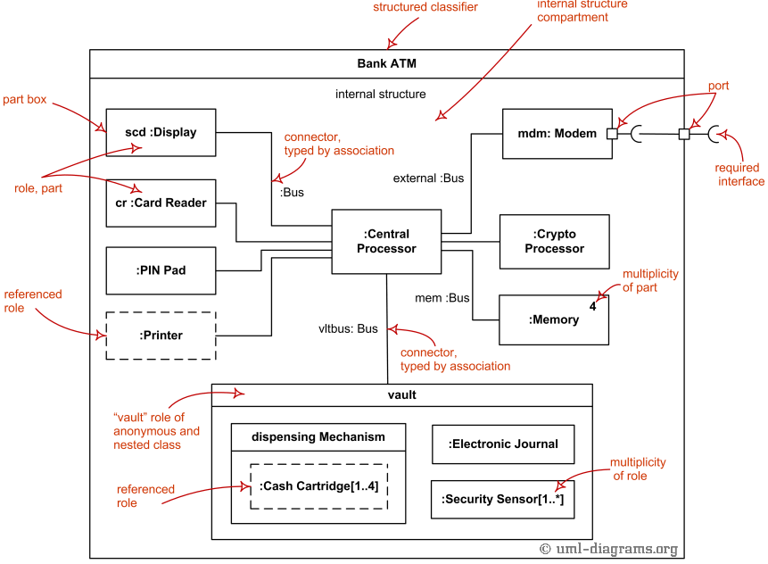
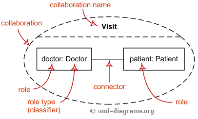
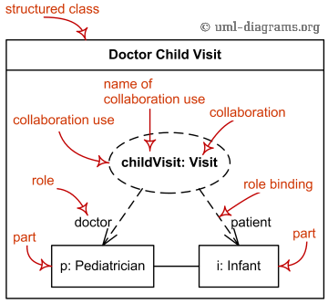

Title: UML composite structure diagram shows internal structure of a classifier, classifier interactions with environment through ports, or a behavior of a collaboration.

URL Source: https://www.uml-diagrams.org/composite-structure-diagrams.html

Markdown Content:
Menu►
*   [UML diagrams](https://www.uml-diagrams.org/ "UML graphical notation overview, examples, and reference.")
*   [Composite structure diagrams](https://www.uml-diagrams.org/composite-structure-diagrams.html "UML composite structure diagrams overview of graphical notation")
*   [Structured classifier](https://www.uml-diagrams.org/structured-classifier.html "UML composite structure diagram structured classifier")
*   [Encapsulated classifier](https://www.uml-diagrams.org/encapsulated-classifier.html "UML composite structure diagram encapsulated classifier")
*   [Part](https://www.uml-diagrams.org/composite-structure-diagrams/part.html "UML composite structure diagram part")
*   [Connector](https://www.uml-diagrams.org/composite-structure-diagrams/connector.html "UML composite structure diagram connector")
*   [Port](https://www.uml-diagrams.org/port.html "UML composite structure diagram port")
*   [Collaboration](https://www.uml-diagrams.org/collaboration-diagrams/collaboration.html "UML collaboration, composite structure diagram")
*   [Collaboration use](https://www.uml-diagrams.org/collaboration-diagrams/collaboration-use.html "UML collaboration use, composite structure diagram")
*   [Collaboration template](https://www.uml-diagrams.org/collaboration-diagrams/collaboration-template.html "UML collaboration template, composite structure diagram")
*   [Composite structures reference](https://www.uml-diagrams.org/composite-structure-diagrams-reference.html "UML Composite Structure Diagrams - Graphical Notation Reference")
*   [Composite structures examples](https://www.uml-diagrams.org/composite-structure-examples.html "UML composite structure diagrams examples")
*   [UML index](https://www.uml-diagrams.org/index-references.html "Index of UML elements")

# UML Composite Structure Diagrams

**Composite Structure Diagram** could be used to show:

*   internal structure of a classifier - [internal structure diagram](https://www.uml-diagrams.org/composite-structure-diagrams.html#internal-structure-diagrams),
*   classifier interactions with environment through [ports](https://www.uml-diagrams.org/port.html),
*   a behavior of a collaboration - [collaboration use diagram](https://www.uml-diagrams.org/composite-structure-diagrams.html#collaboration-use-diagrams).

The term "structure" for this type of diagrams is defined in **UML** as a composition of interconnected elements, representing run-time instances collaborating over communications links to achieve some common objectives.

## Internal Structure Diagrams

**Internal structure diagram** shows [internal structure](https://www.uml-diagrams.org/structured-classifier.html) of a classifier - a decomposition of that classifier into its properties, parts and relationships.

The following graphical elements are typically drawn in a **composite structure diagram** which shows internal structure of a classifier: [class](https://www.uml-diagrams.org/class.html), [part](https://www.uml-diagrams.org/composite-structure-diagrams/part.html), [port](https://www.uml-diagrams.org/port.html), [connector](https://www.uml-diagrams.org/composite-structure-diagrams/connector.html), [usage](https://www.uml-diagrams.org/dependency.html#usage).

Composite structure diagram overview shows elements of internal structure of structured classifier - roles, parts, connectors.

You can see some [examples of internal structure diagrams](https://www.uml-diagrams.org/composite-structure-examples.html) here:

*   Internal Structure - [Bank ATM Composite Structure](https://www.uml-diagrams.org/bank-atm-uml-composite-diagram-example.html?context=cst-examples)
*   Internal Structure - [Tomcat 7 Server Composite Structure](https://www.uml-diagrams.org/tomcat-server-uml-composite-structure-diagram-example.html?context=cst-examples)

## Collaboration Use Diagrams

The **behavior** of the system is the functionality that the system under design will implement or which is already implemented by some existing system. Objects in a system typically cooperate with each other to produce the behavior of a system.

A behavior of a **collaboration** will eventually be exhibited by a set of cooperating instances (specified by classifiers) that communicate with each other by sending signals or invoking operations. However, to understand the mechanisms used in a design, it may be important to describe only those aspects of these classifiers and their interactions that are involved in accomplishing a **task** or a related set of tasks, projected from these classifiers.

**Collaborations** allow us to describe only the relevant aspects of the cooperation of a set of instances by identifying the specific roles that the instances will play.

**Interfaces** allow the externally observable properties of an instance to be specified without determining the classifier that will eventually be used to specify this instance. Consequentially, the **roles** in a collaboration will often be typed by interfaces and will then prescribe properties that the participating instances must exhibit, but will not determine what class will specify the participating instances.

The following nodes and edges are typically drawn in a **composite structure diagram** which shows **behavior of a collaboration**: [collaboration](https://www.uml-diagrams.org/collaboration-diagrams/collaboration.html), [connector](https://www.uml-diagrams.org/composite-structure-diagrams/connector.html), [part](https://www.uml-diagrams.org/composite-structure-diagrams/part.html), **collaboration specialization**, [dependency](https://www.uml-diagrams.org/dependency.html).

Collaboration elements - roles, parts, connectors.  
 Collaboration Visit shows cooperation of doctor and patient roles.

**Collaboration use** represents one particular use (**occurrence**) or application of the pattern described by a [collaboration](https://www.uml-diagrams.org/collaboration-diagrams/collaboration.html) to a specific situation involving specific classes or instances playing the **roles** of the collaboration. A collaboration use shows how the pattern described by a collaboration is applied in a given **context**, by binding specific entities from that context to the roles of the collaboration.

Collaboration use elements - roles, parts, role binding.  
 Collaboration use childVisit represents one particular use  
 of the Visit collaboration.

**Classifier** (in internal structures and collaborations) is extended with the capability to own [collaboration uses](https://www.uml-diagrams.org/collaboration-diagrams/collaboration-use.html). These **collaboration uses** link a [collaboration](https://www.uml-diagrams.org/collaboration-diagrams/collaboration.html) with the classifier to give a description of the behavior of the classifier.

One of the collaboration uses owned by the classifier may be selected as representing the behavior of the classifier as a whole. The collaboration related to the classifier by this collaboration use shows how the instances corresponding to the structural features of this classifier (e.g., its attributes and parts) interact to generate the overall behavior of the classifier.

The **representing collaboration** may be used to provide a description of the behavior of the classifier at a different level of abstraction than is offered by the [internal structure](https://www.uml-diagrams.org/structured-classifier.html) of the classifier. The properties of the classifier are mapped to **roles** in the [collaboration](https://www.uml-diagrams.org/collaboration-diagrams/collaboration.html) by the **role bindings** of the [collaboration use](https://www.uml-diagrams.org/collaboration-diagrams/collaboration-use.html).

You can see an [example of collaboration diagram](https://www.uml-diagrams.org/composite-structure-examples.html) here:

*   Collaboration Use as Design Pattern - [Observer Pattern](https://www.uml-diagrams.org/observer-pattern-uml-composite-diagram-example.html)

  

This document describes UML versions up to **[UML 2.5](https://www.uml-diagrams.org/references.html#ref-uml-25 "UML 2.5 Specification")** and is based on the corresponding **OMG™ Unified Modeling Language™ (OMG UML®)** specifications. UML diagrams were created in **Microsoft® Visio®** 2007-2016 using **[UML 2.x Visio Stencils](http://softwarestencils.com/uml/index.html "Visio Stencil and Template for UML 2.5")**. You can send your comments and suggestions to [webmaster](mailto:webmaster@uml-diagrams.org). [Privacy policy](https://www.uml-diagrams.org/privacy-policy.html).

_Copyright © 2009-2026 uml-diagrams.org. All rights reserved. Authored by Kirill Fakhroutdinov._

[One Payment Instead of Five? See If You Qualify Right Consumer Choice | [Sponsored](https://popup.taboola.com/en/?template=colorbox&utm_source=uml-diagrams&utm_medium=referral&utm_content=next-up-a-delta:Next%20Up:)[Sponsored](https://popup.taboola.com/en/?template=colorbox&utm_source=uml-diagrams&utm_medium=referral&utm_content=next-up-a-delta:Next%20Up:) Read Next Story](https://trk.rightconsumerchoice.org/d5677d67-803d-4b59-a2a8-6d183cbcc151 "One Payment Instead of Five? See If You Qualify")
