Title: UML deployment diagrams overview of graphical notation.

URL Source: https://www.uml-diagrams.org/deployment-diagrams.html

Markdown Content:
Menu►
*   [Home](https://www.uml-diagrams.org/ "UML Graphical Notation Overview and Reference")
*   [Deployment diagrams overview](https://www.uml-diagrams.org/deployment-diagrams-overview.html "UML deployment diagrams overview")
*   [Network architecture](https://www.uml-diagrams.org/network-architecture-diagrams.html "Network architecture diagrams")
*   [Deployment notation](https://www.uml-diagrams.org/deployment-diagrams.html "UML deployment diagrams graphical notation")
*   [Artifact](https://www.uml-diagrams.org/artifact.html "UML deployment diagrams artifact")
*   [Manifestation](https://www.uml-diagrams.org/deployment-diagrams.html#manifestation "UML deployment diagrams manifestation")
*   [Deployment target](https://www.uml-diagrams.org/deployment-diagrams.html#deployment-target "UML deployment diagrams deployment target")
*   [Communication path](https://www.uml-diagrams.org/deployment-diagrams.html#communication-path "UML deployment diagrams communication path")
*   [Deployment](https://www.uml-diagrams.org/deployment-diagrams.html#deployment "UML deployment diagrams deployment")
*   [Reference](https://www.uml-diagrams.org/deployment-diagrams-reference.html "UML deployment diagrams reference")
*   [Deployment examples](https://www.uml-diagrams.org/deployment-diagrams-examples.html "UML deployment diagrams examples")
*   [UML Index](https://www.uml-diagrams.org/index-references.html "Index of UML Elements")

# UML Deployment Diagrams

**Deployment diagram** shows execution architecture of systems that represent the assignment (deployment) of software [artifacts](https://www.uml-diagrams.org/artifact.html) to deployment targets (usually [nodes](https://www.uml-diagrams.org/deployment-diagrams.html#node)).

[Nodes](https://www.uml-diagrams.org/deployment-diagrams.html#node) represent either hardware devices or software execution environments. They could be connected through communication paths to create network systems of arbitrary complexity. [Artifacts](https://www.uml-diagrams.org/artifact.html) represent concrete elements in the physical world that are the result of a development process and are deployed on nodes.

Note, that [components](https://www.uml-diagrams.org/component.html) were directly deployed to nodes in UML 1.x deployment diagrams. In UML 2.x [artifacts](https://www.uml-diagrams.org/artifact.html) are deployed to nodes, and artifacts could [manifest](https://www.uml-diagrams.org/deployment-diagrams.html#manifestation) (implement) components. So components are now deployed to nodes indirectly through artifacts.

The following nodes and edges are typically drawn in a UML deployment diagram: [deployment](https://www.uml-diagrams.org/deployment-diagrams.html#deployment), [artifact](https://www.uml-diagrams.org/artifact.html), **association** between artifacts, **dependency** between artifacts, [component](https://www.uml-diagrams.org/component.html), [manifestation](https://www.uml-diagrams.org/deployment-diagrams.html#manifestation), [node](https://www.uml-diagrams.org/deployment-diagrams.html#node), [device](https://www.uml-diagrams.org/deployment-diagrams.html#device), [execution environment](https://www.uml-diagrams.org/deployment-diagrams.html#execution-environment), **composition** of nodes, [communication path](https://www.uml-diagrams.org/deployment-diagrams.html#communication-path), [deployment specification](https://www.uml-diagrams.org/deployment-diagrams.html#deployment-spec), deployment specification **dependency**, deployment specification **association**.

You can find some [deployment diagrams examples](https://www.uml-diagrams.org/deployment-diagrams-examples.html) here:

*   [Web application deployment](https://www.uml-diagrams.org/web-application-uml-deployment-diagram-example.html?context=depl-examples)
*   [Web application manifestation](https://www.uml-diagrams.org/web-application-uml-manifest-diagram-example.html?context=depl-examples)
*   [Multilayered load balancing](https://www.uml-diagrams.org/web-application-load-balancing-uml-deployment-diagram-example.html?context=depl-examples)
*   [Clustered deployment of J2EE web application](https://www.uml-diagrams.org/web-application-clusters-uml-deployment-diagram-example.html?context=depl-examples)
*   [Apple iTunes deployment](https://www.uml-diagrams.org/apple-itunes-uml-deployment-diagram-example.html)
*   [Android application deployment](https://www.uml-diagrams.org/android-application-uml-deployment-diagram-example.html)

## Manifestation

**Manifestation** is an [abstraction](https://www.uml-diagrams.org/abstraction.html) relationship which represents concrete physical rendering (implementation) of one or more model elements by an [artifact](https://www.uml-diagrams.org/artifact.html) or utilization of the model elements in the construction or generation of the artifact. An artifact **manifests** one or more model elements.

Note, that since UML 2.0 artifacts can manifest any [packageable elements](https://www.uml-diagrams.org/package-diagrams.html#packageable-element), not just [components](https://www.uml-diagrams.org/component.html) as it was in previous versions of UML.

The artifact **owns** the manifestations, each representing the utilization of a packageable element.

Specific **profiles** are expected to stereotype the manifestation relationship to indicate particular forms of manifestation. For example, «**tool generated**» and «**custom code**» might be two manifestations for different classes embodied in an artifact.

A manifestation is notated in the same way as [abstraction](https://www.uml-diagrams.org/abstraction.html), i.e. as a dashed line with an open arrow head directed from **artifact** to **packageable element**, (e.g. to **component** or **package**) and is labeled with the keyword «**manifest**».

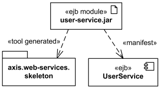
EJB component UserService and skeleton of web services  
 are manifested (implemented) by EJB module user-service.jar artifact

In **UML 1.x**, the concept of manifestation was referred to as **implementation** and annotated as «**implement**». Since this was one of the many uses of the word "implementation" this has been replaced in UML 2.x by «**manifest**».

## Deployment Target

Artifacts are deployed to deployment targets. **Deployment target** is the location for a deployed [artifact](https://www.uml-diagrams.org/artifact.html).

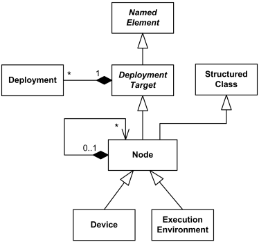
UML 2.4 definition of deployment target

**Instance specification** was extended in **UML 2.0** to allow instance of a [node](https://www.uml-diagrams.org/deployment-diagrams.html#node) to be **deployment target** in a deployment relationship.

**Property** was also extended in **UML 2.0** with the capability of being a **deployment target** in a deployment relationship. This enables modeling the deployment to hierarchical nodes that have properties functioning as internal [parts](https://www.uml-diagrams.org/composite-structure-diagrams/part.html).

Deployment target owns the set of [deployments](https://www.uml-diagrams.org/deployment-diagrams.html#deployment) that target it.

Deployment target has no specific notation by itself, see notations for subclasses.

## Node

**Node** is a [deployment target](https://www.uml-diagrams.org/deployment-diagrams.html#deployment-target) which represents computational resource upon which [artifacts](https://www.uml-diagrams.org/artifact.html) may be deployed for execution.

Node is shown as a perspective, 3-dimensional view of a cube.

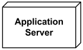
Application Server Node

Node is associated with [deployments](https://www.uml-diagrams.org/deployment-diagrams.html#deployment) of artifacts and indirectly with **packageable elements** that are involved in the [manifestations](https://www.uml-diagrams.org/deployment-diagrams.html#manifestation) by the artifact that is deployed on the node.

Nodes can be interconnected with [communication paths](https://www.uml-diagrams.org/deployment-diagrams.html#communication-path). Communication paths can be defined between nodes such as **application server** and **database server** to define the possible communication paths between the nodes. Specific network topologies can then be defined through **links** between node instances.

**Node** is specialized by:

*   [device](https://www.uml-diagrams.org/deployment-diagrams.html#device)
*   [execution environment](https://www.uml-diagrams.org/deployment-diagrams.html#execution-environment)

### Hierarchical Node

Hierarchical nodes can be modeled using [composition](https://www.uml-diagrams.org/composition.html) or by defining an [internal structure](https://www.uml-diagrams.org/structured-classifier.html). Internal structure of the node is defined in terms of [parts](https://www.uml-diagrams.org/composite-structure-diagrams/part.html) and [connectors](https://www.uml-diagrams.org/composite-structure-diagrams/connector.html). Parts of the node could be only nodes.

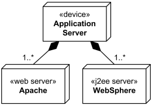
Application server box runs several web servers and J2EE servers

[Execution environment](https://www.uml-diagrams.org/deployment-diagrams.html#execution-environment) is usually [part](https://www.uml-diagrams.org/composite-structure-diagrams/part.html) of a general [node](https://www.uml-diagrams.org/deployment-diagrams.html#node) or [«device»](https://www.uml-diagrams.org/deployment-diagrams.html#device) which represents the physical hardware environment on which this execution environment resides. Execution environments can be **nested** (e.g., a database execution environment may be nested in an operating system execution environment).

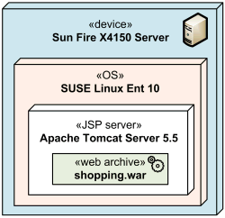
Several execution environments nested into server device

Execution environment instances are assigned to node instances by using [composite associations](https://www.uml-diagrams.org/composition.html) between nodes and execution environments, where the execution environment plays the role of the [part](https://www.uml-diagrams.org/composite-structure-diagrams/part.html).

## Device

A **device** is a [node](https://www.uml-diagrams.org/deployment-diagrams.html#node) which represents a physical computational resource with processing capability upon which artifacts may be deployed for execution.

A **device** is rendered as a node (perspective, 3-dimensional view of a cube) annotated with keyword «**device**».

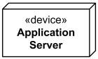
Application Server device

UML provides no standard stereotypes for devices. Examples of non-normative stereotypes for devices are:

*   «application server»
*   «client workstation»
*   «mobile device»
*   «embedded device»

Device may be depicted using custom icon. [Profiles](https://www.uml-diagrams.org/profile-diagrams.html), [stereotypes](https://www.uml-diagrams.org/stereotype.html), and [tagged values](https://www.uml-diagrams.org/stereotype.html#tagged-value) could be used to provide custom icons and properties for the devices.

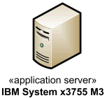
Application Server device depicted using custom icon

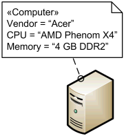
Computer stereotype with tags applied to [Device](https://www.uml-diagrams.org/deployment-diagrams.html#device) class.

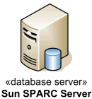
Database Server device depicted using custom icon

Mobile smartphone device depicted using custom icon

Devices may be complex (i.e., they may consist of other devices) where a physical machine is decomposed into its elements, either through namespace ownership or through attributes that are typed by devices.

## Execution Environment

An **execution environment** is a (software) [node](https://www.uml-diagrams.org/deployment-diagrams.html#node) that offers an execution environment for specific types of [components](https://www.uml-diagrams.org/component.html) that are deployed on it in the form of executable [artifacts](https://www.uml-diagrams.org/artifact.html). Components of the appropriate type are deployed to specific execution environments.

**Execution environment** implements a standard set of **services** that components require at execution time (at the modeling level these services are usually implicit). For each [deployment](https://www.uml-diagrams.org/deployment-diagrams.html#deployment) of component, aspects of these services may be determined by properties in a [deployment specification](https://www.uml-diagrams.org/deployment-diagrams.html#deployment-spec) for a particular kind of execution environment.

Execution environment is notated the same way as a [node](https://www.uml-diagrams.org/deployment-diagrams.html#node) (perspective, 3-dimensional view of a cube), annotated with the standard UML stereotype «**executionEnvironment**».

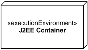
Execution environment - J2EE Container

This «**executionEnvironment**» is pesky sesquipedalian to use. UML provides no other standard stereotypes for execution environments. Examples of reasonable non-normative stereotypes are:

*   «OS»
*   «workflow engine»
*   «database system»
*   «J2EE container»
*   «web server»
*   «web browser»

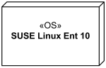
Linux Operating System Execution Environment

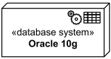
Oracle 10g DBMS Execution Environment

An execution environment can optionally have an explicit [interface](https://www.uml-diagrams.org/interface.html) of **system level services** that can be used by the deployed elements, in those cases where the modeler wants to make the execution environment software execution environment services explicit.

## Communication Path

A **communication path** is [association](https://www.uml-diagrams.org/association.html) between two [deployment targets](https://www.uml-diagrams.org/deployment-diagrams.html#deployment-target), through which they are able to exchange signals and messages.

Communication path is notated as **association**, and it has no additional notation compared to association.

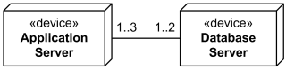
Communication path between several application servers and database servers.

Note, that when deployment targets are some physical [devices](https://www.uml-diagrams.org/deployment-diagrams.html#device), communication path will typically represent a physical connection between the nodes.

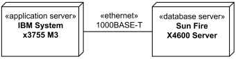
Gigabit Ethernet as communication path between application and database servers.

When deployment targets are [execution environments](https://www.uml-diagrams.org/deployment-diagrams.html#execution-environment), communication path will typically represent some protocol.

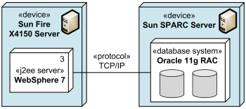
TCP/IP protocol as communication path between J2EE server and database system.

## Deployment

A **deployment** is a [dependency](https://www.uml-diagrams.org/dependency.html) relationship which describes allocation (deployment) of an [artifact](https://www.uml-diagrams.org/artifact.html) to a [deployment target](https://www.uml-diagrams.org/deployment-diagrams.html#deployment-target). Deployment could be also defined at instance level - as allocation of specific artifact instance to the specific instance of deployment target.

A **component deployment** is deployment of one or more artifacts or artifact instances, optionally parameterized by a [deployment specification](https://www.uml-diagrams.org/deployment-diagrams.html#deployment-spec).

It is not very clear why UML defines deployment as a [dependency](https://www.uml-diagrams.org/dependency.html), and not as an [association](https://www.uml-diagrams.org/association.html) or just a [directed relationship](https://www.uml-diagrams.org/uml-core.html#directed-relationship). The major contradiction is that dependency in UML does not have any runtime implications, and is defined in terms of the model elements, not in terms of their instances. At the same time UML 2.4 allows and shows examples of instances of artifacts deployed to instances of nodes.

Deployment could be shown as a [dependency](https://www.uml-diagrams.org/dependency.html) that is drawn from the artifact (supplier) to the deployment target (client) and is labeled with «**deploy**». Note, that dependency usually points from the client to the supplier, i.e. in the direction opposite to what is recommended by UML 2.4 for deployment. On the other hand, UML specification allows to change direction for a dependency based on user's stipulations.

J2EE web application archive portfolio.war  
 deployed on Apache Tomcat JSP server.

At the "instance level" instances of artifacts could be deployed to specific instances of the deployment target. The underlining of the name of artifact instance may be omitted.

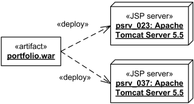
J2EE web application archive portfolio.war deployed  
 on two instances of Apache Tomcat JSP server - psrv_023 and psrv_037.

For modeling complex deployment target models consisting of nodes with a composite structure defined through "parts," a property (that functions as a part) may also be the target of a deployment.

Deployment could be shown with deployed artifacts contained by a [deployment target](https://www.uml-diagrams.org/deployment-diagrams.html#deployment-target).

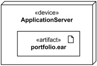
The portfolio.ear artifact deployed on application server.

Deployment could be shown using textual list of deployed artifacts within a deployment target.

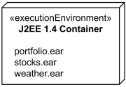
The portfolio.ear, stocks.ear, weather.ear artifacts deployed in J2EE 1.4 container.

Deployment could be shown within a rectangular frame with deployment name in a compartment in the upper left corner. The long form name for the diagram heading is **deployment** and abbreviated form is **dep**.

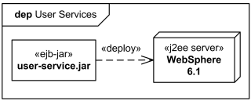
User Services deployment shown in the diagram frame.

## Deployment Specification

A **deployment specification** is an [artifact](https://www.uml-diagrams.org/artifact.html) that specifies a set of deployment properties that determine execution parameters of a **component artifact** that is deployed on a **node**. A deployment specification can be aimed at a specific type of **container** for **components**.

A deployment specification is a general mechanism to parameterize a **deployment relationship**, as is common in various hardware and software technologies. The **deployment specification** element is expected to be extended in specific component profiles. Non-normative examples of the standard stereotypes that a profile might add to deployment specification are, for example, «**concurrencyMode**» with tagged values {thread, process, none}, or «**transactionMode**» with tagged values {transaction, nestedTransaction, none}.

A **deployment specification** at **specification level** is rendered as a classifier rectangle with optional deployment properties in a compartment.

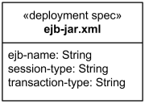
The ejb-jar.xml deployment specification

An artifact that reifies or implements deployment specification properties at **instance level** is a **deployment descriptor**. A deployment descriptor is rendered as a classifier rectangle with the name underlined and with deployment properties having specific values in a compartment.

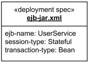
The ejb-jar.xml deployment descriptor

An instance of a deployment specification with specific values for deployment properties may be contained in a complex artifact.

## Deployment Specification Dependency

A [deployment specification](https://www.uml-diagrams.org/deployment-diagrams.html#deployment-spec) could be displayed as a classifier rectangle attached to a **component artifact** using a regular **dependency** arrow pointing to deployed artifact.

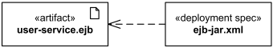
The ejb-jar.xml deployment specification for user-service.ejb artifact.

## Deployment Specification Association

[Deployment specification](https://www.uml-diagrams.org/deployment-diagrams.html#deployment-spec) could be associated with the [deployment](https://www.uml-diagrams.org/deployment-diagrams.html#deployment) of a **component artifact** on a [node](https://www.uml-diagrams.org/deployment-diagrams.html#node). In this case deployment specification could be shown as a classifier rectangle attached to the **deployment**.

Note, that **UML 2.4 specification** shows this association as a **dashed** line (while [association](https://www.uml-diagrams.org/association.html) is normally displayed as solid line.)

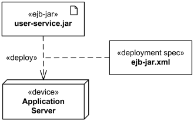
The ejb-jar.xml deployment specification attached to deployment.

This document describes UML versions up to **[UML 2.5](https://www.uml-diagrams.org/references.html#ref-uml-25 "UML 2.5 Specification")** and is based on the corresponding **OMG™ Unified Modeling Language™ (OMG UML®)** specifications. UML diagrams were created in **Microsoft® Visio®** 2007-2016 using **[UML 2.x Visio Stencils](http://softwarestencils.com/uml/index.html "Visio Stencil and Template for UML 2.5")**. You can send your comments and suggestions to [webmaster](mailto:webmaster@uml-diagrams.org). [Privacy policy](https://www.uml-diagrams.org/privacy-policy.html).

_Copyright © 2009-2026 uml-diagrams.org. All rights reserved. Authored by Kirill Fakhroutdinov._

[They Retired Debt-Free in a $150K Tiny Home. Here’s Inside TheDecorIdeas | [Sponsored](https://popup.taboola.com/en/?template=colorbox&utm_source=uml-diagrams&utm_medium=referral&utm_content=next-up-a-delta:Next%20Up:)[Sponsored](https://popup.taboola.com/en/?template=colorbox&utm_source=uml-diagrams&utm_medium=referral&utm_content=next-up-a-delta:Next%20Up:) Read Next Story](https://www.thedecorideas.com/inside-a-150k-tiny-home-that-let-this-couple-retire-debt-free "They Retired Debt-Free in a $150K Tiny Home. Here’s Inside")
