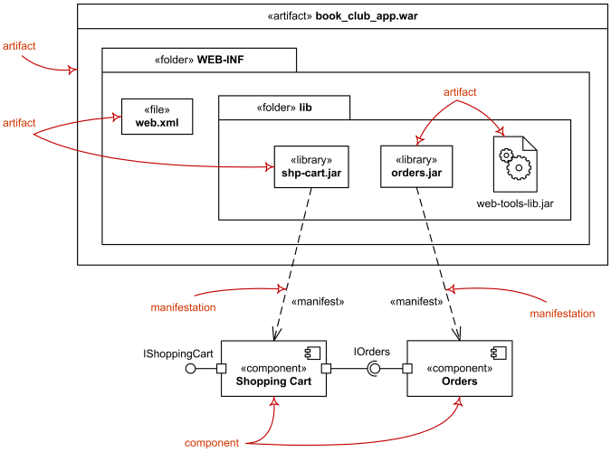
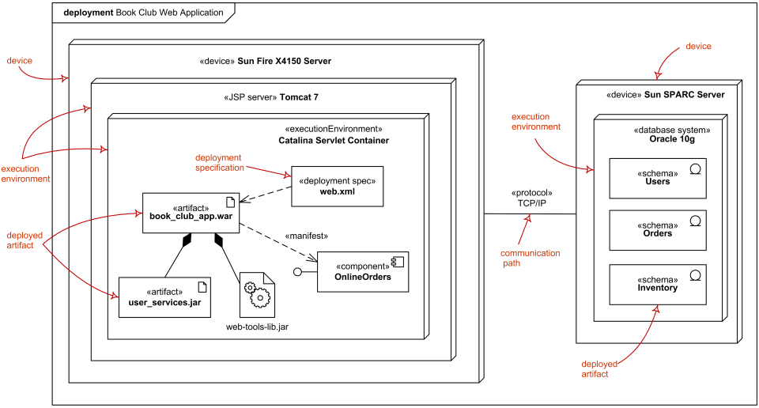
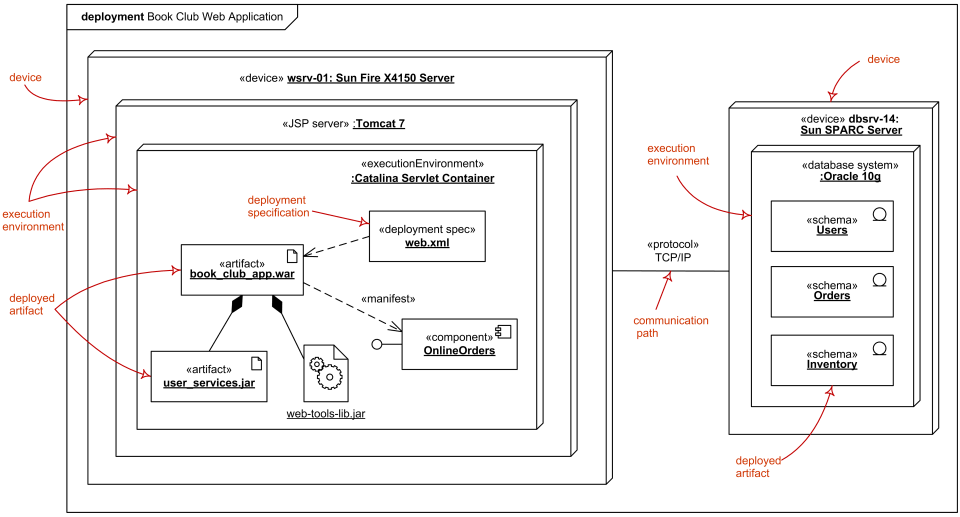
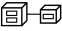

Title: UML deployment diagrams overview, common types of deployment diagrams

URL Source: https://www.uml-diagrams.org/deployment-diagrams-overview.html

Markdown Content:
Menu►
*   [Home](https://www.uml-diagrams.org/ "UML Graphical Notation Overview and Reference")
*   [Deployment diagrams overview](https://www.uml-diagrams.org/deployment-diagrams-overview.html "UML deployment diagrams overview")
*   [Network architecture](https://www.uml-diagrams.org/network-architecture-diagrams.html "Network architecture diagrams")
*   [Deployment notation](https://www.uml-diagrams.org/deployment-diagrams.html "UML deployment diagrams graphical notation")
*   [Artifact](https://www.uml-diagrams.org/artifact.html "UML deployment diagrams artifact")
*   [Manifestation](https://www.uml-diagrams.org/deployment-diagrams.html#manifestation "UML deployment diagrams manifestation")
*   [Deployment target](https://www.uml-diagrams.org/deployment-diagrams.html#deployment-target "UML deployment diagrams deployment target")
*   [Communication path](https://www.uml-diagrams.org/deployment-diagrams.html#communication-path "UML deployment diagrams communication path")
*   [Deployment](https://www.uml-diagrams.org/deployment-diagrams.html#deployment "UML deployment diagrams deployment")
*   [Reference](https://www.uml-diagrams.org/deployment-diagrams-reference.html "UML deployment diagrams reference")
*   [Deployment examples](https://www.uml-diagrams.org/deployment-diagrams-examples.html "UML deployment diagrams examples")
*   [UML Index](https://www.uml-diagrams.org/index-references.html "Index of UML Elements")

# Deployment Diagrams Overview

**Deployment diagram** is a [structure diagram](https://www.uml-diagrams.org/uml-25-diagrams.html#structure-diagram) which shows architecture of the system as deployment (distribution) of software artifacts to deployment targets.

[Artifacts](https://www.uml-diagrams.org/artifact.html) represent concrete elements in the physical world that are the result of a development process. Examples of artifacts are executable files, libraries, archives, database schemas, configuration files, etc.

[Deployment target](https://www.uml-diagrams.org/deployment-diagrams.html#deployment-target) is usually represented by a [node](https://www.uml-diagrams.org/deployment-diagrams.html#node) which is either hardware device or some software execution environment. Nodes could be connected through [communication paths](https://www.uml-diagrams.org/deployment-diagrams.html#communication-path) to create networked systems of arbitrary complexity.

Note, that [components](https://www.uml-diagrams.org/component.html) were directly deployed to nodes in UML 1.x deployment diagrams. In UML 2.x [artifacts](https://www.uml-diagrams.org/artifact.html) are deployed to nodes, and artifacts could [manifest](https://www.uml-diagrams.org/deployment-diagrams.html#manifestation) (implement) components. Components are deployed to nodes indirectly through artifacts.

Deployment diagrams could describe architecture at **specification level** (also called type level) or at **instance level** (similar to class diagrams and object diagrams).

**Specification level** deployment diagram shows some overview of [deployment](https://www.uml-diagrams.org/deployment-diagrams.html#deployment) of [artifacts](https://www.uml-diagrams.org/artifact.html) to [deployment targets](https://www.uml-diagrams.org/deployment-diagrams.html#deployment-target), without referencing specific instances of artifacts or nodes.

**Instance level** deployment diagram shows [deployment](https://www.uml-diagrams.org/deployment-diagrams.html#deployment) of instances of [artifacts](https://www.uml-diagrams.org/artifact.html) to specific instances of [deployment targets](https://www.uml-diagrams.org/deployment-diagrams.html#deployment-target). It could be used for example to show differences in deployments to development, staging or production environments with the names/ids of specific build or deployment servers or devices.

Some common types of deployment diagrams are:

*   [Implementation (manifestation) of components by artifacts](https://www.uml-diagrams.org/deployment-diagrams-overview.html#deployment-manifestation-artifacts),
*   [Specification level deployment diagram](https://www.uml-diagrams.org/deployment-diagrams-overview.html#specification-level-deployment),
*   [Instance level deployment diagram](https://www.uml-diagrams.org/deployment-diagrams-overview.html#instance-level-deployment),
*   [Network architecture of the system](https://www.uml-diagrams.org/network-architecture-diagrams.html).

## Manifestation of Components by Artifacts

While [component diagrams](https://www.uml-diagrams.org/component-diagrams.html) show components and relationships between components and classifiers, and [deployment diagrams](https://www.uml-diagrams.org/deployment-diagrams-overview.html) - [deployments](https://www.uml-diagrams.org/deployment-diagrams.html#deployment) of artifacts to deployment targets, some missing intermediate diagram is **manifestation diagram** to be used to show [manifestation](https://www.uml-diagrams.org/deployment-diagrams.html#manifestation) (implementation) of [components](https://www.uml-diagrams.org/component.html) by [artifacts](https://www.uml-diagrams.org/artifact.html) and internal structure of artifacts.

Because **manifestation diagrams** are not defined by UML 2.4 specification, manifestation of components by artifacts could be shown using either component diagrams or deployment diagrams.

Manifestation of components by artifacts.

## Specification Level Deployment Diagram

Specification level (also called type level) deployment diagram shows some overview of [deployment](https://www.uml-diagrams.org/deployment-diagrams.html#deployment) of [artifacts](https://www.uml-diagrams.org/artifact.html) to [deployment targets](https://www.uml-diagrams.org/deployment-diagrams.html#deployment-target), without referencing specific instances of artifacts or nodes.

Specification level deployment diagram - web application deployed to Tomcat JSP server and database schemas - to database system.

## Instance Level Deployment Diagram

Instance level deployment diagram shows [deployment](https://www.uml-diagrams.org/deployment-diagrams.html#deployment) of instances of [artifacts](https://www.uml-diagrams.org/artifact.html) to specific instances of [deployment targets](https://www.uml-diagrams.org/deployment-diagrams.html#deployment-target). It could be used for example to show differences in deployments to development, staging or production environments with the names/ids of specific deployment servers or devices.

In the example below, web application is deployed to the application server **wsrv-01** and several database schemas - to the database server **dbsrv-14**.

Instance level deployment diagram - web application deployed to Tomcat JSP server and database schemas - to database system.

## Specification Level Network Architecture

Deployment diagrams could be used to show logical or physical [network architecture](https://www.uml-diagrams.org/network-architecture-diagrams.html) of the system. Network architecture diagram could show no artifacts or deployments at all or only the major ones.

[Network architecture diagrams](https://www.uml-diagrams.org/network-architecture-diagrams.html "Network architecture diagrams")

This document describes UML versions up to **[UML 2.5](https://www.uml-diagrams.org/references.html#ref-uml-25 "UML 2.5 Specification")** and is based on the corresponding **OMG™ Unified Modeling Language™ (OMG UML®)** specifications. UML diagrams were created in **Microsoft® Visio®** 2007-2016 using **[UML 2.x Visio Stencils](http://softwarestencils.com/uml/index.html "Visio Stencil and Template for UML 2.5")**. You can send your comments and suggestions to [webmaster](mailto:webmaster@uml-diagrams.org). [Privacy policy](https://www.uml-diagrams.org/privacy-policy.html).

_Copyright © 2009-2026 uml-diagrams.org. All rights reserved. Authored by Kirill Fakhroutdinov._

[Your Dinosaur Shelf Could Use a Little Science Fiction TopGadgetlife | [Sponsored](https://popup.taboola.com/en/?template=colorbox&utm_source=uml-diagrams&utm_medium=referral&utm_content=next-up-a-delta:Next%20Up:)[Sponsored](https://popup.taboola.com/en/?template=colorbox&utm_source=uml-diagrams&utm_medium=referral&utm_content=next-up-a-delta:Next%20Up:) Read Next Story](https://topgadgetlife.com/products/mechanical-t-rex-egg-%E2%80%93-from-mysterious-egg-to-mighty-robotic-dinosaur! "Your Dinosaur Shelf Could Use a Little Science Fiction")
