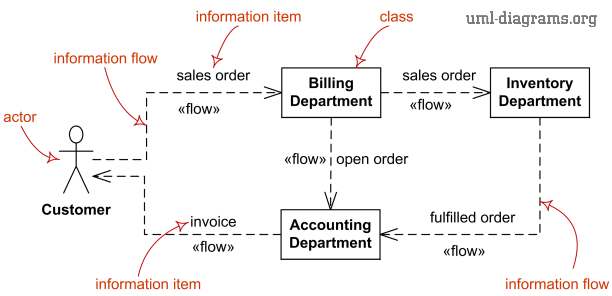

Title: UML Information Flow Diagrams - Overview of Graphical Notation

URL Source: https://www.uml-diagrams.org/information-flow-diagrams.html

Warning: Target URL returned error 400: Bad Request

Markdown Content:
Menu►
*   [Home](https://www.uml-diagrams.org/ "UML graphical notation overview and reference")
*   [Information flow diagrams overview](https://www.uml-diagrams.org/information-flow-diagrams.html "UML information flow diagrams overview")
*   [Information flow elements](https://www.uml-diagrams.org/information-flow-elements.html "UML information flow diagram elements")
*   [Scheduled workflow example](https://www.uml-diagrams.org/information-flow-diagrams/scheduled-workflow-example.html?context=ifl-examples "Scheduled Workflow Information Flow for the Hospital Management example")
*   [UML index](https://www.uml-diagrams.org/index-references.html "Index of UML elements")

# UML Information Flow Diagrams

**Information flow diagram** is **UML**[behavior diagram](https://www.uml-diagrams.org/uml-25-diagrams.html#behavior-diagram) which shows exchange of information between system entities at some high levels of abstraction. Information flows may be useful to describe circulation of information through a system by representing aspects of models not yet fully specified or with less details.

[Information flows](https://www.uml-diagrams.org/information-flow-elements.html#information-flow) do not specify the nature of the information, mechanisms by which it is conveyed, sequences of exchange, or any control conditions. [Information items](https://www.uml-diagrams.org/information-flow-elements.html#information-item) can be used to represent the information that flows through a system along the information flows before details of their realization have been designed.

UML information flow diagram elements - information flow, information item.

### Limitations of Information Flow Diagrams

Information flow diagrams in UML provide fairly meager expressive capabilities.

[Information items](https://www.uml-diagrams.org/information-flow-elements.html#information-item) provide no details about the information they transfer. They do not have [features](https://www.uml-diagrams.org/uml-core.html#feature), [generalizations](https://www.uml-diagrams.org/generalization.html), or [associations](https://www.uml-diagrams.org/association.html).

  

This document describes **UML 2.5** and is based on **OMG™ Unified Modeling Language™ (OMG UML®) 2.5** specification [[UML 2.5 FTF - Beta 1]](https://www.uml-diagrams.org/references.html#ref-uml-25-b1 "UML 2.5 Specification FTF Beta 1"). All UML diagrams were created in **Microsoft Visio** 2007-2016 using [UML 2.2 stencils](http://softwarestencils.com/uml/index.html "Visio Stencil and Template for UML 2.2"). You can send your comments and suggestions to [webmaster](mailto:webmaster@uml-diagrams.org). [Privacy policy](https://www.uml-diagrams.org/privacy-policy.html).

_Copyright © 2009-2026 uml-diagrams.org. All rights reserved. Authored by Kirill Fakhroutdinov._

[Former Governor Nikki Haley Says Georgia-Born Senator Raphael Warnock Should Be Deported Blavity.com | [Sponsored](https://popup.taboola.com/en/?template=colorbox&utm_source=uml-diagrams&utm_medium=referral&utm_content=next-up-a-delta:Next%20Up:)[Sponsored](https://popup.taboola.com/en/?template=colorbox&utm_source=uml-diagrams&utm_medium=referral&utm_content=next-up-a-delta:Next%20Up:) Read Next Story](https://blavity.com/former-governor-nikki-haley-senator-raphael-warnock-deported-herschel-walker "Former Governor Nikki Haley Says Georgia-Born Senator Raphael Warnock Should Be Deported")
