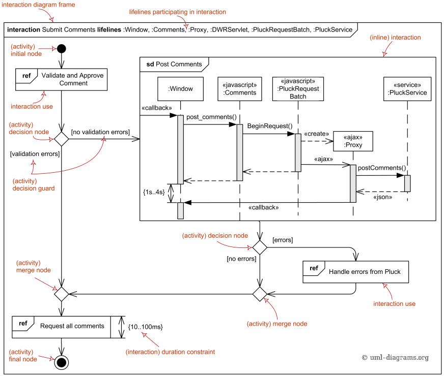
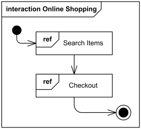
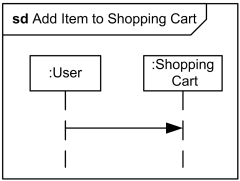
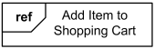

Title: UML interaction overview diagrams provide overview of the flow of control where nodes of the flow are interactions or interaction uses.

URL Source: https://www.uml-diagrams.org/interaction-overview-diagrams.html

Warning: Target URL returned error 400: Bad Request

Markdown Content:
Menu►
*   [UML diagrams](https://www.uml-diagrams.org/ "UML graphical notation overview, examples, and reference.")
*   [Interaction overview diagrams](https://www.uml-diagrams.org/interaction-overview-diagrams.html "UML interaction overview diagrams")
*   [Interaction](https://www.uml-diagrams.org/interaction.html?context=interaction-overview "UML interaction.")
*   [Message](https://www.uml-diagrams.org/interaction-message.html?context=interaction-overview "UML interaction message.")
*   [Activity diagram controls](https://www.uml-diagrams.org/activity-diagrams-controls.html?context=interaction-overview "UML activity diagram controls.")
*   [Reference](https://www.uml-diagrams.org/interaction-overview-diagrams-reference.html "UML interaction overview diagrams reference")
*   [Interaction overview examples](https://www.uml-diagrams.org/interaction-overview-diagrams-examples.html "UML interaction overview diagrams examples")
*   [Online shopping](https://www.uml-diagrams.org/online-shopping-uml-interaction-overview-diagram-example.html?context=iov-examples "Online shopping UML interaction overview diagram example.")
*   [Submit comments](https://www.uml-diagrams.org/pluck-comments-uml-interaction-overview-example.html "Submit comments to Pluck UML interaction overview diagram example.")
*   [UML index](https://www.uml-diagrams.org/index-references.html "Index of UML Elements")

# UML Interaction Overview Diagrams

Interaction overview diagrams provide overview of the flow of control where nodes of the flow are **interactions** or [interaction uses](https://www.uml-diagrams.org/sequence-diagrams.html#interaction-use). [[UML 2.4.1 Specification]](https://www.uml-diagrams.org/references.html#ref-uml-24-super "UML 2.4.1 - Superstructure") in some places relegates these diagrams as [interaction diagrams](https://www.uml-diagrams.org/uml-25-diagrams.html#interaction-diagram) while in other places interaction overview diagrams are referred to as specialization of [activity diagrams](https://www.uml-diagrams.org/activity-diagrams.html).

Interaction overview diagrams do look like [activity diagrams](https://www.uml-diagrams.org/activity-diagrams.html) that can only have inline interactions or interaction uses instead of **invocation actions**. The inline interactions and interaction uses are considered as special forms of **call behavior action**. (It seems that UML 2.4 specification mistakenly refers to those as either [object nodes](https://www.uml-diagrams.org/activity-diagrams-objects.html) or **ActivityInvocations** - which are simply absent in UML 2.4.)

UML 2.4 requires branching and joining of branches in interaction overview diagrams to be properly nested. This is more restrictive than in activity diagrams and could be quite difficult to obey.

UML interaction overview diagram combines elements from activity and interaction diagrams as shown on the picture below.

The following elements of the [activity diagrams](https://www.uml-diagrams.org/activity-diagrams.html) could be used on the interaction overview diagrams: [initial node](https://www.uml-diagrams.org/activity-diagrams-controls.html#initial-node), [flow final node](https://www.uml-diagrams.org/activity-diagrams-controls.html#flow-final-node), [activity final node](https://www.uml-diagrams.org/activity-diagrams-controls.html#activity-final-node), [decision node](https://www.uml-diagrams.org/activity-diagrams-controls.html#decision-node), [merge node](https://www.uml-diagrams.org/activity-diagrams-controls.html#merge-node), [fork node](https://www.uml-diagrams.org/activity-diagrams-controls.html#fork-node), [join node](https://www.uml-diagrams.org/activity-diagrams-controls.html#join-node).

The following elements of the [interaction diagrams](https://www.uml-diagrams.org/uml-25-diagrams.html#interaction-diagram) could be used on the interaction overview diagrams: [interaction](https://www.uml-diagrams.org/interaction-overview-diagrams.html#interaction), [interaction use](https://www.uml-diagrams.org/interaction-overview-diagrams.html#interaction-use), [duration constraint](https://www.uml-diagrams.org/common-behaviors.html#duration-constraint), [time constraint](https://www.uml-diagrams.org/common-behaviors.html#time-constraint).

UML interaction overview diagram combines elements from activity and interaction diagrams.

You can find some [examples of interaction overview diagrams](https://www.uml-diagrams.org/interaction-overview-diagrams-examples.html) here:

*   [Online Shopping](https://www.uml-diagrams.org/online-shopping-uml-interaction-overview-diagram-example.html?context=iov-examples)
*   [Submit Comments to Pluck using DWR, AJAX, JSON](https://www.uml-diagrams.org/pluck-comments-uml-interaction-overview-example.html)

## Frame

Interaction overview diagrams are framed by the same kind of frame that encloses other forms of interaction diagrams - a rectangular frame around the diagram with a name in a compartment in the upper left corner. Interaction kind is **interaction** or **sd** (abbreviated form). Note, that UML has no **io** or **iod** abbreviation as some would expect.

Interaction overview diagram **Online Shopping**

The heading text may also include a list of the contained lifelines (that do not appear graphically).

## Elements of Activity Diagram

**Interaction overview diagrams** are defined as specialization of [activity diagrams](https://www.uml-diagrams.org/activity-diagrams.html) and as such they inherit number of graphical elements.

Interaction overview diagrams can only have inline interactions or interaction uses instead of actions, and activity diagram [actions](https://www.uml-diagrams.org/activity-diagrams-actions.html) could not be used.

The following elements of the activity diagrams could be used on interaction overview diagrams:

*   [initial node](https://www.uml-diagrams.org/activity-diagrams-controls.html#initial-node)
*   [flow final node](https://www.uml-diagrams.org/activity-diagrams-controls.html#flow-final-node)
*   [activity final node](https://www.uml-diagrams.org/activity-diagrams-controls.html#activity-final-node)
*   [decision node](https://www.uml-diagrams.org/activity-diagrams-controls.html#decision-node)
*   [merge node](https://www.uml-diagrams.org/activity-diagrams-controls.html#merge-node)
*   [fork node](https://www.uml-diagrams.org/activity-diagrams-controls.html#fork-node)
*   [join node](https://www.uml-diagrams.org/activity-diagrams-controls.html#join-node)

## Elements of Interaction Diagram

The following elements of the interaction diagrams could be used on interaction overview diagrams:

*   [interaction](https://www.uml-diagrams.org/interaction-overview-diagrams.html#interaction)
*   [interaction use](https://www.uml-diagrams.org/interaction-overview-diagrams.html#interaction-use)
*   [duration constraint](https://www.uml-diagrams.org/common-behaviors.html#duration-constraint)
*   [time constraint](https://www.uml-diagrams.org/common-behaviors.html#time-constraint)

### Interaction

An [interaction diagram](https://www.uml-diagrams.org/uml-25-diagrams.html#interaction-diagram) of any kind may appear inline as an **invocation action**. The inline interaction diagrams may be either anonymous or named.

Interaction Add Item to Shopping Cart may appear inline on some interaction overview diagram

### Interaction Use

An [interaction use](https://www.uml-diagrams.org/sequence-diagrams.html#interaction-use) may appear as an **invocation action**.

Interaction use Add Item to Shopping Cart may appear on some interaction overview diagram

Some UML tools may choose to "explode" the interaction use into an inline interaction with the name of the interaction referred by the use. The inline interaction will have arguments (if any) of the reference replaced with parameters.

  

This document describes UML versions up to **[UML 2.5](https://www.uml-diagrams.org/references.html#ref-uml-25 "UML 2.5 Specification")** and is based on the corresponding **OMG™ Unified Modeling Language™ (OMG UML®)** specifications. UML diagrams were created in **Microsoft® Visio®** 2007-2016 using **[UML 2.x Visio Stencils](http://softwarestencils.com/uml/index.html "Visio Stencil and Template for UML 2.5")**. You can send your comments and suggestions to [webmaster](mailto:webmaster@uml-diagrams.org). [Privacy policy](https://www.uml-diagrams.org/privacy-policy.html).

_Copyright © 2009-2026 uml-diagrams.org. All rights reserved. Authored by Kirill Fakhroutdinov._

[How to Prevent Bone Mass Decrease with Weight Loss GoodRx | [Sponsored](https://popup.taboola.com/en/?template=colorbox&utm_source=uml-diagrams&utm_medium=referral&utm_content=next-up-a-delta:Next%20Up:)[Sponsored](https://popup.taboola.com/en/?template=colorbox&utm_source=uml-diagrams&utm_medium=referral&utm_content=next-up-a-delta:Next%20Up:) Read Next Story](https://www.goodrx.com/conditions/weight-loss/bone-mass-decrease-with-weight-loss "How to Prevent Bone Mass Decrease with Weight Loss")
