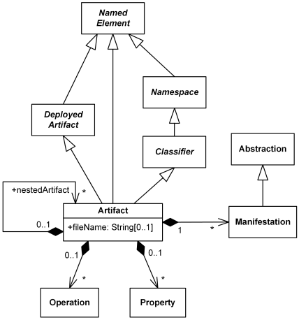
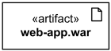
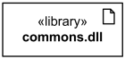
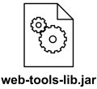
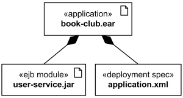
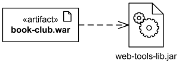

Title: UML artifact represents some physical entity or a piece of information that is used or is produced by a software development process.

URL Source: https://www.uml-diagrams.org/artifact.html

Markdown Content:
Menu►
*   [Home](https://www.uml-diagrams.org/ "UML Graphical Notation Overview and Reference")
*   [Deployment diagrams overview](https://www.uml-diagrams.org/deployment-diagrams-overview.html "UML deployment diagrams overview")
*   [Network architecture](https://www.uml-diagrams.org/network-architecture-diagrams.html "Network architecture diagrams")
*   [Deployment notation](https://www.uml-diagrams.org/deployment-diagrams.html "UML deployment diagrams graphical notation")
*   [Artifact](https://www.uml-diagrams.org/artifact.html "UML deployment diagrams artifact")
*   [Manifestation](https://www.uml-diagrams.org/deployment-diagrams.html#manifestation "UML deployment diagrams manifestation")
*   [Deployment target](https://www.uml-diagrams.org/deployment-diagrams.html#deployment-target "UML deployment diagrams deployment target")
*   [Communication path](https://www.uml-diagrams.org/deployment-diagrams.html#communication-path "UML deployment diagrams communication path")
*   [Deployment](https://www.uml-diagrams.org/deployment-diagrams.html#deployment "UML deployment diagrams deployment")
*   [Reference](https://www.uml-diagrams.org/deployment-diagrams-reference.html "UML deployment diagrams reference")
*   [Deployment examples](https://www.uml-diagrams.org/deployment-diagrams-examples.html "UML deployment diagrams examples")
*   [UML Index](https://www.uml-diagrams.org/index-references.html "Index of UML Elements")

# UML Artifact

An **artifact** is a [classifier](https://www.uml-diagrams.org/classifier.html) that represents some **physical entity**, a piece of information that is used or is produced by a software development process, or by deployment and operation of a system. Artifact is a source of a [deployment](https://www.uml-diagrams.org/deployment-diagrams.html#deployment) to a [node](https://www.uml-diagrams.org/deployment-diagrams.html#node). A particular instance (or "copy") of an artifact is deployed to a node instance.

Some real life examples of UML artifacts are:

*   text document
*   source file
*   script
*   binary executable file
*   archive file
*   database table

The **UML****Standard Profile** defines several **standard stereotypes** that apply to artifacts:

«file»A physical file in the context of the system developed.

Standard stereotypes - subclasses of **«file»**:

«document»A generic file that is not a «source» file or «executable».
«source»A source file that can be compiled into an executable file.
«library»A static or dynamic library file.
«executable»A program file that can be executed on a computer system.
«script»A script file that can be interpreted by a computer system.

Standard UML 1.x stereotype that is now obsolete:

«table»Table in database.

Standard stereotypes can be further specialized into implementation and platform specific stereotypes in profiles. For example, Java profile might define **«jar»** as a subclass of «executable» for executable Java archives. Specific profiles are expected to provide some stereotype for artifact representing sets of files.

UML specifications define **artifact** as a subclass of abstract **deployed artifact**. Deployed artifact is described as an **artifact** or artifact instance that has been deployed to a [deployment target](https://www.uml-diagrams.org/deployment-diagrams.html#deployment-target). Common sense says that the relationship has to be reversed - deployed artifact should be a subclass of artifact, while it has to be allowed for some artifacts not to be deployed at all.

UML abstract syntax of Artifact.

Artifacts may have **properties** that represent [features](https://www.uml-diagrams.org/uml-core.html#feature) of the artifact, and [operations](https://www.uml-diagrams.org/operation.html) that can be performed on its instances. Artifacts have **fileName** attribute - a concrete name that is used to refer to the artifact in a physical context - e.g. **file name** or **URI**. Artifact could have nested artifacts.

Artifacts are deployed to a [deployment target](https://www.uml-diagrams.org/deployment-diagrams.html#deployment-target). **Instance specification** was extended in UML to allow instances of **artifacts** to be **deployed artifacts** in a [deployment](https://www.uml-diagrams.org/deployment-diagrams.html#deployment) relationship.

An artifact is presented using an ordinary class rectangle with the keyword **«artifact»**. Examples in **UML** specification also show **document icon** in upper right corner.

Artifact web-app.war

C# source file artifact UserServices.cs

Library commons.dll

Alternatively, artifact may be depicted by an icon.

Artifact web-tools-lib.jar

Optionally, the underlining of the name of an artifact instance may be omitted, as the context is assumed to be known to users.

## Associations between Artifacts

Artifacts can be involved in [associations](https://www.uml-diagrams.org/association.html) to other artifacts, e.g. [composition](https://www.uml-diagrams.org/composition.html) associations. For instance, a deployment descriptor artifact for a component may be contained within the artifact that [manifests](https://www.uml-diagrams.org/deployment-diagrams.html#manifestation) that component. In that way, the component and its descriptor are deployed to a node instance as one artifact instance.

Application book-club.ear artifact contains EJB user-service.jar artifact and deployment descriptor.

## Dependency between Artifacts

[Artifacts](https://www.uml-diagrams.org/artifact.html) can be involved in [dependency](https://www.uml-diagrams.org/dependency.html) relationship with other artifacts.

Dependency between artifacts is notated in the same way as general [dependency](https://www.uml-diagrams.org/dependency.html), i.e. as a general dashed line with an open arrow head directed from client artifact to supplier artifact.

The book-club.war artifact depends on web-tools-lib.jar artifact.

[Manifestation](https://www.uml-diagrams.org/deployment-diagrams.html#manifestation "UML manifestation")

This document describes UML versions up to **[UML 2.5](https://www.uml-diagrams.org/references.html#ref-uml-25 "UML 2.5 Specification")** and is based on the corresponding **OMG™ Unified Modeling Language™ (OMG UML®)** specifications. UML diagrams were created in **Microsoft® Visio®** 2007-2016 using **[UML 2.x Visio Stencils](http://softwarestencils.com/uml/index.html "Visio Stencil and Template for UML 2.5")**. You can send your comments and suggestions to [webmaster](mailto:webmaster@uml-diagrams.org). [Privacy policy](https://www.uml-diagrams.org/privacy-policy.html).

_Copyright © 2009-2026 uml-diagrams.org. All rights reserved. Authored by Kirill Fakhroutdinov._

[Curren Watches: Selected Steel Styles, 30% Off Curren Watches | [Sponsored](https://popup.taboola.com/en/?template=colorbox&utm_source=uml-diagrams&utm_medium=referral&utm_content=next-up-a-delta:Next%20Up:)[Sponsored](https://popup.taboola.com/en/?template=colorbox&utm_source=uml-diagrams&utm_medium=referral&utm_content=next-up-a-delta:Next%20Up:) Read Next Story](https://glengeprourse.com/08f7e63a-cb07-4d8f-be76-d8f1b6b00dd4 "Curren Watches: Selected Steel Styles, 30% Off")
