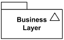
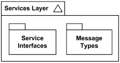
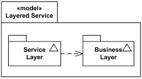

Title: UML Model is a specialized UML package which describes a system from a certain point of view, viewpoint or a profile.

URL Source: https://www.uml-diagrams.org/package-diagrams/model.html

Warning: Target URL returned error 400: Bad Request

Markdown Content:
Menu►
*   [UML diagrams](https://www.uml-diagrams.org/ "UML graphical notation overview, examples, and reference.")
*   [Package diagrams overview](https://www.uml-diagrams.org/package-diagrams-overview.html "UML package diagrams overview")
*   [Package](https://www.uml-diagrams.org/package-diagrams.html#package "UML package diagrams notation - Package")
*   [Package template](https://www.uml-diagrams.org/package-diagrams.html#package-template "UML package diagrams notation - Package template")
*   [Packageable element](https://www.uml-diagrams.org/package-diagrams.html#packageable-element "UML package diagrams notation - packageable element")
*   [Element import](https://www.uml-diagrams.org/element-import.html "UML package diagrams notation - element import")
*   [Package import](https://www.uml-diagrams.org/package-import.html "UML package diagrams notation - package import")
*   [Package merge](https://www.uml-diagrams.org/package-merge.html "UML package diagrams notation - package merge")
*   [Model](https://www.uml-diagrams.org/package-diagrams/model.html "UML package diagrams notation - model")
*   [Package diagrams reference](https://www.uml-diagrams.org/package-diagrams-reference.html "UML Package Diagrams Reference")
*   [Package diagrams examples](https://www.uml-diagrams.org/package-diagrams-examples.html "UML Package Diagrams Examples")
*   [UML Index](https://www.uml-diagrams.org/index-references.html "Index of UML Elements")

# UML Model

**Model** is a specialized UML [package](https://www.uml-diagrams.org/package-diagrams.html#package) which describes a **system** from a certain point of view, **viewpoint**. The viewpoint may also refer to a [profile](https://www.uml-diagrams.org/profile.html) definition. Models are used to draw [model diagrams](https://www.uml-diagrams.org/package-diagrams-overview.html#model-diagram).

[[UML 2.5 FTF - Beta 1]](https://www.uml-diagrams.org/references.html#ref-uml-25-b1 "UML 2.5 Specification FTF Beta 1") is not very consistent defining the scope of the model, a **system**. In one place it says that a model captures a view of a physical system, while in another one - that system is meant in the broadest sense and may include not only software and hardware but organizations and processes.

**View** is defined as some abstraction of the system including only those aspects of the system that are relevant to the purpose of the model, describing those aspects to a certain category of **stakeholders** or from a certain point of view of the stakeholders, and at the appropriate level of detail. 

It means that different models can be provided for the same system, each model representing the system from a different viewpoint or at a different abstraction level.

UML 2.5 loosely defines **stakeholders** "by example", as e.g., designers, users, or customers of the system.

**Stakeholder** (in the context of software projects or systems) could be defined as a person, group or organization within or outside of the project or the system, sponsoring or having an interest in the project, or having a positive or negative influence in the project. 

Examples of the stakeholders include customers, user groups, upper management, product owners, project managers, development teams, software quality engineers, etc.

UML 2.5 specification is also inconsistent between its intentions and examples explaining models. While it states that a model is complete in the sense that it covers **the whole system**, an example provided shows models representing **parts** (tiers) of a system.

Model contains a hierarchical set of elements that together describe the system. It may also contain a set of elements that represents the **environment** of the system, typically [actors](https://www.uml-diagrams.org/use-case-actor.html), together with their relationships. As these are external to the system, they may be collected outside of the hierarchy in separate packages. These external elements and the elements representing the system may be associated with each other.

Model is notated using the ordinary package symbol (a folder icon) with a small triangle in the upper right corner of the large rectangle.

Business layer model

If contents of the model are shown within the large rectangle, the triangle may be drawn to the right of the model name in the tab.

Service Layer model contains service interfaces and message types

Model could be notated as a package with the keyword «model» placed above the name of the model.

Stereotyped model Layered Service.

You can see an example of a model diagram of a layered application based on Microsoft Application Achitecture Guide, 2nd Ed. here - [Multi-Layered Application Model](https://www.uml-diagrams.org/multi-layered-application-uml-model-diagram-example.html).

[Package diagrams reference](https://www.uml-diagrams.org/package-diagrams-reference.html "Package diagrams reference")

This document describes **UML 2.5** and is based on **OMG™ Unified Modeling Language™ (OMG UML®) 2.5** specification [[UML 2.5 FTF - Beta 1]](https://www.uml-diagrams.org/references.html#ref-uml-25-b1 "UML 2.5 Specification FTF Beta 1"). All UML diagrams were created in **Microsoft Visio** 2007-2016 using [UML 2.2 stencils](http://softwarestencils.com/uml/index.html "Visio Stencil and Template for UML 2.2"). You can send your comments and suggestions to [webmaster](mailto:webmaster@uml-diagrams.org). [Privacy policy](https://www.uml-diagrams.org/privacy-policy.html).

_Copyright © 2009-2026 uml-diagrams.org. All rights reserved. Authored by Kirill Fakhroutdinov._

[Tristan Thompson's Poppi Investment Paid Off. Here's The Number Afrotech | [Sponsored](https://popup.taboola.com/en/?template=colorbox&utm_source=uml-diagrams&utm_medium=referral&utm_content=next-up-a-delta:Next%20Up:)[Sponsored](https://popup.taboola.com/en/?template=colorbox&utm_source=uml-diagrams&utm_medium=referral&utm_content=next-up-a-delta:Next%20Up:) Read Next Story](https://afrotech.com/tristan-thompson-poppi "Tristan Thompson's Poppi Investment Paid Off. Here's The Number")
