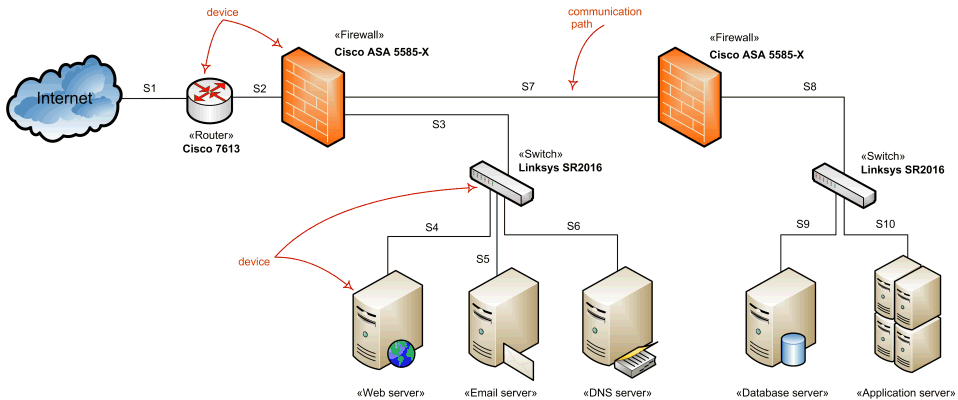
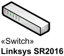
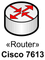
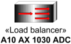
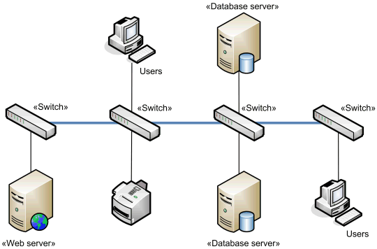

Title: Network architecture diagrams using UML - overview of graphical notation

URL Source: https://www.uml-diagrams.org/network-architecture-diagrams.html

Markdown Content:
Menu►
*   [Home](https://www.uml-diagrams.org/ "UML Graphical Notation Overview and Reference")
*   [Deployment diagrams overview](https://www.uml-diagrams.org/deployment-diagrams-overview.html "UML deployment diagrams overview")
*   [Network architecture](https://www.uml-diagrams.org/network-architecture-diagrams.html "Network architecture diagrams")
*   [Deployment notation](https://www.uml-diagrams.org/deployment-diagrams.html "UML deployment diagrams graphical notation")
*   [Artifact](https://www.uml-diagrams.org/artifact.html "UML deployment diagrams artifact")
*   [Manifestation](https://www.uml-diagrams.org/deployment-diagrams.html#manifestation "UML deployment diagrams manifestation")
*   [Deployment target](https://www.uml-diagrams.org/deployment-diagrams.html#deployment-target "UML deployment diagrams deployment target")
*   [Communication path](https://www.uml-diagrams.org/deployment-diagrams.html#communication-path "UML deployment diagrams communication path")
*   [Deployment](https://www.uml-diagrams.org/deployment-diagrams.html#deployment "UML deployment diagrams deployment")
*   [Reference](https://www.uml-diagrams.org/deployment-diagrams-reference.html "UML deployment diagrams reference")
*   [Deployment examples](https://www.uml-diagrams.org/deployment-diagrams-examples.html "UML deployment diagrams examples")
*   [UML Index](https://www.uml-diagrams.org/index-references.html "Index of UML Elements")

# Network Architecture Diagrams

**UML** standard has no separate kind of diagrams to describe **network architecture** and provides no specific elements related to the networking. [Deployment diagrams](https://www.uml-diagrams.org/deployment-diagrams-overview.html) could be used for this purpose usually with some extra networking [stereotypes](https://www.uml-diagrams.org/stereotype.html). Network architecture diagram will usually show networking [nodes](https://www.uml-diagrams.org/deployment-diagrams.html#node) and [communication paths](https://www.uml-diagrams.org/deployment-diagrams.html#communication-path) between them.

The example of the network diagram below shows network architecture with configuration called "two firewall demilitarized zone". Demilitarized zone (**DMZ**) is a host or network segment located in a "neutral zone" between the Internet and an organization’s intranet (private network). It prevents outside users from gaining direct access to an organization’s internal network while not exposing a web, email or DNS server directly to the Internet.

Network architecture diagram overview - network devices and communications.

Note that this diagram uses networking icons that are **not** part of the UML standard. UML's standard for the node or [device](https://www.uml-diagrams.org/deployment-diagrams.html#device) is a 3-dimensional view of a cube.

## Network Devices

Windows Server System Reference Architecture (WSSRA) (see **Microsoft Network Architecture Blueprint**[[MSNAB 05]](https://www.uml-diagrams.org/references.html#ref-msnab "Microsoft Network Architecture Blueprint.") ) uses the following networking devices to show the overall network architecture:

*   [Switch devices](https://www.uml-diagrams.org/network-architecture-diagrams.html#switch)
*   [Router devices](https://www.uml-diagrams.org/network-architecture-diagrams.html#router)
*   [Load balancing devices](https://www.uml-diagrams.org/network-architecture-diagrams.html#load-balancer)
*   [Firewall devices](https://www.uml-diagrams.org/network-architecture-diagrams.html#firewall)
*   Virtual Private Network (VPN) devices

None of these [devices](https://www.uml-diagrams.org/deployment-diagrams.html#device) are defined in UML standard so most of the descriptions and examples below use networking icons and descriptions provided by Microsoft as part of the blueprints.

### Hub

**Hub** is a network device that links network components such as workstations and servers at OSI layer 1 (L1). Hub contains a port for each network device and copies data received on one port to every other port whether required or not. Because of this data transmissin collisions are very likely.

If two devices connected to the hub start transmitting at the same time, a collision occurs. As a result, error frames will be copied to all devices connected to the hub. As network activity increases collisions become more frequent.

Hubs are no longer considered as network components in the Microsoft WSSRA (see **Microsoft Network Devices Blueprint**[[MSNAB 05]](https://www.uml-diagrams.org/references.html#ref-msnab "Microsoft Network Architecture Blueprint.") ) as they have largely been replaced by [switches](https://www.uml-diagrams.org/network-architecture-diagrams.html#switch).

Hubs could still be used in some cases such as networking between members of server clusters supporting the heartbeat mechanism of cluster nodes.

### Switch

**Switch** is a network device that moves network packets from one device to another at OSI layer 2. Switching devices can determine MAC addresses of the packets destination devices by monitoring network traffic. Once destination addresses are determined, switches can send specific packets to the port that connects to the network adapter with a specific MAC address. (Hubs send every packet to all the ports.)

Enterprise-level switches could have the capability to route packets at OSI layer 3 between [network segments](https://www.uml-diagrams.org/network-architecture-diagrams.html#network-segment), and thus could be used as [routers](https://www.uml-diagrams.org/network-architecture-diagrams.html#router).

Network switch.

### Router

**Router** is a network device that moves data packets from one [network segment](https://www.uml-diagrams.org/network-architecture-diagrams.html#network-segment) to another based on OSI layer 3 addresses. Routing devices are capable to exchange information with other routers on the network to determine the most efficient path from one device to another.

Network router.

### Load Balancer

**Load balancer** is a network device that facilitates **horizontal clustering**, where multiple servers are configured to perform the same function on the network. The load balancing functionality may be provided by software or a hardware device in one of two ways:

*   Distributed - each node in the cluster receives every packet destined for the cluster.
*   Routed - load balancer receives every inbound packet destined for a cluster and determines which host in the cluster to send the packet to.

Network load balancer.

### Firewall

**Firewall** is a network device that controls the flow of traffic between [network segments](https://www.uml-diagrams.org/network-architecture-diagrams.html#network-segment) using OSI layer 3 addresses in order to meet security requirements. Firewall services could be implemented by a dedicated hardware device (particularly to protect the boundary between the internal network and the Internet), or by a network host running software firewall.

Network firewall.

Firewall has set of rules that allow the device performing the firewall services role to determine which traffic is allowed to pass or, conversely, which traffic is not allowed. Most firewalls have an "implicit deny" rule so that if a rule to allow the request does not exist, then the request is denied.

## Network Segments

A **network segment** is defined as two or more devices that communicate with each other at OSI layer 2 (L2) using L2 LAN connectivity devices with no routing at L3 between them. (**Microsoft Network Architecture Blueprint**[[MSNAB 05]](https://www.uml-diagrams.org/references.html#ref-msnab "Microsoft Network Architecture Blueprint."))

Network segments may be **physical** or **logical** (**virtual**). Logical segments are referred to as **virtual local area networks (VLANs)**.

L2 LAN connectivity devices are moving data packets at OSI layer 2 between hosts or devices on the same network segment. This functionality is typically provided by a [switch](https://www.uml-diagrams.org/network-architecture-diagrams.html#switch).

L3 LAN connectivity devices are moving data packets at OSI layer 3 between multiple network segments. This functionality is typically provided by [routers](https://www.uml-diagrams.org/network-architecture-diagrams.html#router) or [load balancers](https://www.uml-diagrams.org/network-architecture-diagrams.html#load-balancer).

**Local area networks** (LANs) are created by connecting either multiple network hosts through an L2 LAN connectivity device or multiple network segments using an L3 LAN connectivity device. The wires of the L2 and L3 LAN connectivity devices are typically owned by the organization. The connectivity speeds between hosts and devices on network segments or between network segments on a LAN are typically 10 megabits per second (Mbps), 100 Mbps or 1 Gbps.

**Wide area networks** are formed by joining one or more LANs through WAN devices and technologies. The endpoint WAN connectivity devices are generally owned by the organization, but the devices in between are usually owned by telephone carriers.

### Backbone

**Backbone** is the link that connects multiple [switches](https://www.uml-diagrams.org/network-architecture-diagrams.html#switch) together.

Network backbone example.

Backbone is usually scaled to allow multiple simultaneous conversations between networked computers and servers to match the speed and number of devices on it. For example, the backbone may be sized at 1 gigabits per second (Gbps) to allow multiple 100 Mbps conversations to occur over the backbone between client computers and servers connected to the switches at 100 Mbps.

### Multihoming

**Multihoming** of servers is the use of multiple network adapters on the same server, or using multiple IP addresses on the same server (which may be used with one or multiple network adapters). Use of multiple network adapters implies the use of multiple IP addresses.

Multiple network adapters on the same device allow to separate traffic for better performance or/and for stronger security. Examples of multihoming are public [firewall](https://www.uml-diagrams.org/network-architecture-diagrams.html#firewall) with separate network interfaces for applying security rules and routing, and perimeter web server with several network interfaces to separate perimeter and internal traffic, and to allow front interface for load balancing.

  

This document describes UML versions up to **[UML 2.5](https://www.uml-diagrams.org/references.html#ref-uml-25 "UML 2.5 Specification")** and is based on the corresponding **OMG™ Unified Modeling Language™ (OMG UML®)** specifications. UML diagrams were created in **Microsoft® Visio®** 2007-2016 using **[UML 2.x Visio Stencils](http://softwarestencils.com/uml/index.html "Visio Stencil and Template for UML 2.5")**. You can send your comments and suggestions to [webmaster](mailto:webmaster@uml-diagrams.org). [Privacy policy](https://www.uml-diagrams.org/privacy-policy.html).

_Copyright © 2009-2026 uml-diagrams.org. All rights reserved. Authored by Kirill Fakhroutdinov._

[Discover Alpe d’Huez and Les 2 Alpes OnTheSnow Magazine | [Sponsored](https://popup.taboola.com/en/?template=colorbox&utm_source=uml-diagrams&utm_medium=referral&utm_content=next-up-a-delta:Next%20Up:)[Sponsored](https://popup.taboola.com/en/?template=colorbox&utm_source=uml-diagrams&utm_medium=referral&utm_content=next-up-a-delta:Next%20Up:) Read Next Story](https://www.onthesnow.com/news/alpe-dhuez-and-les-2-alpes-the-french-resorts-to-discover-this-winter "Discover Alpe d’Huez and Les 2 Alpes")
