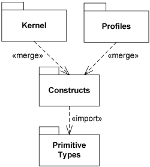

Title: UML package merge is a relationship between two packages to indicate that content of one package is extended by the contents of another package.

URL Source: https://www.uml-diagrams.org/package-merge.html

Warning: Target URL returned error 400: Bad Request

Markdown Content:
Menu►
*   [UML diagrams](https://www.uml-diagrams.org/ "UML graphical notation overview, examples, and reference.")
*   [Package diagrams overview](https://www.uml-diagrams.org/package-diagrams-overview.html "UML package diagrams overview")
*   [Package](https://www.uml-diagrams.org/package-diagrams.html#package "UML package diagrams notation - Package")
*   [Package template](https://www.uml-diagrams.org/package-diagrams.html#package-template "UML package diagrams notation - Package template")
*   [Packageable element](https://www.uml-diagrams.org/package-diagrams.html#packageable-element "UML package diagrams notation - packageable element")
*   [Element import](https://www.uml-diagrams.org/element-import.html "UML package diagrams notation - element import")
*   [Package import](https://www.uml-diagrams.org/package-import.html "UML package diagrams notation - package import")
*   [Package merge](https://www.uml-diagrams.org/package-merge.html "UML package diagrams notation - package merge")
*   [Model](https://www.uml-diagrams.org/package-diagrams/model.html "UML package diagrams notation - model")
*   [Package diagrams reference](https://www.uml-diagrams.org/package-diagrams-reference.html "UML Package Diagrams Reference")
*   [Package diagrams examples](https://www.uml-diagrams.org/package-diagrams-examples.html "UML Package Diagrams Examples")
*   [UML Index](https://www.uml-diagrams.org/index-references.html "Index of UML Elements")

# UML Package Merge

A **package merge** is a [directed relationship](https://www.uml-diagrams.org/uml-core.html#directed-relationship) between two packages that indicates that content of one package is extended by the contents of another package.

Package merge is similar to [generalization](https://www.uml-diagrams.org/generalization.html) in the sense that the source element conceptually adds the characteristics of the target element to its own characteristics resulting in an element that combines the characteristics of both.

Package merge can be viewed as an operation that takes the contents of two packages and produces a new package that combines the contents of the packages involved in the merge.

This mechanism should be used when elements defined in different packages have the **same name** and are intended to represent the **same concept**. Most often it is used to provide different definitions of a given concept for different purposes, starting from a common base definition.

A given base concept is extended in increments, with each increment defined in a separate merged package. By selecting which increments to merge, it is possible to obtain a custom definition of a concept for a specific end.

Package merge is particularly useful in **meta-modeling** and is extensively used in the definition of the UML metamodel.

**Package merge** is shown using a dashed line with an open arrowhead pointing from the receiving package to the merged package. Keyword «merge» is shown near the dashed line.

Kernel and Profile packages merge Constructs package  
 which imports Primitive Types.

[Model](https://www.uml-diagrams.org/package-diagrams/model.html "Package diagram model")

This document describes UML versions up to **[UML 2.5](https://www.uml-diagrams.org/references.html#ref-uml-25 "UML 2.5 Specification")** and is based on the corresponding **OMG™ Unified Modeling Language™ (OMG UML®)** specifications. UML diagrams were created in **Microsoft® Visio®** 2007-2016 using **[UML 2.x Visio Stencils](http://softwarestencils.com/uml/index.html "Visio Stencil and Template for UML 2.5")**. You can send your comments and suggestions to [webmaster](mailto:webmaster@uml-diagrams.org). [Privacy policy](https://www.uml-diagrams.org/privacy-policy.html).

_Copyright © 2009-2026 uml-diagrams.org. All rights reserved. Authored by Kirill Fakhroutdinov._

[Inside the 7-Minute Miracle at Tokyo Station wovana | [Sponsored](https://popup.taboola.com/en/?template=colorbox&utm_source=uml-diagrams&utm_medium=referral&utm_content=next-up-a-delta:Next%20Up:)[Sponsored](https://popup.taboola.com/en/?template=colorbox&utm_source=uml-diagrams&utm_medium=referral&utm_content=next-up-a-delta:Next%20Up:) Read Next Story](https://kitchen-gardens.info/story/shinkansen-seven-minute-cleaning-crew "Inside the 7-Minute Miracle at Tokyo Station")
