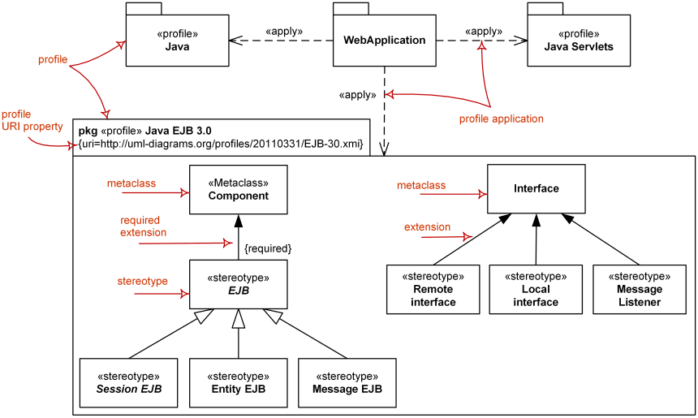

Title: UML profile diagram is a structure diagram which describes UML extension mechanism by defining custom stereotypes, tagged values and constraints.

URL Source: https://www.uml-diagrams.org/profile-diagrams.html

Warning: Target URL returned error 400: Bad Request

Markdown Content:
Menu►
*   [UML diagrams](https://www.uml-diagrams.org/ "UML graphical notation overview, examples, and reference.")
*   [Profile diagrams](https://www.uml-diagrams.org/profile-diagrams.html "UML profile diagrams overview of graphical notation")
*   [Profile](https://www.uml-diagrams.org/profile.html "UML profile")
*   [Stereotype](https://www.uml-diagrams.org/stereotype.html "UML stereotype")
*   [Metaclass](https://www.uml-diagrams.org/profile-metaclass.html "UML profile metaclass")
*   [Extension](https://www.uml-diagrams.org/profile-extension.html "UML profile extension")
*   [Reference](https://www.uml-diagrams.org/profile-reference.html "UML profile reference")
*   [Application](https://www.uml-diagrams.org/profile-application.html "UML profile application")
*   [Profiles reference](https://www.uml-diagrams.org/profile-diagrams-reference.html "UML profile diagrams reference")
*   [Profile diagrams examples](https://www.uml-diagrams.org/profile-diagrams-examples.html "UML profile diagrams examples")
*   [UML meta modeling](https://www.uml-diagrams.org/uml-meta-models.html "UML meta models and profiles")
*   [UML index](https://www.uml-diagrams.org/index-references.html "Index of UML Elements")

# UML Profile Diagrams

**Profile diagram** is [structure diagram](https://www.uml-diagrams.org/uml-25-diagrams.html#structure-diagram) which describes **lightweight extension mechanism** to the UML by defining custom [stereotypes](https://www.uml-diagrams.org/stereotype.html), [tagged values](https://www.uml-diagrams.org/stereotype.html#tagged-value), and constraints. Profiles allow adaptation of the UML metamodel for different:

*   _platforms_, such as Java Platform, Enterprise Edition (Java EE) or Microsoft .NET Framework, or
*   _domains_, such business process modeling, service-oriented architecture, medical applications, etc.

For example, semantics of standard UML metamodel elements could be specialized in a profile. In a model with the profile "Java model," generalization of classes should be able to be restricted to single inheritance without having to explicitly assign a stereotype «Java class» to each and every class instance.

The profiles mechanism is not a first-class extension mechanism. It does not allow to modify existing metamodels or to create a new metamodel as MOF does. Profile only allows adaptation or customization of an existing metamodel with constructs that are specific to a particular domain, platform, or method. It is not possible to take away any of the constraints that apply to a metamodel, but it is possible to **add new constraints** that are specific to the profile.

Metamodel customizations are defined in a profile, which is then applied to a package. [Stereotypes](https://www.uml-diagrams.org/stereotype.html) are specific metaclasses, [tagged values](https://www.uml-diagrams.org/stereotype.html#tagged-value) are standard metaattributes, and **profiles** are specific kinds of packages.

Profiles can be dynamically applied to or retracted from a model. They can also be dynamically combined so that several profiles will be applied at the same time on the same model.

Graphical nodes and edges used on profile diagrams are: [profile](https://www.uml-diagrams.org/profile.html), [metaclass](https://www.uml-diagrams.org/profile-metaclass.html), [stereotype](https://www.uml-diagrams.org/stereotype.html), [extension](https://www.uml-diagrams.org/profile-extension.html), [reference](https://www.uml-diagrams.org/profile-reference.html), [profile application](https://www.uml-diagrams.org/profile-application.html).

Major elements of UML profile diagram - [profile](https://www.uml-diagrams.org/profile.html), [stereotype](https://www.uml-diagrams.org/stereotype.html), [metaclass](https://www.uml-diagrams.org/profile-metaclass.html), [extension](https://www.uml-diagrams.org/profile-extension.html), [profile application](https://www.uml-diagrams.org/profile-application.html).

#### Revisions

Profiles were present in UML 1.x. Profile diagrams were introduced in **UML 2.0** but first appeared on "official" taxonomy of UML diagrams in **UML 2.2** ([[UML 2.2 - Superstructure]](https://www.uml-diagrams.org/references.html#ref-uml-22-super "UML 2.2 - Superstructure"), Figure A.5).

  

This document describes UML versions up to **[UML 2.5](https://www.uml-diagrams.org/references.html#ref-uml-25 "UML 2.5 Specification")** and is based on the corresponding **OMG™ Unified Modeling Language™ (OMG UML®)** specifications. UML diagrams were created in **Microsoft® Visio®** 2007-2016 using **[UML 2.x Visio Stencils](http://softwarestencils.com/uml/index.html "Visio Stencil and Template for UML 2.5")**. You can send your comments and suggestions to [webmaster](mailto:webmaster@uml-diagrams.org). [Privacy policy](https://www.uml-diagrams.org/privacy-policy.html).

_Copyright © 2009-2026 uml-diagrams.org. All rights reserved. Authored by Kirill Fakhroutdinov._

[How to Protect Your Bone Health During Weight Loss GoodRx | [Sponsored](https://popup.taboola.com/en/?template=colorbox&utm_source=uml-diagrams&utm_medium=referral&utm_content=next-up-a-delta:Next%20Up:)[Sponsored](https://popup.taboola.com/en/?template=colorbox&utm_source=uml-diagrams&utm_medium=referral&utm_content=next-up-a-delta:Next%20Up:) Read Next Story](https://www.goodrx.com/conditions/weight-loss/bone-mass-decrease-with-weight-loss "How to Protect Your Bone Health During Weight Loss")
