Title: UML stereotype is a profile class which defines how an existing metaclass may be extended as part of a profile.

URL Source: https://www.uml-diagrams.org/stereotype.html

Warning: Target URL returned error 400: Bad Request

Markdown Content:
Menu►
*   [UML diagrams](https://www.uml-diagrams.org/ "UML graphical notation overview, examples, and reference.")
*   [Profile diagrams](https://www.uml-diagrams.org/profile-diagrams.html "UML profile diagrams overview of graphical notation")
*   [Profile](https://www.uml-diagrams.org/profile.html "UML profile")
*   [Stereotype](https://www.uml-diagrams.org/stereotype.html "UML stereotype")
*   [Metaclass](https://www.uml-diagrams.org/profile-metaclass.html "UML profile metaclass")
*   [Extension](https://www.uml-diagrams.org/profile-extension.html "UML profile extension")
*   [Reference](https://www.uml-diagrams.org/profile-reference.html "UML profile reference")
*   [Application](https://www.uml-diagrams.org/profile-application.html "UML profile application")
*   [Profiles reference](https://www.uml-diagrams.org/profile-diagrams-reference.html "UML profile diagrams reference")
*   [Profile diagrams examples](https://www.uml-diagrams.org/profile-diagrams-examples.html "UML profile diagrams examples")
*   [UML meta modeling](https://www.uml-diagrams.org/uml-meta-models.html "UML meta models and profiles")
*   [UML index](https://www.uml-diagrams.org/index-references.html "Index of UML Elements")

# UML Stereotype

**Stereotype** is a **profile class** which defines how an existing [metaclass](https://www.uml-diagrams.org/profile-metaclass.html) may be [extended](https://www.uml-diagrams.org/profile-extension.html) as part of a profile. It enables the use of a platform or domain specific terminology or notation in place of, or in addition to, the ones used for the extended metaclass.

A stereotype cannot be used by itself, but must always be used with one of the metaclasses it [extends](https://www.uml-diagrams.org/profile-extension.html). Stereotype cannot be extended by another stereotype.

A stereotype uses the same notation as a class, with the keyword **«stereotype»** shown before or above the name of the stereotype. Stereotype names should not clash with keyword names for the extended model element.

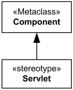
Servlet Stereotype extends Component.

Stereotype can change the graphical appearance of the extended model element by using attached icons represented by the **Image** profile class.

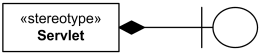
Stereotype Servlet with attached custom icon.

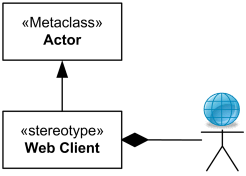
Actor is extended by stereotype Web Client with attached custom icon.

Because stereotype is a class, it may have [properties](https://www.uml-diagrams.org/property.html). Properties of a stereotype are referred to as [tag definitions](https://www.uml-diagrams.org/stereotype.html#tag-definition). When a stereotype is applied to a model element, the values of the properties are referred to as [tagged values](https://www.uml-diagrams.org/stereotype.html#tagged-value).

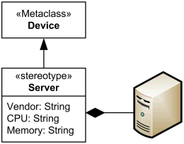
Device extended by Server stereotype with tag definitions and custom icon.

## Stereotype Application

Profile diagram is used to show **definition** of stereotype. Stereotype is [applied](https://www.uml-diagrams.org/profile-application.html) when it is used on use case diagrams, class diagrams, deployment diagrams, etc.

When a stereotype is **applied** to a model element, an instance of the stereotype is linked to an instance of the metaclass. The name of the applied stereotype is shown within a pair of guillemets above or before the name of the model element.

UML versions before 2.4 required the first letter of the name of the applied stereotype to be in **lower case** (e.g. «servlet»). Starting from UML 2.4, the first letter should normally be in **upper case**. Naming stereotype applications with lower-case letters where the stereotypes themselves are defined using upper-case first letter is still valid but is considered obsolete.

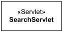
Stereotype «Servlet» applied to  
 the model element SearchServlet

If multiple stereotypes are applied to the same element, the names of the applied stereotypes are shown as a comma-separated list within a pair of guillemets.

When the extended model element has a keyword, then the stereotype name could be displayed close to the keyword, within separate guillemets (example: «device» «server»).

When a stereotype includes the definition of an icon, this icon can be graphically attached to the model elements extended by the stereotype. Every model element that has a graphical presentation can have an attached icon. When a model element is extended by one single stereotype the icon can be presented in a reduced shape, inside and on top of the box representing the model element.

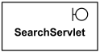
Servlet stereotype applied to the class SearchServlet.

When stereotype is applied, the whole classifier box can be replaced by enlarged icon of the stereotype.

Servlet stereotype applied to the class SearchServlet.

Some model elements are already using an icon for their default presentation. A typical example of this is the [actor](https://www.uml-diagrams.org/use-case-actor.html) model element, which uses the "stickman" icon. In that case, when a model element is extended by a stereotype with an icon, the stereotype’s icon **replaces the default presentation icon** within diagrams.

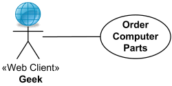
«Web Client» stereotype applied to the Geek [actor](https://www.uml-diagrams.org/use-case-actor.html).

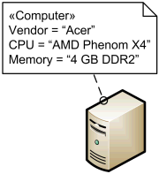
Computer stereotype with tags applied to [Device](https://www.uml-diagrams.org/deployment-diagrams.html#device) class.

## Stereotype Relationships

A stereotype must always be used in conjunction with one of the [metaclasses](https://www.uml-diagrams.org/profile-metaclass.html) it [extends](https://www.uml-diagrams.org/profile-extension.html). A metaclass may be [extended](https://www.uml-diagrams.org/profile-extension.html) by one or more stereotypes. Each stereotype may extend one or more metaclasses.

Stereotypes can participate in [binary association](https://www.uml-diagrams.org/association.html#binary-association). The opposite class can be another stereotype, a non-stereotype class owned by a [profile](https://www.uml-diagrams.org/profile.html) or a [metaclass](https://www.uml-diagrams.org/profile-metaclass.html). The stereotype must own property at the association end to be able to navigate to the opposite class. If the opposite end is not a stereotype, the opposite property must be owned by the association itself.

A stereotype may [generalize](https://www.uml-diagrams.org/generalization.html) or specialize only another stereotype.

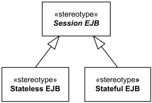
Abstract stereotype Session EJB is specialized by  
 stereotypes Stateless EJB and Stateful EJB.

## Tag Definition

[Properties](https://www.uml-diagrams.org/property.html) of a stereotype are referred to as **tag definitions** (or **metaproperties**).

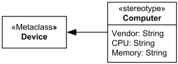
Stereotype Computer with tag definitions for vendor, CPU, and memory

### Tagged Value

Stereotype is [applied](https://www.uml-diagrams.org/profile-application.html) when it is used on use case diagrams, class diagrams, deployment diagrams, etc.

When a stereotype is applied to a model element, the values of its properties may be referred to as [tagged values](https://www.uml-diagrams.org/stereotype.html#tagged-value).

**UML 1.x** defined **tagged value** as one of UML extensibility mechanisms permitting arbitrary information (which could not be expressed by UML) to be attached to models. Tagged value is a keyword-value pair that may be attached to any kind of model [element](https://www.uml-diagrams.org/uml-core.html#element).

The keyword is called a **tag**. Each tag represents a particular kind of property applicable to one or many kinds of model elements. Both the tag and the value are usually encoded as strings though UML tool allow to use other data types for values.

**Tagged value** specification in **UML 1.x** has the form  
name = value  
 where name is the name of a tag or metamodel attribute and value is an arbitrary string that denotes its value. For example,  
{author="Joe Smith", deadline=31-March-1997, status=analysis}

Boolean tags frequently have the form **isQuality**, where quality is some condition that may be **true** or **false**. In these cases, the form "quality" may usually appear by itself, without a value and defaulting to **true**. For example, **{abstract}** is the same as **{isAbstract=true}**. To specify a value of **false**, omit the name completely. Tags of other types require explicit values.

Tagged value (as well as metamodel attribute) is displayed as a comma delimited sequence of properties inside a pair of curly braces "{" and "}".

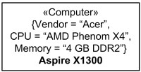
Stereotype Computer applied  
 using "traditional" tag values notation.

In **UML 1.3** tagged values could extend a model element without requiring the presence of a stereotype. In **UML 1.4**, this capability, although still supported, was **deprecated**, to be used only for backward compatibility reasons.

Since **UML 2.0**, a tagged value can only be represented as an [attribute](https://www.uml-diagrams.org/property.html#classifier-attribute) defined on a stereotype. Therefore, a model element must be extended by a stereotype in order to be extended by tagged values. To support compatibility with the UML 1.3 some UML tools can automatically define a stereotype to which "unattached" attributes (tagged values) will be attached.

Tag values could be shown in class **compartment** under stereotype name. An additional compartment is required for each applied stereotype whose values are to be displayed. Each such compartment is headed by the name of the applied stereotype in guillemets.

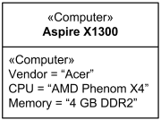
Stereotype Computer applied with tag values in compartment

Tag values could be shown in attached [comment](https://www.uml-diagrams.org/uml-core.html#comment) under stereotype name.

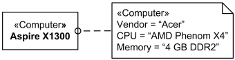
Stereotype Computer applied with tag values in comment note

When displayed in compartments or in a comment symbol, each name-value pair should appear on a separate line.

This document describes UML versions up to **[UML 2.5](https://www.uml-diagrams.org/references.html#ref-uml-25 "UML 2.5 Specification")** and is based on the corresponding **OMG™ Unified Modeling Language™ (OMG UML®)** specifications. UML diagrams were created in **Microsoft® Visio®** 2007-2016 using **[UML 2.x Visio Stencils](http://softwarestencils.com/uml/index.html "Visio Stencil and Template for UML 2.5")**. You can send your comments and suggestions to [webmaster](mailto:webmaster@uml-diagrams.org). [Privacy policy](https://www.uml-diagrams.org/privacy-policy.html).

_Copyright © 2009-2026 uml-diagrams.org. All rights reserved. Authored by Kirill Fakhroutdinov._

[10 Cancer Causing Foods That You'd Better Quit Little Fries | [Sponsored](https://popup.taboola.com/en/?template=colorbox&utm_source=uml-diagrams&utm_medium=referral&utm_content=next-up-a-delta:Next%20Up:)[Sponsored](https://popup.taboola.com/en/?template=colorbox&utm_source=uml-diagrams&utm_medium=referral&utm_content=next-up-a-delta:Next%20Up:) Read Next Story](https://www.littlefries.com/shield-your-health-beware-of-these-10-cancer-causing-foods "10 Cancer Causing Foods That You'd Better Quit")
