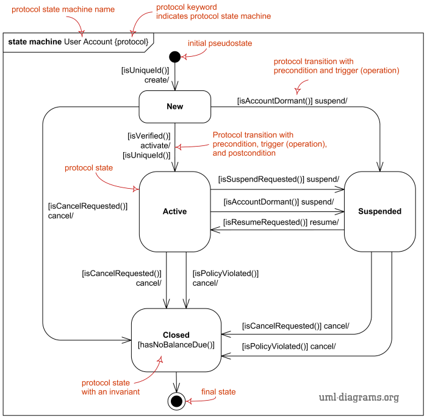
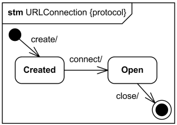
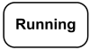
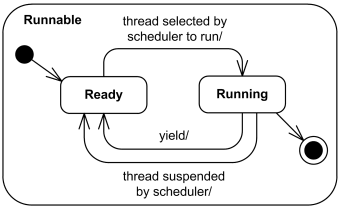
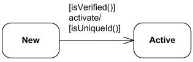

Title: UML Protocol State Machine Diagrams

URL Source: https://www.uml-diagrams.org/protocol-state-machine-diagrams.html

Warning: Target URL returned error 400: Bad Request

Markdown Content:
Menu►
*   [UML diagrams](https://www.uml-diagrams.org/ "UML graphical notation overview, examples, and reference.")
*   [State machine diagrams](https://www.uml-diagrams.org/state-machine-diagrams.html "UML state machine diagrams - overview of graphical notation")
*   [Protocol state machines](https://www.uml-diagrams.org/protocol-state-machine-diagrams.html "UML protocol state machine diagrams - overview of graphical notation")
*   [Reference](https://www.uml-diagrams.org/state-machine-diagrams-reference.html "UML state machine diagrams reference")
*   [State machine examples](https://www.uml-diagrams.org/state-machine-diagrams-examples.html "Examples of UML state machine diagrams")
*   [UML Index](https://www.uml-diagrams.org/index-references.html "Index of UML Elements")

# UML Protocol State Machine Diagrams

UML protocol state machine diagrams are used to express a **usage protocol** or a **lifecycle** of some [classifier](https://www.uml-diagrams.org/classifier.html). It shows which operations of the classifier may be called in each state of the classifier, under which specific conditions, and satisfying some optional postconditions after the classifier transitions to a target state.

Because these diagrams show lifecycle, they are useful to show different stable states of a class of objects which could exist for some time, and to explain how objects could change their states over the time. For example, we can show how User Account could be created, activated, suspended, and cancelled.

Major elements of the protocol state machine diagram are [protocol state](https://www.uml-diagrams.org/protocol-state-machine-diagrams.html#protocol-state), [protocol transition](https://www.uml-diagrams.org/protocol-state-machine-diagrams.html#protocol-transition), and different [pseudostates](https://www.uml-diagrams.org/state-machine-diagrams.html#pseudostate), as shown on the overview diagram below.

Protocol state machine diagram overview.

Protocol state machine diagram is virtually synonym of the [protocol state machine](https://www.uml-diagrams.org/protocol-state-machine-diagrams.html#protocol-state-machine) as one diagram usually shows one protocol machine.

## Protocol State Machine

**Protocol state machine** is a specialization of [behavioral state machine](https://www.uml-diagrams.org/state-machine-diagrams.html#behavioral-state-machine) and is used to express **usage protocol** or **lifecycle** of a [classifier](https://www.uml-diagrams.org/classifier.html). It specifies which operations of the classifier can be called in which state and under which condition, thus specifying the allowed call sequences on the classifier’s operations. Protocol state machines express the legal transitions that a classifier can trigger.

Protocol state machine is always defined in the **context** of a classifier. A classifier may have several protocol state machines.

All transitions of a protocol state machine must be [protocol transitions](https://www.uml-diagrams.org/protocol-state-machine-diagrams.html#protocol-transition).

The notation for protocol state machine is similar to the one of behavioral state machines. The keyword **{protocol}** is placed close to the name of the state machine to differentiate protocol state machine diagrams.

Protocol state machine for URLConnection class

## Protocol State

The states of a protocol state machine (protocol states) present an **external view** of the class that is exposed to its clients. Depending on the context, protocol states can correspond to the internal states of the instances as expressed by behavioral state machines, or they can be different.

The states of protocol state machines are exposed to the users of their context classifiers. A protocol state represents an exposed stable situation of its context classifier: When an instance of the classifier is not processing any operation, users of this instance can always know its state configuration.

Simple protocol state **Running**.

States of a protocol state machine cannot have entry, exit, or do activity actions. Protocol state machines also cannot have deep or shallow history pseudostates.

Protocol state machines can have [submachine states](https://www.uml-diagrams.org/state-machine-diagrams.html#submachine-state), [composite states](https://www.uml-diagrams.org/state-machine-diagrams.html#composite-state), and concurrent regions.

Simple composite protocol state **Runnable**.

For example, concurrent regions make it possible to express protocol where an instance can have several active states simultaneously. Substate machines and compound transitions are used as in behavioral state machines for factorizing complex protocol state machines.

## Protocol Transition

A **protocol transition** is specialization of [(behavioral) transition](https://www.uml-diagrams.org/state-machine-diagrams.html#behavioral-transition) used for the protocol state machines which specifies a legal transition for an [operation](https://www.uml-diagrams.org/operation.html). Protocol transition has the following [features](https://www.uml-diagrams.org/uml-core.html#feature): a pre-condition (guard), [trigger](https://www.uml-diagrams.org/common-behaviors.html#trigger), and a post-condition.

Protocol transition is usually associated with some operation that belongs to the context classifier of the protocol state machine. The protocol transition specifies that the associated (referred) operation can be called for an instance in the origin state under the initial condition (guard), and that at the end of the transition, the destination state will be reached with the post condition satisfied.

Compound transitions can also be used for protocol state machines.

Protocol transition is rendered as a transition arrow from the source [vertex](https://www.uml-diagrams.org/state-machine-diagrams.html#vertex) to the target vertex, with optional text describing transition.

Protocol transition from New to the Active state  
 with pre-condition (guard), trigger, and a post-condition.

The textual notation for a protocol transition is described by the following syntax rules (note, there are no syntax rules for protocol transition in UML 2.5 specification, so I made those up):

protocol-transition ::= [pre-condition][trigger](https://www.uml-diagrams.org/common-behaviors.html#trigger-syntax)'/' [post-condition]  
pre-condition::= '['[constraint](https://www.uml-diagrams.org/constraint.html#constraint-syntax)']'   
post-condition::= '['[constraint](https://www.uml-diagrams.org/constraint.html#constraint-syntax)']'

Note, that though UML 2.5 specification says that "the usual StateMachine notation applies", and it is rather jocose statement as protocol transition syntax (shown above) is quite different from the [behavioral transition syntax](https://www.uml-diagrams.org/state-machine-diagrams.html#transition-syntax).

The guard of the [behavioral transitions](https://www.uml-diagrams.org/state-machine-diagrams.html#transition-syntax) for the protocol transitions is named pre-condition, and is placed **before** the trigger. Post-condition was added to protocol transitions and appear **after** the trigger. Protocol transitions have no behavior-expression. It is not clear whether trigger is optional for protocol transitions as it is for behavioral transitions. Both protocol transition syntax and examples show '/' after the trigger, which is different from behavioral transitions, where '/' is the token placed before behavior-expression. Everything else is "the usual StateMachine notation". :o)

  

This document describes **UML 2.5** and is based on **OMG™ Unified Modeling Language™ (OMG UML®) 2.5** specification [[UML 2.5 FTF - Beta 1]](https://www.uml-diagrams.org/references.html#ref-uml-25-b1 "UML 2.5 Specification FTF Beta 1"). All UML diagrams were created in **Microsoft Visio** 2007-2016 using [UML 2.2 stencils](http://softwarestencils.com/uml/index.html "Visio Stencil and Template for UML 2.2"). You can send your comments and suggestions to [webmaster](mailto:webmaster@uml-diagrams.org). [Privacy policy](https://www.uml-diagrams.org/privacy-policy.html).

_Copyright © 2009-2026 uml-diagrams.org. All rights reserved. Authored by Kirill Fakhroutdinov._

[How NF1 Command Center Unifies Whole Teams NF1 (NeuroForce One) | [Sponsored](https://popup.taboola.com/en/?template=colorbox&utm_source=uml-diagrams&utm_medium=referral&utm_content=next-up-a-delta:Next%20Up:)[Sponsored](https://popup.taboola.com/en/?template=colorbox&utm_source=uml-diagrams&utm_medium=referral&utm_content=next-up-a-delta:Next%20Up:) Read Next Story](https://commandcenter.neuroforceone.com/ "How NF1 Command Center Unifies Whole Teams")
