Title: UML sequence diagrams overview of graphical notation

URL Source: https://www.uml-diagrams.org/sequence-diagrams.html

Markdown Content:
Menu►
*   [UML Diagrams](https://www.uml-diagrams.org/ "UML Diagrams - overview, reference, and examples.")
*   [Sequence diagrams](https://www.uml-diagrams.org/sequence-diagrams.html "UML sequence diagrams - overview of graphical notation.")
*   [Interaction](https://www.uml-diagrams.org/interaction.html "UML interaction.")
*   [Message](https://www.uml-diagrams.org/interaction-message.html "UML interaction message.")
*   [Combined fragment](https://www.uml-diagrams.org/sequence-diagrams-combined-fragment.html "UML sequence diagram combined fragment.")
*   [Reference](https://www.uml-diagrams.org/sequence-diagrams-reference.html "UML sequence diagrams graphical notation reference.")
*   [Examples](https://www.uml-diagrams.org/sequence-diagrams-examples.html "UML sequence diagrams examples.")
*   [Sequence Diagrams Q&As](https://www.uml-diagrams.org/sequence-diagrams-questions-answers.html "UML sequence diagrams questions and answers.")
*   [UML Index](https://www.uml-diagrams.org/index-references.html "Index of UML elements")

# UML Sequence Diagrams

**Sequence diagram** is the most common kind of [interaction diagram](https://www.uml-diagrams.org/uml-25-diagrams.html#interaction-diagram), which focuses on the [message](https://www.uml-diagrams.org/interaction-message.html) interchange between a number of [lifelines](https://www.uml-diagrams.org/sequence-diagrams.html#lifeline).

Sequence diagram describes an interaction by focusing on the sequence of messages that are exchanged, along with their corresponding occurrence specifications on the lifelines.

The following nodes and edges are typically drawn in a **UML****sequence diagram**: [lifeline](https://www.uml-diagrams.org/sequence-diagrams.html#lifeline), [execution specification](https://www.uml-diagrams.org/sequence-diagrams.html#execution), [message](https://www.uml-diagrams.org/interaction-message.html), [combined fragment](https://www.uml-diagrams.org/sequence-diagrams-combined-fragment.html), [interaction use](https://www.uml-diagrams.org/sequence-diagrams.html#interaction-use), [state invariant](https://www.uml-diagrams.org/sequence-diagrams.html#state-invariant), **continuation**, [destruction occurrence](https://www.uml-diagrams.org/sequence-diagrams.html#destruction-occurrence-seq).

Major elements of the sequence diagram are shown on the picture below.

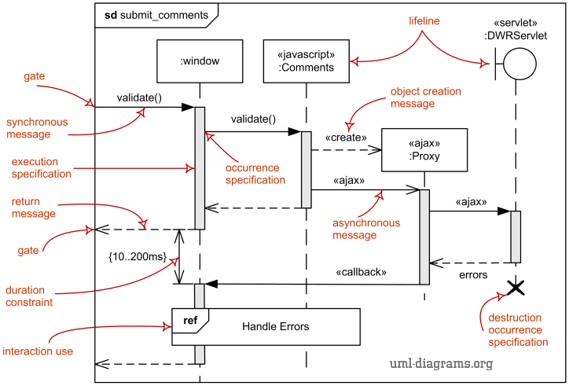
Major elements of UML sequence diagram.

You can find some [sequence diagram examples](https://www.uml-diagrams.org/sequence-diagrams-examples.html) here:

*   [Online Bookshop](https://www.uml-diagrams.org/online-shopping-uml-sequence-diagram-example.html?context=seq-examples)
*   [Submit Comments to Pluck using DWR, AJAX, JSON](https://www.uml-diagrams.org/pluck-comments-uml-sequence-diagram-example.html)
*   [Facebook User Authentication in a Web Application](https://www.uml-diagrams.org/facebook-authentication-uml-sequence-diagram-example.html)
*   [Spring and Hibernate transaction management](https://www.uml-diagrams.org/examples/spring-hibernate-transaction-sequence-diagram-example.html?context=seq-examples)

## Lifeline

**Lifeline** is a [named element](https://www.uml-diagrams.org/uml-core.html#named-element) which represents an **individual participant** in the interaction. While [parts](https://www.uml-diagrams.org/composite-structure-diagrams/part.html) and structural features may have multiplicity greater than 1, lifelines represent **only one** interacting entity.

If the referenced connectable element is multivalued (i.e, has a multiplicity > 1), then the lifeline may have an expression (**selector**) that specifies which particular part is represented by this lifeline. If the selector is omitted, this means that an **arbitrary representative** of the multivalued connectable element is chosen.

A lifeline is shown using a symbol that consists of a rectangle forming its "head" followed by a vertical line (which may be dashed) that represents the lifetime of the participant.

Information identifying the lifeline is displayed inside the rectangle in the following format (slightly modified from what's in UML 2.4 standard):

lifeline-ident ::= [ connectable-element-name ['[' selector ']']]  [ ':' class-name ][ decomposition ] | '**self**'   
selector ::= expression  
decomposition ::= '**ref**' interaction-ident [ '**strict**' ]

where class-name is the type referenced by the represented connectable element. Note that although the syntax allows it, lifeline-ident cannot be empty.

The lifeline head has a shape that is based on the [classifier](https://www.uml-diagrams.org/classifier.html) for the part that this lifeline represents. Usually the head is a white rectangle containing name of class.

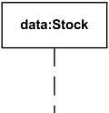
**Lifeline** "data" of class Stock

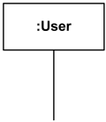
Anonymous lifeline of class User

![Image 4: Lifeline x selected with [k] of class X.](images/sequence-lifeline-selector.png)
**Lifeline** "x" of class X is selected with **selector** [k]

If the name is the keyword **self**, then the lifeline represents the object of the classifier that encloses the Interaction that **owns** the Lifeline. **Ports** of the encloser may be shown separately even when self is included.

## Gate

A **gate** is a **message end**, connection point for relating a [message](https://www.uml-diagrams.org/interaction-message.html) outside of an [interaction fragment](https://www.uml-diagrams.org/sequence-diagrams.html#interaction-fragment) with a message inside the interaction fragment.

The purpose of gates and messages between gates is to specify the concrete sender and receiver for every message. Gates play different roles:

*   **formal gates** - on interactions
*   **actual gates** - on [interaction uses](https://www.uml-diagrams.org/sequence-diagrams.html#interaction-use)
*   **expression gates** - on [combined fragment](https://www.uml-diagrams.org/sequence-diagrams-combined-fragment.html)

The gates are named implicitly or explicitly. Implicit gate name is constructed by concatenating the direction of the message ("in" or "out") and the message name, e.g. in_search, out_read.

Gates are notated just as message connection points on the frame.

## Interaction Fragment

**Interaction fragment** is a [named element](https://www.uml-diagrams.org/uml-core.html#named-element) representing the most general interaction unit. Each interaction fragment is conceptually like an interaction by itself.

There is no general notation for an interaction fragment. Its subclasses define their own notation.

Examples of **interaction fragments** are:

*   [occurrence](https://www.uml-diagrams.org/sequence-diagrams.html#occurrence)
*   [execution](https://www.uml-diagrams.org/sequence-diagrams.html#execution)
*   [state invariant](https://www.uml-diagrams.org/sequence-diagrams.html#state-invariant)
*   [combined fragment](https://www.uml-diagrams.org/sequence-diagrams-combined-fragment.html)
*   [interaction use](https://www.uml-diagrams.org/sequence-diagrams.html#interaction-use)

## Occurrence

**Occurrence** (complete UML name - **occurrence specification**, i.e. "event description") is [interaction fragment](https://www.uml-diagrams.org/sequence-diagrams.html#interaction-fragment) which represents a moment in time (event) at the beginning or end of a [message](https://www.uml-diagrams.org/interaction-message.html) or at the beginning or end of an [execution](https://www.uml-diagrams.org/sequence-diagrams.html#execution).

An occurrence specification is one of the basic semantic units of interactions. The meanings of interactions are specified by sequences of occurrences described by occurrence specifications.

Each occurrence specification appears on exactly one [lifeline](https://www.uml-diagrams.org/sequence-diagrams.html#lifeline). Occurrence specifications of a lifeline are ordered along the lifeline.

Occurrence specification has no notation and is just a point at the beginning or end of a message or at the beginning or end of an execution specification.

Examples of **occurrences** are:

*   [message occurrence](https://www.uml-diagrams.org/sequence-diagrams.html#message-occurrence)
*   [execution occurrence](https://www.uml-diagrams.org/sequence-diagrams.html#execution-occurrence)

### Message Occurrence

**Message occurrence** (complete UML name - **message occurrence specification**) is an [occurrence](https://www.uml-diagrams.org/sequence-diagrams.html#occurrence) which represents such events as sending and receiving of signals or invoking or receiving of operation calls.

#### Destruction Occurrence

**Destruction occurrence** is a [message occurrence](https://www.uml-diagrams.org/sequence-diagrams.html#message-occurrence) which represents the destruction of the instance described by the [lifeline](https://www.uml-diagrams.org/sequence-diagrams.html#lifeline). It may result in the subsequent destruction of other objects that this object owns by [composition](https://www.uml-diagrams.org/composition.html). No other occurrence may appear below the destruction event on a given lifeline.

Complete UML name of the occurrence is **destruction occurrence specification**. Until UML 2.4 it was called **destruction event**, and earlier - **stop**.

The destruction of instance is depicted by a cross in the form of an **X** at the bottom of a lifeline.

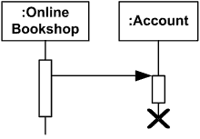
Account lifeline is terminated

### Execution Occurrence

**Execution occurrence** (complete UML name - **execution occurrence specification**) is an [occurrence](https://www.uml-diagrams.org/sequence-diagrams.html#occurrence) which represents moments in time at which actions or behaviors start or finish.

Execution occurrence references exactly one [execution specification](https://www.uml-diagrams.org/sequence-diagrams.html#execution) which describes the execution that is started or finished at this execution occurrence.

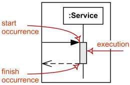
Duration of an execution is represented  
 by two execution occurrences - start and finish.

## Execution

**Execution** (full name - **execution specification**, informally called **activation**) is [interaction fragment](https://www.uml-diagrams.org/sequence-diagrams.html#interaction-fragment) which represents a period in the participant's lifetime when it is

*   executing a unit of behavior or action within the [lifeline](https://www.uml-diagrams.org/sequence-diagrams.html#lifeline),
*   sending a signal to another participant,
*   waiting for a reply message from another participant.

Note, that the **execution specification** includes the cases when behavior is not active, but just waiting for reply. The **duration** of an execution is represented by two [execution occurrences](https://www.uml-diagrams.org/sequence-diagrams.html#execution-occurrence) - the **start** occurrence and the **finish** occurrence.

**Execution** is represented as a thin grey or white rectangle on the lifeline.

**Execution specification** shown as grey rectangle on the Service lifeline.

**Execution specification** can be represented by a wider labeled rectangle, where the label usually identifies the action that was executed.

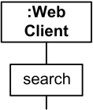
**Execution Specification** represented as wider rectangle labeled as action.

For execution specifications that refer to **atomic actions** such as reading attributes of a **signal** (conveyed by the message), the **action** symbol may be associated with the reception occurrence specification with a line in order to emphasize that the whole action is associated with only one occurrence specification (and start and finish associations refer to the same occurrence specification).

Overlapping **execution specifications** on the same lifeline are represented by overlapping rectangles.

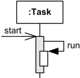
Overlapping execution specifications on the same lifeline - message to self.

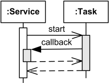
Overlapping execution specifications on the same lifeline - callback message.

## State Invariant

A **state invariant** is an [interaction fragment](https://www.uml-diagrams.org/sequence-diagrams.html#interaction-fragment) which represents a runtime [constraint](https://www.uml-diagrams.org/constraint.html) on the participants of the interaction. It may be used to specify different kinds of constraints, such as values of attributes or variables, internal or external states, etc.

The constraint is evaluated immediately prior to the execution of the next occurrence specification such that all actions that are not explicitly modeled have been executed. If the constraint is true, the trace is a valid trace, otherwise the trace is an invalid trace.

State invariant is usually shown as a constraint in curly braces on the lifeline.

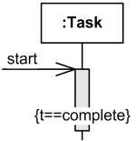
Attribute t of Task should be equal to complete.

It could also be shown as a [state](https://www.uml-diagrams.org/state-machine-diagrams.html#state) symbol representing the equivalent of a constraint that checks the state of the object represented by the lifeline. This could be either the internal state of the classifier behavior of the corresponding classifier or some external state based on a "black-box" view of the lifeline.

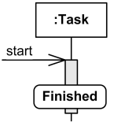
Task should be in Finished state.

State invariant can optionally be shown as a [note](https://www.uml-diagrams.org/uml-core.html#comment) associated with an occurrence specification.

## Interaction Use

**Interaction use** is an [interaction fragment](https://www.uml-diagrams.org/sequence-diagrams.html#interaction-fragment) which allows to use (or call) another interaction. Large and complex sequence diagrams could be simplified with interaction uses. It is also common to reuse some interaction between several other interactions.

Referenced interaction has formal gates. Interaction use provides a set of actual gates that must match the formal gates of the interaction.

Interaction use works as:

*   copy the contents of the referred interaction to where this interaction needs to be used,
*   substitute formal parameters with arguments,
*   connect the formal gates with the actual ones.

The interaction use is shown as a [combined fragment](https://www.uml-diagrams.org/sequence-diagrams-combined-fragment.html) with operator **ref**.

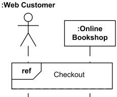
Web customer and Bookshop use (reference) interaction Checkout.

The syntax of the interaction use of the **ref** operator is:

interaction-use ::= [ attribute-name '=' ] [ collaboration-use '.' ] interaction-name [ io-arguments ]  [ ':' return-value ]   
io-arguments ::= '(' io-argument [ ',' io-argument ]*  ')'   
io-argument ::= in-argument |  'out' out-argument

The attribute-name refers to an attribute of one of the lifelines in the interaction that will receive interaction result. Note, that this restricts results of interactions to be assigned only to attributes. In real life, results of a method call could be assigned to a variable from calling method.

The collaboration-use is an identification of collaboration use that binds lifelines of a collaboration. The interaction name is in that case within that collaboration.

The io-arguments is list of **in** and/or **out** arguments of the interaction.

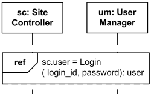
Use Login interaction to authenticate user and assign result back to the user attribute of Site Controller.

One constraint imposed by UML specification that is sometimes difficult to follow is that the interaction use must cover all involved lifelines represented on the enclosing interaction. This means that all those lifelines should be somehow located near each other. If we have another interaction use on the same diagram it could be very tricky to rearrange all involved lifelines as required by UML.

This document describes **UML 2.5** and is based on **OMG™ Unified Modeling Language™ (OMG UML®) 2.5** specification [[UML 2.5 FTF - Beta 1]](https://www.uml-diagrams.org/references.html#ref-uml-25-b1 "UML 2.5 Specification FTF Beta 1"). All UML diagrams were created in **Microsoft Visio** 2007-2016 using [UML 2.2 stencils](http://softwarestencils.com/uml/index.html "Visio Stencil and Template for UML 2.2"). You can send your comments and suggestions to [webmaster](mailto:webmaster@uml-diagrams.org). [Privacy policy](https://www.uml-diagrams.org/privacy-policy.html).

_Copyright © 2009-2026 uml-diagrams.org. All rights reserved. Authored by Kirill Fakhroutdinov._

[Deep Learning-Assisted Analysis of Biomarker Changes in Therapy-Resistant Neovascular Age-Related Macular Degeneration – The Doctor's Channel The Doctor's Channel | [Sponsored](https://popup.taboola.com/en/?template=colorbox&utm_source=uml-diagrams&utm_medium=referral&utm_content=next-up-a-delta:Next%20Up:)[Sponsored](https://popup.taboola.com/en/?template=colorbox&utm_source=uml-diagrams&utm_medium=referral&utm_content=next-up-a-delta:Next%20Up:) Read Next Story](https://www.thedoctorschannel.com/article/deep-learning-assisted-analysis-of-biomarker-changes-in-therapy-resistant-neovascular-age-related-macular-degeneration "Deep Learning-Assisted Analysis of Biomarker Changes in Therapy-Resistant Neovascular Age-Related Macular Degeneration – The Doctor's Channel")
