Title: UML State Machine Diagrams - Overview of Graphical Notation

URL Source: https://www.uml-diagrams.org/state-machine-diagrams.html

Warning: Target URL returned error 400: Bad Request

Markdown Content:
Menu►
*   [UML diagrams](https://www.uml-diagrams.org/ "UML graphical notation overview, examples, and reference.")
*   [State machine diagrams](https://www.uml-diagrams.org/state-machine-diagrams.html "UML state machine diagrams - overview of graphical notation")
*   [Protocol state machines](https://www.uml-diagrams.org/protocol-state-machine-diagrams.html "UML protocol state machine diagrams - overview of graphical notation")
*   [Reference](https://www.uml-diagrams.org/state-machine-diagrams-reference.html "UML state machine diagrams reference")
*   [State machine examples](https://www.uml-diagrams.org/state-machine-diagrams-examples.html "Examples of UML state machine diagrams")
*   [UML Index](https://www.uml-diagrams.org/index-references.html "Index of UML Elements")

# State Machine Diagrams

**State machine diagram** is a [behavior diagram](https://www.uml-diagrams.org/uml-25-diagrams.html#behavior-diagram) which shows discrete behavior of a part of designed system through finite state transitions. State machine diagrams can also be used to express the usage protocol of part of a system. Two kinds of state machines defined in **UML 2.4** are

*   [behavioral state machine](https://www.uml-diagrams.org/state-machine-diagrams.html#behavioral-state-machine), and
*   [protocol state machine](https://www.uml-diagrams.org/protocol-state-machine-diagrams.html#protocol-state-machine).

The following nodes and edges are typically drawn in **state machine diagram**: [behavioral state](https://www.uml-diagrams.org/state-machine-diagrams.html#behavioral-state), [behavioral transition](https://www.uml-diagrams.org/state-machine-diagrams.html#behavioral-transition), [protocol state](https://www.uml-diagrams.org/protocol-state-machine-diagrams.html#protocol-state), [protocol transition](https://www.uml-diagrams.org/protocol-state-machine-diagrams.html#protocol-transition), different [pseudostates](https://www.uml-diagrams.org/state-machine-diagrams.html#pseudostate).

You can find some [state machine diagrams examples](https://www.uml-diagrams.org/state-machine-diagrams-examples.html) here:

*   [Water Phase Diagram as State Machine](https://www.uml-diagrams.org/examples/water-phase-uml-state-machine-diagram-example.html)
*   [Bank ATM State Machine](https://www.uml-diagrams.org/bank-atm-uml-state-machine-diagram-example.html?context=stm-examples)
*   [Java Thread States and Life Cycle](https://www.uml-diagrams.org/java-thread-uml-state-machine-diagram-example.html?context=stm-examples)
*   [Java EJB - Life Cycle of a Session Object](https://www.uml-diagrams.org/java-ejb-state-machine-diagram-example.html?context=stm-examples)
*   [User account state machine diagram example](https://www.uml-diagrams.org/examples/online-shopping-user-account-state-diagram-example.html?context=stm-examples)

## Behavioral State Machine

**Behavioral state machine** is specialization of [behavior](https://www.uml-diagrams.org/common-behaviors.html#behavior) and is used to specify discrete behavior of a part of designed system through finite state transitions. The state machine formalism used in this case is an object-based variant of **Harel statecharts**.

[Behavior](https://www.uml-diagrams.org/common-behaviors.html#behavior) is modeled as a traversal of a graph of [state](https://www.uml-diagrams.org/state-machine-diagrams.html#behavioral-state) nodes connected with [transitions](https://www.uml-diagrams.org/state-machine-diagrams.html#behavioral-transition). Transitions are triggered by the dispatching of series of events. During the traversal, the state machine could also execute some activities.

Behavioral state machine could be owned by [behaviored classifier](https://www.uml-diagrams.org/common-behaviors.html#behaviored-classifier) which is called its **context**. The context defines which signal and call **triggers** are defined for this state machine, and which attributes and operations are available in activities of the state machine. Signal triggers and call triggers for the state machine are defined according to the receptions and operations of this classifier.

State machine may have an associated [behavioral feature](https://www.uml-diagrams.org/uml-core.html#behavioral-feature) (specification) and be the **method** of this behavioral feature. In this case the state machine specifies the behavior of this **behavioral feature**. The parameters of the state machine match the parameters of the behavioral feature and provide the means for accessing the behavioral feature parameters within the state machine.

The [event](https://www.uml-diagrams.org/event.html) pool for the state machine is the event pool of the instance according to the behaviored context classifier, or the classifier owning the behavioral feature for which the state machine is a method.

The **context** classifier of the method state machine of a behavioral feature must be the classifier that owns the behavioral feature. A state machine without a **context** classifier may use triggers that are independent of receptions or operations of a classifier, i.e., either just signal triggers or call triggers based upon operation template parameters of the (parameterized) statemachine.

The association between a state machine and its context classifier or behavioral feature does not have a special notation.

State machine could be rendered in the frame labeled as **state machine** or **stm** in abbreviated form. (Note, that for whatever reason **all** examples of state machine frames in Chapter 15 of UML 2.4 spec do not have this frame type specified.) The content area of the frame is usually state machine itself but in general it could contain other kinds of UML diagrams.

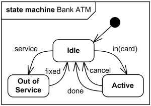
High level behavioral state machine for bank ATM

Behavioral state machine is subclassed by [protocol state machine](https://www.uml-diagrams.org/protocol-state-machine-diagrams.html#protocol-state-machine).

### Vertex

**Vertex** is named element which is an abstraction of a node in a state machine graph. In general, it can be the source or destination of any number of **transitions**.

Subclasses of vertex are:

*   [state](https://www.uml-diagrams.org/state-machine-diagrams.html#behavioral-state)
*   [pseudostate](https://www.uml-diagrams.org/state-machine-diagrams.html#pseudostate)

**State** is a [vertex](https://www.uml-diagrams.org/state-machine-diagrams.html#vertex) which models a situation during which some (usually implicit) invariant condition holds.

### Behavioral State

State in [behavioral state machines](https://www.uml-diagrams.org/state-machine-diagrams.html#behavioral-state-machine) models a situation during which some (usually implicit) invariant condition holds. The invariant may represent a static situation such as an object waiting for some external event to occur. However, it can also model dynamic conditions such as the process of performing some behavior (i.e., the model element under consideration enters the state when the behavior commences and leaves it as soon as the behavior is completed).

Inherited states are drawn with dashed lines or gray-toned lines.

The UML defines the following kinds of states:

*   [simple state](https://www.uml-diagrams.org/state-machine-diagrams.html#simple-state),
*   [composite state](https://www.uml-diagrams.org/state-machine-diagrams.html#composite-state),
*   [submachine state](https://www.uml-diagrams.org/state-machine-diagrams.html#submachine-state).

#### Simple State

A **simple state** is a state that does not have substates - it has no [regions](https://www.uml-diagrams.org/state-machine-diagrams.html#region) and it has no [submachine states](https://www.uml-diagrams.org/state-machine-diagrams.html#submachine-state).

Simple state is shown as a rectangle with rounded corners and the state name inside the rectangle.

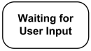
Simple state Waiting for Customer Input.

Optionally, state may have state name placed inside an attached name tab. The name tab is a rectangle, usually resting on the outside of the top side of a state.

Simple state may have compartments. The compartments of the state are:

*   name compartment
*   internal activities compartment
*   internal transitions compartment

**Name compartment** holds the (optional) name of the state, as a string. States without names are called **anonymous states** and are all considered distinct (different) states. Name compartments should not be used if a name tab is used and vice versa. It is recommended not to use the state wih the same name several times in the same diagram.

**Internal activities compartment** holds a list of internal actions or state (do) activities (behaviors) that are performed while the element is in the state. The activity label identifies the circumstances under which the behavior specified by the activity expression will be invoked. The behavior expression may use any attributes and association ends that are in the scope of the owning entity. For list items where the expression is empty, the slash separator is optional.

Several labels are reserved for special purposes and cannot be used as event names. The following are the reserved activity labels:

*   entry (behavior performed upon entry to the state)
*   do (ongoing behavior, performed as long as the element is in the state)
*   exit (behavior performed upon exit from the state)

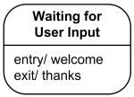
Simple state **Waiting for Customer Input** with name and internal activities compartments.

**Internal transition compartment** contains a list of internal transitions, where each item has the form as described for trigger. Each event name may appear more than once per state if the guard conditions are different. The event parameters and the guard conditions are optional. If the event has parameters, they can be used in the expression through the current event variable.

#### Composite State

Generally, **composite state** is defined as state that has substates (nested states). Substates could be sequential (disjoint) or concurrent (orthogonal). UML 2.4 defines composite state as the state which contains one or more [regions](https://www.uml-diagrams.org/state-machine-diagrams.html#region). (Note, that region is defined back as an orthogonal part of either a composite state or a state machine.) A state is not allowed to have both regions and a submachine.

**Simple composite state** contains just one region.

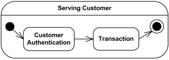
Simple composite state Serving Customer has two substates.

**Orthogonal composite state** has more than one regions. Each region has a set of mutually exclusive disjoint subvertices and a set of transitions. A given state may only be decomposed in one of these two ways.

Any state enclosed within a region of a composite state is called a **substate** of that composite state. It is called a **direct substate** when it is not contained by any other state; otherwise, it is referred to as an **indirect substate**.

Each region of a composite state may have an initial pseudostate and a final state. A transition to the enclosing state represents a transition to the initial pseudostate in each region. A newly-created object takes its topmost default transitions, originating from the topmost initial pseudostates of each region.

Composite state may have state name placed inside an attached name tab. The name tab is a rectangle, usually resting on the outside of the top side of a state.

Composite state may have compartments. The compartments of the state are:

*   name compartment
*   internal activities compartment
*   internal transitions compartment
*   decomposition compartment

The first three compartments are the same as for [simple state](https://www.uml-diagrams.org/state-machine-diagrams.html#simple-state).

**Decomposition compartment** shows composition structure of the state as a a nested diagram with regions, states, and transitions. For convenience and appearance, the text compartments may be shrunk horizontally within the graphic region.

In some cases, it is convenient to hide the decomposition of a composite state. For example, there may be a large number of states nested inside a composite state and they may simply not fit in the graphical space available for the diagram. In that case, the composite state may be represented by a simple state graphic with a special "composite" icon, usually in the lower right-hand corner. This icon, consisting of two horizontally placed and connected states, is an optional visual cue that the state has a decomposition that is not shown in this particular diagram. Instead, the contents of the composite state are shown in a separate diagram. The "hiding" is a matter of graphical convenience and has no semantic significance in terms of access restrictions.

Composite state Serving Customer with decomposition hidden.

A composite state may have one or more **entry** and **exit points** on its outside border or in close proximity of that border (inside or outside).

#### Submachine State

A submachine state specifies the insertion of the specification of a submachine state machine. The state machine that contains the submachine state is called the containing state machine. The same state machine may be a submachine more than once in the context of a single containing state machine.

A submachine state is semantically equivalent to a composite state. The regions of the submachine state machine are the regions of the composite state. The entry, exit, and behavior actions and internal transitions are defined as part of the state. Submachine state is a decomposition mechanism that allows factoring of common behaviors and their reuse.

**Name compartment** holds the (optional) name of the state, as a string. The name of the referenced state machine is shown as a string following ':' after the name of the state.

### Region

A **region** is defined in UML 2.4 as an orthogonal part of either a [composite state](https://www.uml-diagrams.org/state-machine-diagrams.html#composite-state) or a state machine. Region contains states and transitions.

A composite state or state machine with regions is shown by tiling the graph region of the state/state machine using dashed lines to divide it into regions. Each region may have an optional name and contains the nested disjoint states and the transitions between these. The text compartments of the entire state are separated from the orthogonal regions by a solid line.

A composite state or state machine with just one region is shown by showing a nested state diagram within the graph region.

In order to indicate that an inherited region is extended, the keyword «extended» is associated with the name of the region.

### Pseudostate

A pseudostate is an abstract [vertex](https://www.uml-diagrams.org/state-machine-diagrams.html#vertex) that encompasses different types of transient vertices in the state machine graph.

Pseudostates are typically used to connect multiple transitions into more complex state transitions paths. For example, by combining a transition entering a fork pseudostate with a set of transitions exiting the fork pseudostate, we get a compound transition that leads to a set of orthogonal target states.

Pseudostates include:

*   [initial pseudostate](https://www.uml-diagrams.org/state-machine-diagrams.html#initial-pseudostate)
*   [terminate pseudostate](https://www.uml-diagrams.org/state-machine-diagrams.html#terminate-pseudostate)
*   [entry point](https://www.uml-diagrams.org/state-machine-diagrams.html#entry-point-pseudostate)
*   [exit point](https://www.uml-diagrams.org/state-machine-diagrams.html#exit-point-pseudostate)
*   [choice](https://www.uml-diagrams.org/state-machine-diagrams.html#choice-pseudostate)
*   [join](https://www.uml-diagrams.org/state-machine-diagrams.html#join-pseudostate)
*   [fork](https://www.uml-diagrams.org/state-machine-diagrams.html#fork-pseudostate)
*   [junction](https://www.uml-diagrams.org/state-machine-diagrams.html#junction-pseudostate)
*   [shallow history pseudostate](https://www.uml-diagrams.org/state-machine-diagrams.html#shallow-history-pseudostate)
*   [deep history pseudostate](https://www.uml-diagrams.org/state-machine-diagrams.html#deep-history-pseudostate)

#### Initial Pseudostate

An **initial pseudostate** represents a default [vertex](https://www.uml-diagrams.org/state-machine-diagrams.html#vertex) that is the source for a single transition to the **default state** of a [composite state](https://www.uml-diagrams.org/state-machine-diagrams.html#composite-state). There can be at most one initial vertex in a region. The outgoing transition from the initial vertex may have a behavior, but not a trigger or guard.

An initial pseudostate is shown as a small solid filled circle.

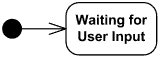
Initial pseudostate transitions to Waiting for User Input state

In a region of a classifier behavior state machine, the transition from an initial pseudostate may be labeled with the trigger event that creates the object; otherwise, it must be unlabeled. If it is unlabeled, it represents any transition from the enclosing state.

#### Terminate Pseudostate

**Terminate pseudostate** implies that the execution of this state machine by means of its context object is terminated. The state machine does not exit any states nor does it perform any exit actions other than those associated with the transition leading to the terminate pseudostate. Entering a terminate pseudostate is equivalent to invoking a DestroyObjectAction.

A terminate pseudostate is shown as a cross.

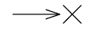
Transition to terminate pseudostate

#### Entry Point

**Entry point pseudostate** is an entry point of a state machine or composite state. In each region of the state machine or composite state it has at most a single transition to a vertex within the same region.

An entry point is shown as a small circle on the border of the state machine diagram or composite state, with the name associated with it.

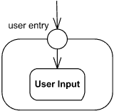
Entry point **user entry**

Optionally it may be placed both within the state machine diagram and outside the border of the state machine diagram or composite state.

#### Exit Point

**Exit point pseudostate** is an exit point of a state machine or composite state. Entering an exit point within any region of the composite state or state machine referenced by a submachine state implies the exit of this composite state or submachine state and the triggering of the transition that has this exit point as source in the state machine enclosing the submachine or composite state.

An exit point is shown as a small circle with a cross on the border of the state machine diagram or composite state, with the name associated with it.

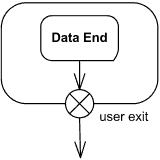
Exit point **user exit**

Optionally it may be placed both within the state machine diagram or composite state and outside the border of the state machine diagram or composite state.

Alternatively, the “bracket” notation can also be used for the transition oriented notation.

#### Choice

**Choice pseudostate** realizes a dynamic conditional branch. It evaluates the guards of the triggers of its outgoing transitions to select only one outgoing transition. The decision on which path to take may be a function of the results of prior actions performed in the same run-to-completion step. Dynamic choices should be distinguished from static junction branch points.

A choice pseudostate is shown as a diamond-shaped symbol.

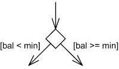
Select outgoing transition based on condition.

If more than one of the guards evaluates to true, an arbitrary one is selected. If none of the guards evaluates to true, then the model is considered ill-formed. To avoid this define one outgoing transition with the predefined "else" guard when appropriate.

If all guards associated with triggers of transitions leaving a choice pseudostate are binary expressions that share a common left operand, simplified notation could be used. The left operand is placed inside the diamond-shaped symbol and the rest of the guard expressions is placed on the outgoing transitions.

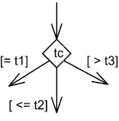
Choice based on guards applied to the value inside diamond

#### Fork

**Fork pseudostate** vertices serve to split an incoming transition into two or more transitions terminating on orthogonal target vertices (i.e., vertices in different regions of a composite state). The segments outgoing from a fork vertex must not have guards or triggers.

The notation for a fork is a short heavy bar. The bar may have one or more arrows from the bar to states. A transition string may be shown near the bar.

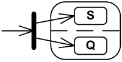
Fork splits transition into two transitions

#### Join

**Join pseudostate** merges several transitions originating from source vertices in different orthogonal regions. The transitions entering a join vertex cannot have guards or triggers.

The notation for a join is a short heavy bar. The bar may have one or more arrows from source states to the bar. A transition string may be shown near the bar.

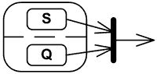
Join merges transitions into single transition

#### Junction

**Junction pseudostate** vertices are vertices that are used to chain together multiple transitions. They are used to construct compound transition paths between states. For example, a junction can be used to converge multiple incoming transitions into a single outgoing transition representing a shared transition path (this is known as a merge).

Conversely, they can be used to split an incoming transition into multiple outgoing transition segments with different guard conditions. This realizes a static conditional branch. (In the latter case, outgoing transitions whose guard conditions evaluate to false are disabled.

A predefined guard denoted "else" may be defined for at most one outgoing transition. This transition is enabled if all the guards labeling the other transitions are false.) Static conditional branches are distinct from dynamic conditional branches that are realized by choice vertices.

A junction is represented by a small black circle.

Multiple trigger-free and effect-free transitions originating on a set of states and targeting a junction vertex with a single outgoing transition may be presented as a state symbol with a list of the state names and an outgoing transition symbol corresponding to the outgoing transition from the junction.

The special case of the transition from the junction having a history as target may optionally be presented as the target being the state list state symbol.

#### Shallow History Pseudostate

**Shallow history pseudostate** represents the most recent active substate of its containing state (but not the substates of that substate). A composite state can have at most one shallow history vertex. A transition coming into the shallow history vertex is equivalent to a transition coming into the most recent active substate of a state. At most one transition may originate from the history connector to the default shallow history state. This transition is taken in case the composite state had never been active before. The entry action of the state represented by the shallow history is performed.

A shallow history is indicated by a small circle containing an "H". It applies to the state region that directly encloses it.

#### Deep History Pseudostate

**Deep history pseudostate** represents the most recent active configuration of the composite state that directly contains this pseudostate (e.g., the state configuration that was active when the composite state was last exited). A composite state can have at most one deep history vertex. At most one transition may originate from the history connector to the default deep history state. This transition is taken in case the composite state had never been active before. Entry actions of states entered on the implicit direct path from the deep history to the innermost state(s) represented by a deep history are performed. The entry action is preformed only once for each state in the active state configuration being restored.

A deep history is indicated by a small circle containing an "H*". It applies to the state region that directly encloses it.

### Final State

**Final state** is a special kind of [state](https://www.uml-diagrams.org/state-machine-diagrams.html#behavioral-state) signifying that the enclosing region is completed. If the enclosing region is directly contained in a state machine and all other regions in the state machine also are completed, then it means that the entire state machine is completed. Note, that for some reason UML 2.4 defines final state as a subclass of state but not as [pseudostate](https://www.uml-diagrams.org/state-machine-diagrams.html#pseudostate). ([Initial state](https://www.uml-diagrams.org/state-machine-diagrams.html#initial-pseudostate) is pseudostate.)

A final state is shown as a circle surrounding a small solid filled circle.

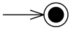
Transition to final state.

### Behavioral Transition

A transition is a directed relationship between a source [vertex](https://www.uml-diagrams.org/state-machine-diagrams.html#vertex) and a target vertex. It may be part of a **compound transition**, which takes the state machine from one state configuration to another, representing the complete response of the state machine to an occurrence of an event of a particular type.

The default notation for a behavioral transition is described by the following BNF (slightly modifed and fixed version of the BNF from UML 2.4 specs):

transition ::= [ triggers ] [guard] ['/'behavior-expression]   
triggers ::= [trigger](https://www.uml-diagrams.org/common-behaviors.html#trigger-syntax)[','[trigger](https://www.uml-diagrams.org/common-behaviors.html#trigger-syntax)]*   
guard::= '['[constraint](https://www.uml-diagrams.org/constraint.html#constraint-syntax)']'

Optional list of [triggers](https://www.uml-diagrams.org/common-behaviors.html#trigger) specifies [events](https://www.uml-diagrams.org/event.html) that may induce state transition. An event **satisfies** a trigger if it matches the event associated with the trigger. Since more than one transition may be enabled by the same event, it is a necessary but not sufficient condition for the firing of a transition.

The guard-constraint is a Boolean expression written in terms of parameters of the **triggering event** and attributes and links of the **context object**. The guard constraint may also involve tests of orthogonal states of the current state machine, or explicitly designated states of some reachable object (for example, "**in** Active State").

In a simple transition with a guard, the guard is evaluated before the transition is triggered. In compound transitions involving multiple guards, all guards are evaluated before a transition is triggered, unless there are choice points along one or more of the paths. The order in which the guards are evaluated is not defined. Guards should not include expressions causing side effects.

The behavior-expression is executed if and when the transition fires. It may be written in terms of operations, attributes, and links of the **context object** and the parameters of the **triggering event**, or any other features visible in its scope. The behavior expression may be an action sequence.

An example of transition with guard constraint and transition string:

left-mouse-down(coordinates) [coordinates **in** active_window] / link:=select-link(coordinates);link.follow()

When left-mouse-down event happens (**trigger**) and click coordinates are in active_window (**guard**), link will be selected and followed (**behavior-expression**), and transition fired.

The triggers and the subsequent effect of a transition may be notated either textually according to the syntax above or using graphical symbols on a transition.

Transitions originating from **composite states** are called **high-level transitions** or **group transitions**. If triggered, they result in exiting of all the substates of the composite state executing their exit activities starting with the innermost states in the active state configuration.

A **compound transition** represents a "semantically complete" path made of one or more transitions, originating from a set of states (as opposed to pseudo-state) and targeting a set of states.

An **internal transition** executes without exiting or re-entering the state in which it is defined. This is true even if the state machine is in a nested state within this state.

A **completion transition** is a transition originating from a state or an exit point but which does not have an explicit trigger, although it may have a guard defined. A completion transition is implicitly triggered by a **completion event**.

[Protocol state machine diagrams](https://www.uml-diagrams.org/protocol-state-machine-diagrams.html "UML Protocol State Machine Diagrams")

  

This document describes **UML 2.5** and is based on **OMG™ Unified Modeling Language™ (OMG UML®) 2.5** specification [[UML 2.5 FTF - Beta 1]](https://www.uml-diagrams.org/references.html#ref-uml-25-b1 "UML 2.5 Specification FTF Beta 1"). All UML diagrams were created in **Microsoft Visio** 2007-2016 using [UML 2.2 stencils](http://softwarestencils.com/uml/index.html "Visio Stencil and Template for UML 2.2"). You can send your comments and suggestions to [webmaster](mailto:webmaster@uml-diagrams.org). [Privacy policy](https://www.uml-diagrams.org/privacy-policy.html).

_Copyright © 2009-2026 uml-diagrams.org. All rights reserved. Authored by Kirill Fakhroutdinov._

[How to Protect Your Bone Health During Weight Loss GoodRx | [Sponsored](https://popup.taboola.com/en/?template=colorbox&utm_source=uml-diagrams&utm_medium=referral&utm_content=next-up-a-delta:Next%20Up:)[Sponsored](https://popup.taboola.com/en/?template=colorbox&utm_source=uml-diagrams&utm_medium=referral&utm_content=next-up-a-delta:Next%20Up:) Read Next Story](https://www.goodrx.com/conditions/weight-loss/bone-mass-decrease-with-weight-loss "How to Protect Your Bone Health During Weight Loss")
