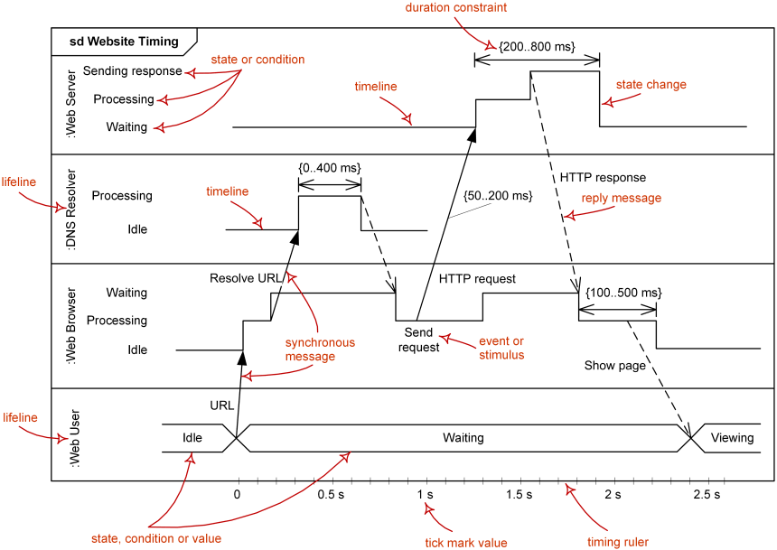
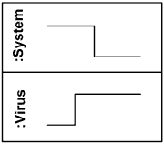
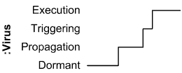
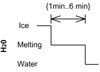
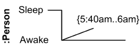
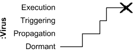

Title: UML Timing Diagrams - Overview of Graphical Notation

URL Source: https://www.uml-diagrams.org/timing-diagrams.html

Warning: Target URL returned error 400: Bad Request

Markdown Content:
Menu►
*   [UML diagrams](https://www.uml-diagrams.org/ "UML Diagrams - overview, reference, and examples.")
*   [Timing diagrams](https://www.uml-diagrams.org/timing-diagrams.html "UML timing diagrams - overview of graphical notation")
*   [Interaction](https://www.uml-diagrams.org/interaction.html?context=timing-diagrams "UML interaction.")
*   [Reference](https://www.uml-diagrams.org/timing-diagrams-reference.html "UML timing diagrams graphical notation reference")
*   [Timing diagrams examples](https://www.uml-diagrams.org/timing-diagrams-examples.html "UML timing diagrams examples")
*   [Stages of Alzheimer’s disease](https://www.uml-diagrams.org/alzheimers-uml-timing-diagram-example.html "Stages of Alzheimer’s disease UML timing diagram example")
*   [Website latency](https://www.uml-diagrams.org/website-latency-uml-timing-diagram-example.html "Website latency UML timing diagram example")
*   [UML index](https://www.uml-diagrams.org/index-references.html "Index of UML Elements")

# Timing Diagrams

**Timing diagrams** are **UML**[interaction diagrams](https://www.uml-diagrams.org/uml-25-diagrams.html#interaction-diagram) used to show interactions when a primary purpose of the diagram is to reason about **time**. Timing diagrams focus on conditions changing within and among **lifelines** along a linear time axis. Timing diagrams describe behavior of both individual [classifiers](https://www.uml-diagrams.org/classifier.html) and interactions of classifiers, focusing attention on time of events causing changes in the modeled conditions of the lifelines.

Major elements of timing UML diagram - [lifeline](https://www.uml-diagrams.org/timing-diagrams.html#lifeline), [timeline](https://www.uml-diagrams.org/timing-diagrams.html#state-timeline), state or condition, message, [duration constraint](https://www.uml-diagrams.org/timing-diagrams.html#duration-constraint), timing ruler.

You can find some [timing diagram examples](https://www.uml-diagrams.org/timing-diagrams-examples.html) here:

*   Medical domain - [Stages of Alzheimer’s Disease](https://www.uml-diagrams.org/alzheimers-uml-timing-diagram-example.html)
*   User Experience - [Website Latency](https://www.uml-diagrams.org/website-latency-uml-timing-diagram-example.html)

## Lifeline

**Lifeline** is a [named element](https://www.uml-diagrams.org/uml-core.html#named-element) which represents an **individual participant** in the interaction. While [parts](https://www.uml-diagrams.org/composite-structure-diagrams/part.html) and structural features may have multiplicity greater than 1, lifelines represent **only one** interacting entity. See [lifeline](https://www.uml-diagrams.org/sequence-diagrams.html#lifeline) from sequence diagrams for details.

Lifeline on the timing diagrams is represented by the **name** of classifier or the instance it represents. It could be placed inside diagram frame or a "swimlane".

**Lifelines** representing instances of System and Virus

## State or Condition Timeline

Timing diagram could show **states** of the participating [classifier](https://www.uml-diagrams.org/classifier.html) or attribute, or some testable **conditions**, such as a discrete or enumerable value of an attribute.

Timeline shows Virus changing its state between Dormant, Propagation, Triggering and Execution state

UML also allows the state/condition dimension be **continuous**. It could be used in scenarios where entities undergo continuous state changes, such as temperature or density.

## Duration Constraint

**Duration constraint** is an [interval constraint](https://www.uml-diagrams.org/common-behaviors.html#interval-constraint) that refers to a **duration interval**. The duration interval is duration used to determine whether the constraint is satisfied.

The semantics of a duration constraint is inherited from constraints. If constraints are violated, traces become negative which means that system is considered as failed.

Duration constraint is shown as some graphical association between a **duration interval** and the constructs that it constrains.

Ice should melt into water in 1 to 6 minutes

## Time Constraint

**Time constraint** is an [interval constraint](https://www.uml-diagrams.org/common-behaviors.html#interval-constraint) that refers to a **time interval**. The time interval is time expression used to determine whether the constraint is satisfied.

The semantics of a time constraint is inherited from constraints. All traces where the constraints are violated are negative traces, i.e., if they occur, the system is considered as failed.

Time constraint is shown as graphical association between a time interval and the construct that it constrains. Typically this graphical association is a small line, e.g., between an occurrence specification and a time interval.

Person should wake up between 5:40 am and 6 am

## Destruction Occurrence

**Destruction occurrence** is a [message occurrence](https://www.uml-diagrams.org/sequence-diagrams.html#message-occurrence) which represents the destruction of the instance described by the [lifeline](https://www.uml-diagrams.org/sequence-diagrams.html#lifeline). It may result in the subsequent destruction of other objects that this object owns by [composition](https://www.uml-diagrams.org/composition.html). No other occurrence may appear after the destruction event on a given lifeline.

#### Notation

The destruction event is depicted by a cross in the form of an **X** at the end of a timeline.

Virus lifeline is terminated

#### History

Complete UML name of the occurrence is **destruction occurrence specification**. Until UML 2.4 it was called **destruction event**, and earlier - **stop**.

This document describes UML versions up to **[UML 2.5](https://www.uml-diagrams.org/references.html#ref-uml-25 "UML 2.5 Specification")** and is based on the corresponding **OMG™ Unified Modeling Language™ (OMG UML®)** specifications. UML diagrams were created in **Microsoft® Visio®** 2007-2016 using **[UML 2.x Visio Stencils](http://softwarestencils.com/uml/index.html "Visio Stencil and Template for UML 2.5")**. You can send your comments and suggestions to [webmaster](mailto:webmaster@uml-diagrams.org). [Privacy policy](https://www.uml-diagrams.org/privacy-policy.html).

_Copyright © 2009-2026 uml-diagrams.org. All rights reserved. Authored by Kirill Fakhroutdinov._

[The Dalles: Bettors Turn To AI [See how]Sportspickhero.com | [Sponsored](https://popup.taboola.com/en/?template=colorbox&utm_source=uml-diagrams&utm_medium=referral&utm_content=next-up-a-delta:Next%20Up:)[Sponsored](https://popup.taboola.com/en/?template=colorbox&utm_source=uml-diagrams&utm_medium=referral&utm_content=next-up-a-delta:Next%20Up:) Read Next Story](https://sportspickhero.com/ "The Dalles: Bettors Turn To AI [See how]")
