Title: Examples of UML diagrams - use case, class, component, package, activity, sequence diagrams, etc.

URL Source: https://www.uml-diagrams.org/index-examples.html

Warning: Target URL returned error 400: Bad Request

Markdown Content:
Menu►
*   [Home](https://www.uml-diagrams.org/ "UML Diagrams - overview, reference, and examples.")
*   [UML Diagrams](https://www.uml-diagrams.org/uml-25-diagrams.html "UML 2.5 diagrams overview")
*   [Class Diagrams](https://www.uml-diagrams.org/class-diagrams-overview.html "UML Class Diagrams Overview")
*   [Composite Structures](https://www.uml-diagrams.org/composite-structure-diagrams.html "UML Composite Structure Diagrams Overview")
*   [Packages](https://www.uml-diagrams.org/package-diagrams-overview.html "UML Package Diagrams Overview")
*   [Components](https://www.uml-diagrams.org/component-diagrams.html "UML Component Diagrams")
*   [Deployments](https://www.uml-diagrams.org/deployment-diagrams-overview.html "UML Deployment Diagrams Overview")
*   [Use Case Diagrams](https://www.uml-diagrams.org/use-case-diagrams.html "UML Use Case Diagrams Overview")
*   [Information Flows](https://www.uml-diagrams.org/information-flow-diagrams.html "UML information flow diagrams overview")
*   [Activities](https://www.uml-diagrams.org/activity-diagrams.html "UML Activity Diagrams")
*   [State Machines](https://www.uml-diagrams.org/state-machine-diagrams.html "UML State Machine Diagrams Overview")
*   [Sequence Diagrams](https://www.uml-diagrams.org/sequence-diagrams.html "UML Sequence Diagrams Overview")
*   [Communications](https://www.uml-diagrams.org/communication-diagrams.html "UML Communication Diagrams")
*   [Timing Diagrams](https://www.uml-diagrams.org/timing-diagrams.html "UML Timing Diagrams")
*   [Interaction Overviews](https://www.uml-diagrams.org/interaction-overview-diagrams.html "UML Interaction Overview Diagrams")
*   [Profiles](https://www.uml-diagrams.org/profile-diagrams.html "UML Profile Diagrams")
*   [UML Index](https://www.uml-diagrams.org/index-references.html "Index of UML Elements")
*   [Examples](https://www.uml-diagrams.org/index-examples.html "Index of examples of UML diagrams")
*   [About](https://www.uml-diagrams.org/about.html "About this web site")

# UML Diagrams Examples

## Examples by Technology or Application Domain

[Online shopping UML diagrams](https://www.uml-diagrams.org/examples/online-shopping-example.html)  
[Ticket vending machine UML diagrams](https://www.uml-diagrams.org/ticket-vending-machine-uml-diagrams-examples.html)  
[Bank ATM UML diagrams](https://www.uml-diagrams.org/examples/bank-atm-example.html)  
[Hospital management UML diagrams](https://www.uml-diagrams.org/examples/hospital-management-example.html)  
[Digital imaging and communications in medicine (DICOM) UML diagrams](https://www.uml-diagrams.org/dicom-uml-diagrams-examples.html)  
[Java technology UML diagrams](https://www.uml-diagrams.org/examples/java-uml-examples.html)  
[Application development for Android UML diagrams](https://www.uml-diagrams.org/examples/android-uml-examples.html)  
[Software licensing and protection using SafeNet Sentinel HASP security solution](https://www.uml-diagrams.org/software-licensing-sentinel-uml-examples.html)  

## Examples by Types of Diagrams

[Activity diagram examples](https://www.uml-diagrams.org/activity-diagrams-examples.html)  
[Class diagram examples](https://www.uml-diagrams.org/class-diagrams-examples.html)  
[Communication diagram examples](https://www.uml-diagrams.org/communication-diagrams-examples.html)  
[Component diagram examples](https://www.uml-diagrams.org/component-diagrams-examples.html)  
[Composite structure diagram examples](https://www.uml-diagrams.org/composite-structure-examples.html)  
[Deployment diagram examples](https://www.uml-diagrams.org/deployment-diagrams-examples.html)  
[Information flow diagram example](https://www.uml-diagrams.org/information-flow-diagrams/scheduled-workflow-example.html)  
[Interaction overview diagram examples](https://www.uml-diagrams.org/interaction-overview-diagrams-examples.html)  
[Object diagram example](https://www.uml-diagrams.org/online-shopping-user-login-uml-object-diagram-example.html)  
[Package diagram examples](https://www.uml-diagrams.org/package-diagrams-examples.html)  
[Profile diagram examples](https://www.uml-diagrams.org/profile-diagrams-examples.html)  
[Sequence diagram examples](https://www.uml-diagrams.org/sequence-diagrams-examples.html)  
[State machine diagram examples](https://www.uml-diagrams.org/state-machine-diagrams-examples.html)  
[Timing diagram examples](https://www.uml-diagrams.org/timing-diagrams-examples.html)  
[Use case diagram examples](https://www.uml-diagrams.org/use-case-diagrams-examples.html)  

### Use Case Diagrams

#### Business Use Case Diagrams

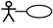[Airport check-in and security screening business model](https://www.uml-diagrams.org/airport-checkin-uml-use-case-diagram-example.html)

[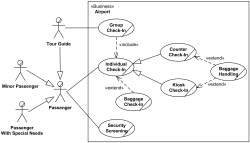](https://www.uml-diagrams.org/airport-checkin-uml-use-case-diagram-example.html)

  

[Restaurant business model](https://www.uml-diagrams.org/restaurant-uml-use-case-diagram-example.html)

[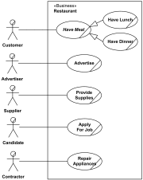](https://www.uml-diagrams.org/restaurant-uml-use-case-diagram-example.html)

  

#### System Use Case Diagrams

[Ticket vending machine](https://www.uml-diagrams.org/ticket-vending-machine-use-case-diagram-example.html?context=uc-examples)

[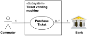](https://www.uml-diagrams.org/ticket-vending-machine-use-case-diagram-example.html?context=uc-examples)

  

[Bank ATM UML use case diagrams examples](https://www.uml-diagrams.org/bank-atm-uml-use-case-diagram-example.html?context=uc-examples)

[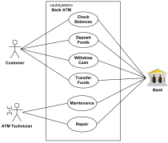](https://www.uml-diagrams.org/bank-atm-uml-use-case-diagram-example.html?context=uc-examples)

  

[Point of Sales (POS) terminal](https://www.uml-diagrams.org/examples/point-of-sales-uml-use-case-diagram-example.html)

[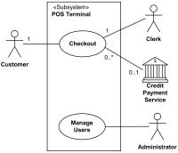](https://www.uml-diagrams.org/examples/point-of-sales-uml-use-case-diagram-example.html)

  

[e-Library online public access catalog (OPAC)](https://www.uml-diagrams.org/online-library-uml-use-case-diagram-example.html)

[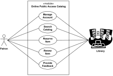](https://www.uml-diagrams.org/online-library-uml-use-case-diagram-example.html)

  

[Online shopping use case diagrams](https://www.uml-diagrams.org/examples/online-shopping-use-case-diagram-example.html?context=uc-examples)

[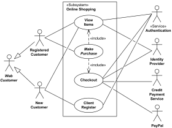](https://www.uml-diagrams.org/examples/online-shopping-use-case-diagram-example.html?context=uc-examples)

  

[Credit card processing system](https://www.uml-diagrams.org/examples/online-shopping-credit-cards-use-cases-example.html?context=uc-examples)

[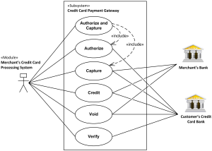](https://www.uml-diagrams.org/examples/online-shopping-credit-cards-use-cases-example.html?context=uc-examples)

  

[Website administration](https://www.uml-diagrams.org/examples/website-admin-use-case-diagrams-example.html?context=uc-examples)

[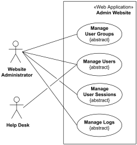](https://www.uml-diagrams.org/examples/website-admin-use-case-diagrams-example.html?context=uc-examples)

  

[Hospital Management](https://www.uml-diagrams.org/examples/hospital-management-use-case-diagram-example.html?context=uc-examples)

[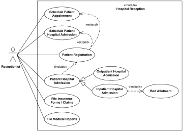](https://www.uml-diagrams.org/examples/hospital-management-use-case-diagram-example.html)

  

[Radiology diagnostic reporting UML use case diagram example](https://www.uml-diagrams.org/radiology-diagnostic-report-uml-use-case-diagram-example.html?context=uc-examples)

[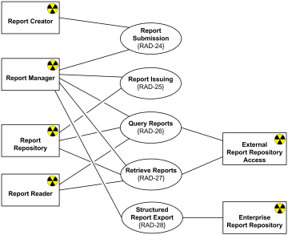](https://www.uml-diagrams.org/radiology-diagnostic-report-uml-use-case-diagram-example.html?context=uc-examples)

  

[Software protection and licensing UML use case diagram example](https://www.uml-diagrams.org/examples/software-license-use-case-diagram-example.html?context=uc-examples)

[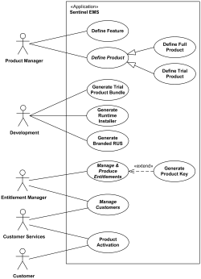](https://www.uml-diagrams.org/examples/software-license-use-case-diagram-example.html?context=uc-examples)

  

### Information Flow Diagrams

[Scheduled Workflow information flow for the IHE Radiology Technical Framework](https://www.uml-diagrams.org/information-flow-diagrams/scheduled-workflow-example.html?context=ifl-examples)

[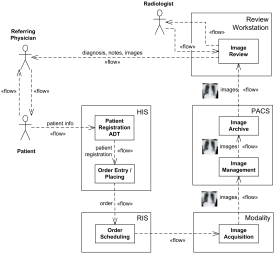](https://www.uml-diagrams.org/information-flow-diagrams/scheduled-workflow-example.html?context=ifl-examples)

  

### Class Diagrams

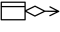[Abstract Factory Design Pattern](https://www.uml-diagrams.org/design-pattern-abstract-factory-uml-class-diagram-example.html)

[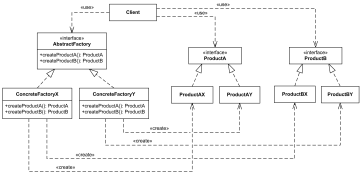](https://www.uml-diagrams.org/design-pattern-abstract-factory-uml-class-diagram-example.html)

  

#### Domain Models

[Library domain model](https://www.uml-diagrams.org/library-domain-uml-class-diagram-example.html)

[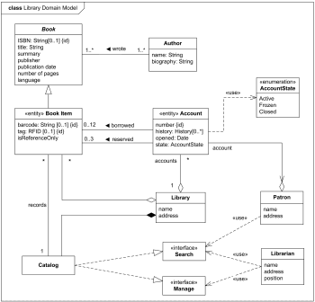](https://www.uml-diagrams.org/library-domain-uml-class-diagram-example.html)

  

[Bank account class diagram example](https://www.uml-diagrams.org/examples/bank-account-domain-diagram-example.html?context=cls-examples)

[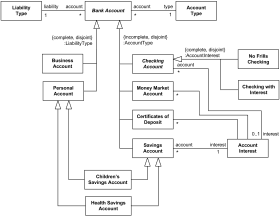](https://www.uml-diagrams.org/examples/bank-account-domain-diagram-example.html?context=cls-examples)

  

[Online shopping domain model](https://www.uml-diagrams.org/examples/online-shopping-domain-uml-diagram-example.html?context=cls-examples)

[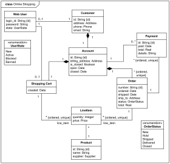](https://www.uml-diagrams.org/examples/online-shopping-domain-uml-diagram-example.html?context=cls-examples)

  

[Health insurance policy UML class diagram example](https://www.uml-diagrams.org/examples/health-insurance-policy-domain-diagram-example.html?context=cls-examples)

[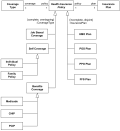](https://www.uml-diagrams.org/examples/health-insurance-policy-domain-diagram-example.html?context=cls-examples)

  

[Hospital domain UML class diagram example](https://www.uml-diagrams.org/examples/hospital-domain-diagram.html?context=cls-examples)

[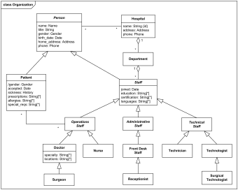](https://www.uml-diagrams.org/examples/hospital-domain-diagram.html?context=cls-examples)

  

[Digital imaging in medicine - DICOM model of the real world](https://www.uml-diagrams.org/dicom-real-world-uml-class-diagram-example.html?context=cls-examples)

[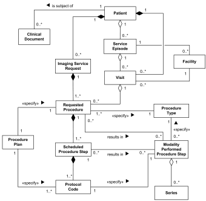](https://www.uml-diagrams.org/dicom-real-world-uml-class-diagram-example.html?context=cls-examples)

  

[Sentinel HASP software licensing domain UML class diagram example](https://www.uml-diagrams.org/software-licensing-domain-diagram-example.html?context=cls-examples)

[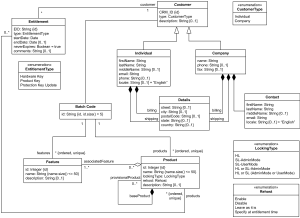](https://www.uml-diagrams.org/software-licensing-domain-diagram-example.html?context=cls-examples)

  

#### APIs

[Digital imaging in medicine - DICOM Application Hosting API](https://www.uml-diagrams.org/dicom-application-hosting-api-uml-class-diagram-example.html?context=cls-examples)

[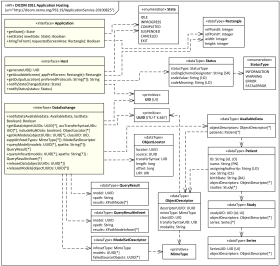](https://www.uml-diagrams.org/dicom-application-hosting-api-uml-class-diagram-example.html?context=cls-examples)

  

[Java util.concurrent API UML class diagram examples](https://www.uml-diagrams.org/java-7-concurrent-uml-class-diagram-example.html?context=cls-examples)

[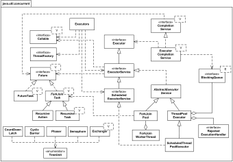](https://www.uml-diagrams.org/java-7-concurrent-uml-class-diagram-example.html?context=cls-examples)

  

#### Implementation Models

[Android Camera implementation classes](https://www.uml-diagrams.org/android-camera-uml-class-diagram-example.html)

[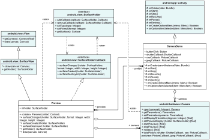](https://www.uml-diagrams.org/android-camera-uml-class-diagram-example.html)

  

[Sentinel HASP licensing UML class diagram of Aladdin package](https://www.uml-diagrams.org/software-licensing-class-diagram-example.html?context=cls-examples)

[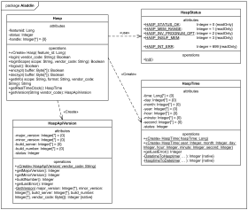](https://www.uml-diagrams.org/software-licensing-class-diagram-example.html?context=cls-examples)

  

### Object Diagrams

[Web application Login Controller object diagram](https://www.uml-diagrams.org/online-shopping-user-login-uml-object-diagram-example.html?context=cls-examples)

[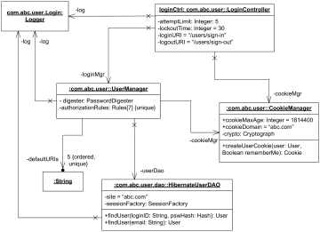](https://www.uml-diagrams.org/online-shopping-user-login-uml-object-diagram-example.html?context=cls-examples)

  

### Composite Structure Diagrams

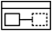[Bank ATM UML composite structure diagram example](https://www.uml-diagrams.org/bank-atm-uml-composite-diagram-example.html?context=cst-examples)

[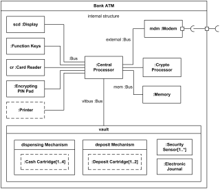](https://www.uml-diagrams.org/bank-atm-uml-composite-diagram-example.html?context=cst-examples)

  

[Apache Tomcat 7 web server UML composite structure diagram example](https://www.uml-diagrams.org/tomcat-server-uml-composite-structure-diagram-example.html?context=cst-examples)

[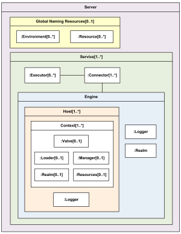](https://www.uml-diagrams.org/tomcat-server-uml-composite-structure-diagram-example.html?context=cst-examples)

  

[Observer design pattern as UML collaboration use example](https://www.uml-diagrams.org/observer-pattern-uml-composite-diagram-example.html)

[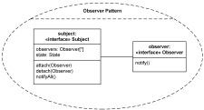](https://www.uml-diagrams.org/observer-pattern-uml-composite-diagram-example.html)

  

### Package Diagrams

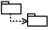[Multi-Layered Application Model](https://www.uml-diagrams.org/multi-layered-application-uml-model-diagram-example.html)

[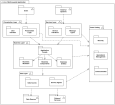](https://www.uml-diagrams.org/multi-layered-application-uml-model-diagram-example.html)

  

[Multi-Layered Web Architecture](https://www.uml-diagrams.org/multi-layered-web-architecture-uml-package-diagram-example.html)

[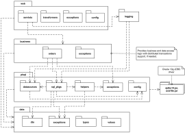](https://www.uml-diagrams.org/multi-layered-web-architecture-uml-package-diagram-example.html)

  

[Java™ Platform Standard Edition 7 API UML package diagram example.](https://www.uml-diagrams.org/java-7-api-uml-package-diagram-example.html?context=pkg-examples)

[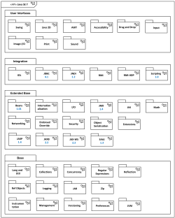](https://www.uml-diagrams.org/java-7-api-uml-package-diagram-example.html?context=pkg-examples)

  

[Java Servlet 2.5 API UML package diagram example](https://www.uml-diagrams.org/examples/java-servlet-25-api-package-diagram-example.html?context=pkg-examples)

[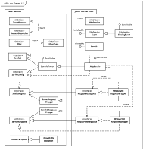](https://www.uml-diagrams.org/examples/java-servlet-25-api-package-diagram-example.html?context=pkg-examples)

  

[Java Servlet 3.0 API UML package diagram example](https://www.uml-diagrams.org/examples/java-servlet-30-api-package-diagram-example.html?context=pkg-examples)

[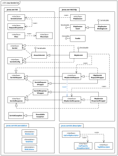](https://www.uml-diagrams.org/examples/java-servlet-30-api-package-diagram-example.html?context=pkg-examples)

  

[Spring and Hibernate ORM data access packages and classes](https://www.uml-diagrams.org/spring-hibernate-uml-package-diagram-example.html)

[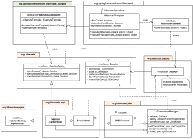](https://www.uml-diagrams.org/spring-hibernate-uml-package-diagram-example.html?context=activity-examples)

  

[(Data) Transfer Object (Value Object) design pattern package template](https://www.uml-diagrams.org/transfer-object-pattern-uml-package-template-example.html)

[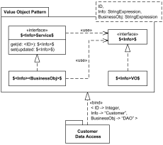](https://www.uml-diagrams.org/transfer-object-pattern-uml-package-template-example.html)

  

### Component Diagrams

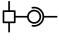[Online shopping component diagram](https://www.uml-diagrams.org/examples/online-shopping-uml-component-diagram-example.html?context=cmp-examples)

[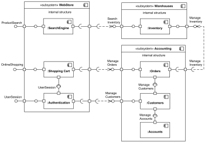](https://www.uml-diagrams.org/examples/online-shopping-uml-component-diagram-example.html?context=cmp-examples)

  

[Sentinel HASP licensing components](https://www.uml-diagrams.org/software-licensing-component-diagram-example.html?context=cmp-examples)

[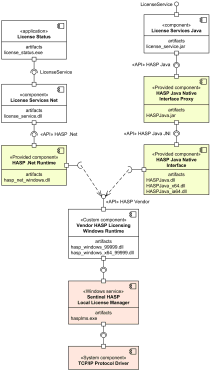](https://www.uml-diagrams.org/software-licensing-component-diagram-example.html?context=cmp-examples)

  

### Deployment Diagrams

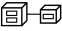[Online shopping web application manifestation](https://www.uml-diagrams.org/web-application-uml-manifest-diagram-example.html?context=depl-examples)

[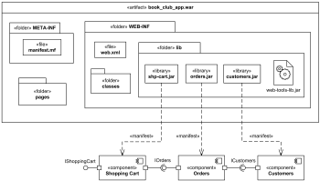](https://www.uml-diagrams.org/web-application-uml-manifest-diagram-example.html?context=depl-examples)

  

[Online shopping web application UML deployment diagram](https://www.uml-diagrams.org/web-application-uml-deployment-diagram-example.html?context=depl-examples)

[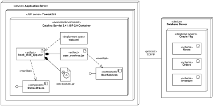](https://www.uml-diagrams.org/web-application-uml-deployment-diagram-example.html?context=depl-examples)

  

[Clustered deployment of J2EE web application](https://www.uml-diagrams.org/web-application-clusters-uml-deployment-diagram-example.html?context=depl-examples)

[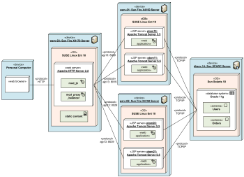](https://www.uml-diagrams.org/web-application-clusters-uml-deployment-diagram-example.html?context=depl-examples)

  

[Multilayered load balancing of J2EE servers](https://www.uml-diagrams.org/web-application-load-balancing-uml-deployment-diagram-example.html?context=depl-examples)

[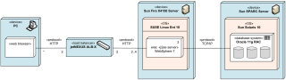](https://www.uml-diagrams.org/web-application-load-balancing-uml-deployment-diagram-example.html?context=depl-examples)

  

[Apple iTunes UML deployment diagram](https://www.uml-diagrams.org/apple-itunes-uml-deployment-diagram-example.html)

[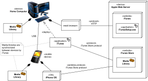](https://www.uml-diagrams.org/apple-itunes-uml-deployment-diagram-example.html)

  

[Android application deployment](https://www.uml-diagrams.org/android-application-uml-deployment-diagram-example.html)

[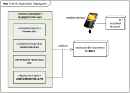](https://www.uml-diagrams.org/android-application-uml-deployment-diagram-example.html)

  

#### Network Diagrams

[Home network diagram example](https://www.uml-diagrams.org/examples/home-network-diagram-example.html?context=depl-examples)

  

[Web application network diagram example](https://www.uml-diagrams.org/examples/web-application-network-diagram-example.html?context=depl-examples)

  

### Profile Diagrams

[Service Oriented Architecture Modeling Language (SoaML) UML profile diagram examples](https://www.uml-diagrams.org/soaml-uml-profile-diagram-example.html)

  

[Java Enterprise JavaBeans (EJB) 3.0 UML Profile](https://www.uml-diagrams.org/java-ejb-uml-profile-diagram-example.html?context=prf-examples)

  

[Digital Imaging and Communications in Medicine (DICOM) UML profile diagram example](https://www.uml-diagrams.org/dicom-uml-profile-diagram-example.html?context=prf-examples)

  

### Activity Diagrams

[Business flow - Process purchase order](https://www.uml-diagrams.org/shopping-process-order-uml-activity-diagram-example.html?context=activity-examples)

  

[Business flow - Document management process](https://www.uml-diagrams.org/document-management-uml-activity-diagram-example.html)

  

[Electronic prescription service](https://www.uml-diagrams.org/electronic-prescriptions-activity-diagram-example.html?context=activity-examples)

  

[Software design - Resolve software issue](https://www.uml-diagrams.org/software-resolve-issue-uml-activity-diagram-example.html)

  

[Software licensing - activation of Sentinel HASP SL provisional product UML activity diagram example](https://www.uml-diagrams.org/software-licensing-activity-diagram-example.html?context=activity-examples)

  

[Online shopping UML activity diagram](https://www.uml-diagrams.org/online-shopping-uml-activity-diagram-example.html?context=activity-examples)

  

[Ticket vending machine](https://www.uml-diagrams.org/ticket-vending-machine-activity-diagram-example.html?context=activity-examples)

  

[Web security - Single Sign-On (SSO) for Google Apps](https://www.uml-diagrams.org/google-sign-on-uml-activity-diagram-example.html)

  

### State Machine Diagrams

[Water Phase Diagram as State Machine](https://www.uml-diagrams.org/examples/water-phase-uml-state-machine-diagram-example.html)

  

[Bank ATM behavioral state machine UML diagram example](https://www.uml-diagrams.org/bank-atm-uml-state-machine-diagram-example.html?context=stm-examples)

  

[Online shopping user account UML state machine diagram example](https://www.uml-diagrams.org/examples/online-shopping-user-account-state-diagram-example.html?context=stm-examples)

  

[Java Thread states and life cycle UML protocol state machine example](https://www.uml-diagrams.org/java-thread-uml-state-machine-diagram-example.html?context=stm-examples)

  

[Java EJB life cycle of a session object UML state machine example](https://www.uml-diagrams.org/java-ejb-state-machine-diagram-example.html?context=stm-examples)

  

[Digital Imaging and Communications in Medicine (DICOM) Hosted Application life cycle UML protocol state machine example](https://www.uml-diagrams.org/dicom-hosted-application-uml-state-machine-diagram-example.html?context=stm-examples)

  

### Sequence Diagrams

[Online bookshop UML sequence diagram](https://www.uml-diagrams.org/online-shopping-uml-sequence-diagram-example.html?context=seq-examples)

  

[Submit comments to Pluck using DWR, AJAX, JSON](https://www.uml-diagrams.org/pluck-comments-uml-sequence-diagram-example.html)

  

[Facebook user authentication in a web application](https://www.uml-diagrams.org/facebook-authentication-uml-sequence-diagram-example.html)

  

[Spring and Hibernate transaction management](https://www.uml-diagrams.org/examples/spring-hibernate-transaction-sequence-diagram-example.html)

  

### Timing Diagrams

[Medical domain - Stages of Alzheimer’s disease UML timing diagram example](https://www.uml-diagrams.org/alzheimers-uml-timing-diagram-example.html)

  

[Web user experience - Website latency UML timing diagram example](https://www.uml-diagrams.org/website-latency-uml-timing-diagram-example.html)

  

### Communication Diagrams

[Online bookshop communication diagram](https://www.uml-diagrams.org/examples/online-shopping-uml-communication-diagram-example.html?context=cmm-examples)

  

### Interaction Overview Diagrams

[Online shopping interaction overview diagram](https://www.uml-diagrams.org/online-shopping-uml-interaction-overview-diagram-example.html?context=iov-examples)

  

[Submit comments to Pluck using DWR, AJAX, JSON](https://www.uml-diagrams.org/pluck-comments-uml-interaction-overview-example.html)

  

  

This document describes UML versions up to **[UML 2.5](https://www.uml-diagrams.org/references.html#ref-uml-25 "UML 2.5 Specification")** and is based on the corresponding **OMG™ Unified Modeling Language™ (OMG UML®)** specifications. UML diagrams were created in **Microsoft® Visio®** 2007-2016 using **[UML 2.x Visio Stencils](http://softwarestencils.com/uml/index.html "Visio Stencil and Template for UML 2.5")**. You can send your comments and suggestions to [webmaster](mailto:webmaster@uml-diagrams.org). [Privacy policy](https://www.uml-diagrams.org/privacy-policy.html).

_Copyright © 2009-2026 uml-diagrams.org. All rights reserved. Authored by Kirill Fakhroutdinov._

[How to Protect Your Bone Health During Weight Loss GoodRx | [Sponsored](https://popup.taboola.com/en/?template=colorbox&utm_source=uml-diagrams&utm_medium=referral&utm_content=next-up-a-delta:Next%20Up:)[Sponsored](https://popup.taboola.com/en/?template=colorbox&utm_source=uml-diagrams&utm_medium=referral&utm_content=next-up-a-delta:Next%20Up:) Read Next Story](https://www.goodrx.com/conditions/weight-loss/bone-mass-decrease-with-weight-loss "How to Protect Your Bone Health During Weight Loss")
