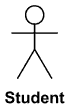
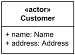
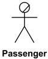
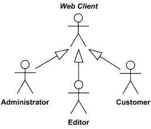

Title: UML actor is a role played by a human user of the designed system, some other system or hardware that interacts with the subject by using services of the subject.

URL Source: https://www.uml-diagrams.org/use-case-actor.html

Warning: Target URL returned error 400: Bad Request

Markdown Content:
Menu►
*   [UML diagrams](https://www.uml-diagrams.org/ "UML graphical notation overview, examples, and reference.")
*   [Use case diagrams](https://www.uml-diagrams.org/use-case-diagrams.html "UML Use Case diagrams overview of graphical notation")
*   [Subject](https://www.uml-diagrams.org/use-case-subject.html "Subject of UML use case diagrams")
*   [Actor](https://www.uml-diagrams.org/use-case-actor.html "Actor of UML use case diagrams")
*   [Use case](https://www.uml-diagrams.org/use-case.html "Use case of UML use case diagrams")
*   [Association](https://www.uml-diagrams.org/use-case-actor-association.html "Association between actor and use case in UML use case diagrams")
*   [Extend](https://www.uml-diagrams.org/use-case-extend.html "Extend relationship of UML use case diagrams")
*   [Include](https://www.uml-diagrams.org/use-case-include.html "Include relationship of UML use case diagrams")
*   [How to draw](https://www.uml-diagrams.org/use-case-diagrams-how-to.html "How to Draw UML Use Case Diagram.")
*   [Use case diagrams examples](https://www.uml-diagrams.org/use-case-diagrams-examples.html "UML Use Case diagrams examples")
*   [Use case diagrams reference](https://www.uml-diagrams.org/use-case-reference.html "UML Use Case diagrams graphical notation reference")
*   [Use case diagrams FAQ](https://www.uml-diagrams.org/use-case-diagrams-questions-answers.html "UML Use Case diagrams FAQ")
*   [UML index](https://www.uml-diagrams.org/index-references.html "Index of UML Elements")

# UML Actor

An **actor** is [behaviored classifier](https://www.uml-diagrams.org/common-behaviors.html#behaviored-classifier) which specifies a **role** played by an **external entity** that interacts with the [subject](https://www.uml-diagrams.org/use-case-subject.html) (e.g., by exchanging signals and data), a human user of the designed system, some other system or hardware using services of the subject.

The term "**role**" is used informally as some type, group or particular facet of users that require specific services from the subject modeled with associated use cases. When an external entity interacts with the subject, it plays the role of a specific actor. That single physical entity may play several different roles, and a specific role may be played by single or multiple different instances.

Since an actor is external to the subject, it is typically defined in the same classifier or package that incorporates the [subject](https://www.uml-diagrams.org/use-case-subject.html).

All actors must have names according to the assumed role. Examples of actor names (user roles):

*   Customer
*   Web Client
*   Student
*   Passenger
*   Payment System

Standard UML notation for actor is "**stick man**" icon with the name of the actor above or below of the icon. Actor names should follow the capitalization and punctuation guidelines for [classes](https://www.uml-diagrams.org/class.html). The names of **abstract actors** should be shown in italics.

Student **actor**

**Custom icons** that convey the kind of actor may also be used to denote an actor, such as using a separate icon(s) for non-human actors.

Custom icon for Web Client **actor**

Custom icon for Bank **actor**

An actor may also be shown as a [class](https://www.uml-diagrams.org/class.html) rectangle with the standard keyword **«actor»**, having usual notation for class compartments, if needed.

Customer **actor** as Class

An **actor** can only have [binary associations](https://www.uml-diagrams.org/association.html#binary-association) to [use cases](https://www.uml-diagrams.org/use-case.html), **components**, and **classes**.

## Business Actor

A **business actor** (introduced in **Rational Unified Process** (RUP) to support business modeling) represents a role played by some person or system **external** to the modeled **business** and interacting with the business. Note, business actor is **not** defined in UML standard.

Some typical examples of business actors are:

*   Customer
*   Supplier
*   Patron
*   Passenger
*   Authority
*   Bank

Each **business actor** represents something outside of the modeled business and should be involved with at least one [business use case](https://www.uml-diagrams.org/use-case.html#business-use-case).

**Business actor** is represented in RUP by "**stick man**" icon with a line crossing its head.

**Business actor** Passenger

### Relationships Between Actors

We can define **abstract** or **concrete** actors and specialize them using **generalization** relationship.

[Generalization](https://www.uml-diagrams.org/generalization.html) between actors is rendered as a solid directed line with a large arrowhead (same as for generalization between classes).

Web Client actor is abstract superclass for Administrator, Editor and Customer

[Use case association](https://www.uml-diagrams.org/use-case-actor-association.html "UML use case association")

This document describes **UML 2.5** and is based on **OMG™ Unified Modeling Language™ (OMG UML®) 2.5** specification [[UML 2.5 RTF - Beta 2]](https://www.uml-diagrams.org/references.html#ref-uml-25-b2 "UML 2.5 Specification RTF Beta 2"). All UML diagrams were created in **Microsoft Visio** 2007-2016 using [UML 2.2 stencils](http://softwarestencils.com/uml/index.html "Visio Stencil and Template for UML 2.2"). You can send your comments and suggestions to [webmaster](mailto:webmaster@uml-diagrams.org). [Privacy policy](https://www.uml-diagrams.org/privacy-policy.html).

_Copyright © 2009-2026 uml-diagrams.org. All rights reserved. Authored by Kirill Fakhroutdinov._

[One Person, 100 Seats, 7 Minutes: Japan's Train Cleaners wovana | [Sponsored](https://popup.taboola.com/en/?template=colorbox&utm_source=uml-diagrams&utm_medium=referral&utm_content=next-up-a-delta:Next%20Up:)[Sponsored](https://popup.taboola.com/en/?template=colorbox&utm_source=uml-diagrams&utm_medium=referral&utm_content=next-up-a-delta:Next%20Up:) Read Next Story](https://kitchen-gardens.info/story/shinkansen-seven-minute-cleaning-crew "One Person, 100 Seats, 7 Minutes: Japan's Train Cleaners")
