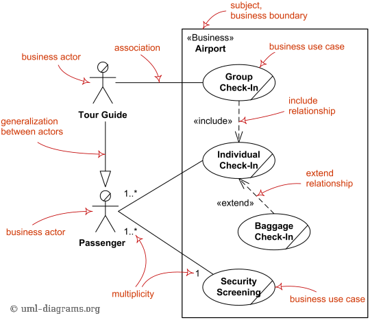
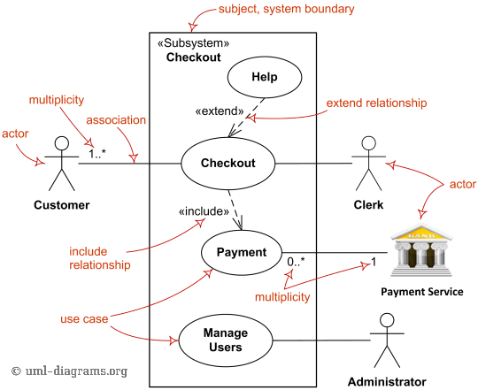

Title: Use case diagrams are UML diagrams describing units of useful functionality (use cases) performed by a system in collaboration with external users (actors).

URL Source: https://www.uml-diagrams.org/use-case-diagrams.html

Markdown Content:
Menu►
*   [UML diagrams](https://www.uml-diagrams.org/ "UML graphical notation overview, examples, and reference.")
*   [Use case diagrams](https://www.uml-diagrams.org/use-case-diagrams.html "UML Use Case diagrams overview of graphical notation")
*   [Subject](https://www.uml-diagrams.org/use-case-subject.html "Subject of UML use case diagrams")
*   [Actor](https://www.uml-diagrams.org/use-case-actor.html "Actor of UML use case diagrams")
*   [Use case](https://www.uml-diagrams.org/use-case.html "Use case of UML use case diagrams")
*   [Association](https://www.uml-diagrams.org/use-case-actor-association.html "Association between actor and use case in UML use case diagrams")
*   [Extend](https://www.uml-diagrams.org/use-case-extend.html "Extend relationship of UML use case diagrams")
*   [Include](https://www.uml-diagrams.org/use-case-include.html "Include relationship of UML use case diagrams")
*   [How to draw](https://www.uml-diagrams.org/use-case-diagrams-how-to.html "How to Draw UML Use Case Diagram.")
*   [Use case diagrams examples](https://www.uml-diagrams.org/use-case-diagrams-examples.html "UML Use Case diagrams examples")
*   [Use case diagrams reference](https://www.uml-diagrams.org/use-case-reference.html "UML Use Case diagrams graphical notation reference")
*   [Use case diagrams FAQ](https://www.uml-diagrams.org/use-case-diagrams-questions-answers.html "UML Use Case diagrams FAQ")
*   [UML index](https://www.uml-diagrams.org/index-references.html "Index of UML Elements")

# UML Use Case Diagrams

**Use case diagrams** are usually referred to as [behavior diagrams](https://www.uml-diagrams.org/uml-25-diagrams.html#behavior-diagram) used to describe a set of actions ([use cases](https://www.uml-diagrams.org/use-case.html)) that some system or systems ([subject](https://www.uml-diagrams.org/use-case-subject.html)) should or can perform in collaboration with one or more **external users** of the system ([actors](https://www.uml-diagrams.org/use-case-actor.html)). Each use case should provide some observable and valuable result to the actors or other stakeholders of the system.

Note, that UML 2.0 to 2.4 specifications also described **use case diagram** as a specialization of a [class diagram](https://www.uml-diagrams.org/class-diagrams-overview.html), and class diagram is a [structure diagram](https://www.uml-diagrams.org/uml-25-diagrams.html#structure-diagram).

Use case diagrams are in fact twofold - they are both [behavior diagrams](https://www.uml-diagrams.org/uml-25-diagrams.html#behavior-diagram), because they describe behavior of the system, and they are also [structure diagrams](https://www.uml-diagrams.org/uml-25-diagrams.html#structure-diagram) - as a special case of class diagrams where classifiers are restricted to be either [actors](https://www.uml-diagrams.org/use-case-actor.html) or [use cases](https://www.uml-diagrams.org/use-case.html) related to each other with [associations](https://www.uml-diagrams.org/association.html).

[[UML 2.5 FTF - Beta 1]](https://www.uml-diagrams.org/references.html#ref-uml-25-b1 "UML 2.5 Specification FTF Beta 1") moved use cases out of behavior modeling to UML **supplementary concepts**. So, it is an unfortunate quandary what kind of UML diagrams use case diagrams are.

## Business Use Case Diagrams

While support for **business modeling** was declared as one of the goals of the UML, UML specification provides **no notation** specific to business needs.

[Business use cases](https://www.uml-diagrams.org/use-case.html#business-use-case) were introduced in **Rational Unified Process** (RUP) to represent business function, process, or activity performed in the modeled **business**. A [business actor](https://www.uml-diagrams.org/use-case-actor.html#business-actor) represents a role played by some person or system external to the modeled business, and interacting with the business. Business use case should produce a result of observable value to a business actor.

Major elements of the business use case diagram are shown on the picture below. Note again, both business use case as well as business actor are not defined in UML standard, so you will either need to use some UML tool supporting those or create your own business modeling stereotypes.

Major elements of business use case diagram - [business actor](https://www.uml-diagrams.org/use-case-actor.html#business-actor), [business use case](https://www.uml-diagrams.org/use-case.html#business-use-case),   
[business boundary](https://www.uml-diagrams.org/use-case-subject.html), [include](https://www.uml-diagrams.org/use-case-include.html) and [extend](https://www.uml-diagrams.org/use-case-extend.html) relationships.

## System Use Case Diagrams

(System) Use case diagrams are used to specify:

*   (external) **requirements**, required usages of a system under design or analysis ([subject](https://www.uml-diagrams.org/use-case-subject.html)) - to capture what the system is supposed to do;
*   the **functionality** offered by a subject – what the system can do;
*   requirements the specified subject poses on its **environment** - by defining how environment should interact with the subject so that it will be able to perform its services.

Major elements of the UML use case diagram are shown on the picture below.

Major elements of UML use case diagram - [actor](https://www.uml-diagrams.org/use-case-actor.html), [use case](https://www.uml-diagrams.org/use-case.html), [subject](https://www.uml-diagrams.org/use-case-subject.html),  
[include](https://www.uml-diagrams.org/use-case-include.html) and [extend](https://www.uml-diagrams.org/use-case-extend.html) relationships.

[Use Case Subject](https://www.uml-diagrams.org/use-case-subject.html "UML use case subject")

This document describes **UML 2.5** and is based on **OMG™ Unified Modeling Language™ (OMG UML®) 2.5** specification [[UML 2.5 RTF - Beta 2]](https://www.uml-diagrams.org/references.html#ref-uml-25-b2 "UML 2.5 Specification RTF Beta 2"). All UML diagrams were created in **Microsoft Visio** 2007-2016 using [UML 2.2 stencils](http://softwarestencils.com/uml/index.html "Visio Stencil and Template for UML 2.2"). You can send your comments and suggestions to [webmaster](mailto:webmaster@uml-diagrams.org). [Privacy policy](https://www.uml-diagrams.org/privacy-policy.html).

_Copyright © 2009-2026 uml-diagrams.org. All rights reserved. Authored by Kirill Fakhroutdinov._

[How to Protect Your Bone Health During Weight Loss GoodRx | [Sponsored](https://popup.taboola.com/en/?template=colorbox&utm_source=uml-diagrams&utm_medium=referral&utm_content=next-up-a-delta:Next%20Up:)[Sponsored](https://popup.taboola.com/en/?template=colorbox&utm_source=uml-diagrams&utm_medium=referral&utm_content=next-up-a-delta:Next%20Up:) Read Next Story](https://www.goodrx.com/conditions/weight-loss/bone-mass-decrease-with-weight-loss "How to Protect Your Bone Health During Weight Loss")
