Title: UML Use case specifies complete and useful behavior of a subject (system under construction or consideration) that yields an observable result of some value to one or more actors.

URL Source: https://www.uml-diagrams.org/use-case.html

Markdown Content:
Menu►
*   [UML diagrams](https://www.uml-diagrams.org/ "UML graphical notation overview, examples, and reference.")
*   [Use case diagrams](https://www.uml-diagrams.org/use-case-diagrams.html "UML Use Case diagrams overview of graphical notation")
*   [Subject](https://www.uml-diagrams.org/use-case-subject.html "Subject of UML use case diagrams")
*   [Actor](https://www.uml-diagrams.org/use-case-actor.html "Actor of UML use case diagrams")
*   [Use case](https://www.uml-diagrams.org/use-case.html "Use case of UML use case diagrams")
*   [Association](https://www.uml-diagrams.org/use-case-actor-association.html "Association between actor and use case in UML use case diagrams")
*   [Extend](https://www.uml-diagrams.org/use-case-extend.html "Extend relationship of UML use case diagrams")
*   [Include](https://www.uml-diagrams.org/use-case-include.html "Include relationship of UML use case diagrams")
*   [How to draw](https://www.uml-diagrams.org/use-case-diagrams-how-to.html "How to Draw UML Use Case Diagram.")
*   [Use case diagrams examples](https://www.uml-diagrams.org/use-case-diagrams-examples.html "UML Use Case diagrams examples")
*   [Use case diagrams reference](https://www.uml-diagrams.org/use-case-reference.html "UML Use Case diagrams graphical notation reference")
*   [Use case diagrams FAQ](https://www.uml-diagrams.org/use-case-diagrams-questions-answers.html "UML Use Case diagrams FAQ")
*   [UML index](https://www.uml-diagrams.org/index-references.html "Index of UML Elements")

# UML Use Case

Use cases allow to capture requirements of systems under design or consideration, describe functionality provided by those systems, and determine the requirements the systems pose on their environment.

UML Specifications, e.g. [[UML 2.5 RTF - Beta 2]](https://www.uml-diagrams.org/references.html#ref-uml-25-b2 "UML 2.5 Specification RTF Beta 2") provide several slightly different definitions of use case. I compiled the definition below from those pieces.

A **use case** is a kind of [behaviored classifier](https://www.uml-diagrams.org/common-behaviors.html#behaviored-classifier) that specifies a [complete] unit of [useful] functionality performed by [one or more] [subjects](https://www.uml-diagrams.org/use-case-subject.html) to which the [use case applies](https://www.uml-diagrams.org/use-case-subject.html#apply-use-case) in collaboration with one or more [actors](https://www.uml-diagrams.org/use-case-actor.html), and which [for complete use cases] yields an observable result that is of some value to those actors [or other stakeholders] of each subject.

UML specifications require that "this functionality must always be completed for the UseCase to complete. It is deemed complete if, after its execution, the subject will be in a state in which no further inputs or actions are expected and the UseCase can be initiated again, or in an error state."

The problem with this requirement is that it doesn't consider [extending use cases](https://www.uml-diagrams.org/use-case-extend.html) and [included use cases](https://www.uml-diagrams.org/use-case-include.html). The extending use case may not necessarily be meaningful by itself. Included use case is some common part extracted to a separate use case. It is also seems inapplicable to require to yield an observable result.

It is also doubtful that use case functionality is always **useful**: "Each UseCase specifies a unit of useful functionality that the subject provides to its users."

"A UseCase may apply to any number of subjects." It is reasonable to expect to have at least one subject for each use case, otherwise the definition of use case will make no sense. At the same time, UseCase class description in UML specification allows use case to have no associated subjects.

While "the key concepts specified in this clause are Actors, UseCases, and subjects" one of the definitions of use case somehow also mentions "other stakeholders of the subject." It should be enough to have actors, and if "stakeholders" have something else to add, they should be included in the UML specification as a separate concept.

UML specifications until UML 2.5 required that use case functionality is **initiated by an actor**. In UML 2.5 this was removed, meaning that there could be some situations when system functionality is started by system itself while still providing useful result to an actor. For example, system could notify a customer that order was shipped, schedule user information cleanup and archiving, request some information from another system, etc.

Also, all UML 2.x specifications until UML 2.5 stated that use cases "are defined according to the needs of actors." This sentence was removed from UML 2.5 as some actors might have neither needs nor requirements by themselves.

#### Naming Use Cases

UML Specification provides no guidelines on use case names. The only requirement is that each use case must have a name. We should just follow use case definition to give some name to that unit of functionality performed by a system which provides some observable and useful result to an actor. Examples of use case names:

*   Make Purchase
*   Place Order
*   Update Subscription
*   Transfer Funds
*   Hire Employee
*   Manage Account

#### Notation

Use case is usually shown as an ellipse containing the name of the use case.

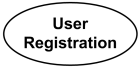
User Registration **use case**

Name of the use case could also be placed below the ellipse.

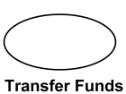
Transfer Funds **use case**

If a [subject](https://www.uml-diagrams.org/use-case-subject.html) (or system boundary) is displayed, the use case ellipse is visually located inside the system boundary rectangle. Note, that this does not necessarily mean that the subject classifier owns the contained use cases, but merely that the use case **applies** to that classifier.

Use cases have no standard keywords or stereotypes. Use case could be shown with a **custom stereotype** above the name. As a classifier, use case has [properties](https://www.uml-diagrams.org/property.html). A list of use case properties - [operations](https://www.uml-diagrams.org/operation.html) and [attributes](https://www.uml-diagrams.org/property.html#classifier-attribute) - could be shown in a compartment within the use case oval below the use case name.

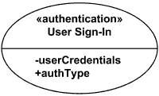
**Use Case** User Sign-In stereotyped as «authentication»

Use case with [extension points](https://www.uml-diagrams.org/use-case-extend.html#extension-point) may be listed in a compartment of the use case with the heading **extension points**.

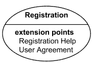
Registration **Use Case** with **extension points** Registration Help and User Agreement

A use case can also be shown using the standard rectangle notation for classifiers with an ellipse icon in the upper right-hand corner of the rectangle and with optional separate list compartments for its features.

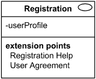
Registration **Use Case** shown using the standard rectangle notation for classifiers

## Abstract Use Case

All UML 2.x specifications including **UML 2.5** do not mention, define or explain **abstract use cases**. **UML 1.x** specification mentioned that "the name of an abstract use case may be shown in italics" but since **UML 2.0** this sentence was removed from UML specifications without any explanations.

One reason that the sentence was removed could be that because use case is a [classifier](https://www.uml-diagrams.org/classifier.html), and any classifier could be abstract (with the name shown in italics), it is obvious that it should be applicable to the use cases as well.

On the other hand, as the sentence was removed and **UML 2.5** does not mention **abstract use cases** at all and does not provide even a single example of abstract use cases, it could mean that they expect all use cases to be **concrete**, not abstract. In this case, it would be reasonable to have this situation explained explicitly in UML specification.

Assuming use case could be abstract and applying appropriate definition for the [classifier](https://www.uml-diagrams.org/classifier.html), **abstract use case** is use case which does not have complete declaration (is **incomplete**) and ("typically", as UML specification says) can not be instantiated. An abstract use case is intended to be used by other use cases, e.g., as a target of [generalization](https://www.uml-diagrams.org/use-case.html#generalization) relationship. I hope that "the name of an abstract use case may be shown in italics" is still applicable in UML 2.5, as it was specified in UML 1.x.

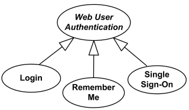
Web User Authentication use case is [abstract use case](https://www.uml-diagrams.org/use-case.html#abstract-use-case)  
 specialized by Login, Remember Me and Single Sign-On use cases.

When UML 2.4 specification describes [include](https://www.uml-diagrams.org/use-case-include.html) relationship between use cases, they explain that "what is left in a base use case is usually **not complete**", but for some reason avoiding to call it **abstract use case**. Generally, it should mean that including use case is always abstract.

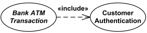
Bank ATM Transaction use case becomes [abstract use case](https://www.uml-diagrams.org/use-case.html#abstract-use-case)  
 as a result of including Customer Authentication use case.

Though UML specification avoids doing it, it is quite common to find sources that define including use cases as **abstract use cases** or **essential** use cases. While we may assume that including use cases are always abstract, included use case could probably be either abstract or concrete. Amazingly, there are some sources - that I can't agree with - providing exactly opposite explanation that including (base) use cases are "usually concrete", while included ("addition") use cases are "usually abstract".

To add even more to the confusion, yet other sources define abstract use cases as use cases described at the abstract level (business use cases, sometimes called essential use cases) as opposed to the system use cases.

## Business Use Case

Though support for **business modeling** is declared as a goal of UML, UML specification provides no notion for **business use cases**.

**Business use cases** were introduced in **Rational Unified Process** (RUP) to support Business Modeling to represent business function, process, or activity performed in the modeled **business**. Business use case should produce a result of observable value to a [business actor](https://www.uml-diagrams.org/use-case-actor.html#business-actor).

A **business use case** defines what happens in the business when the use case is requested by business actor, it describes complete workflow or business process that produces results required or in need of business actor.

**Business use case** is represented in RUP with use case oval and a line crossing it as shown below.

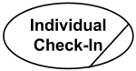
**Business use case** Individual Check-In

There are two alternative approaches to name business use cases. Use case could be named from the point of view of [business actor](https://www.uml-diagrams.org/use-case-actor.html#business-actor) - expressing goal or need of the actor - or from the point of view of business itself - by giving names to **business processes** or services provided to business actors.

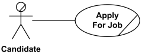
**Business use case** - Candidate Applies for Job

The **Apply for Job** business use case expresses the goal of the **Candidate** business actor. Alternative name from business view would be **Hire Staff**.

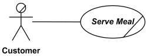
**Business use case** - Business Serves Meal to Customer

In this case, business use case is named according to the business process or service - business **Serves Meal** to **Customer**. Alternative name from actor view would be **Have Meal**.

You can see other differences between these two approaches by comparing examples of business use case diagrams for [Restaurant](https://www.uml-diagrams.org/restaurant-uml-use-case-diagram-example.html).

## Describing Use Case Behaviors

Use case [behaviors](https://www.uml-diagrams.org/common-behaviors.html#behavior) may be described in a natural language text (opaque behavior), which is current common practice, or by using UML [behavior diagrams](https://www.uml-diagrams.org/uml-25-diagrams.html#behavior-diagram) for specific behaviors such as

*   [activity](https://www.uml-diagrams.org/activity-diagrams.html#activity),
*   [state machine](https://www.uml-diagrams.org/state-machine-diagrams.html#behavioral-state-machine),
*   [interaction](https://www.uml-diagrams.org/interaction.html).

Behavior of a use case may also be described indirectly through a [collaboration](https://www.uml-diagrams.org/collaboration-diagrams/collaboration.html) that uses the use case and its actors as the classifiers that type its [parts](https://www.uml-diagrams.org/composite-structure-diagrams/part.html).

Which of these techniques to use depends on the nature of the use case behavior as well as on the intended reader. These descriptions can be combined.

UML tools should allow linking behaviors to the described use case. Use case could be rendered in a [frame](https://www.uml-diagrams.org/frame.html) labeled as **use case** or **uc** (abbreviated form). Content area of the frame could be represented by different kinds of UML diagrams describing behavior of the use case.

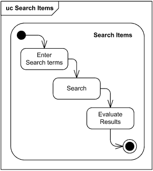
**Use case** Search Items rendered as frame with  
 associated Search Items [activity diagram](https://www.uml-diagrams.org/activity-diagrams.html)

Another example of such binding of a use case to the behavior represented by activity is shown below using UML 2.5 notation.

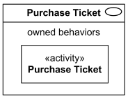
Purchase Ticket use case owns behavior  
 represented by Purchase Ticket activity.

Purchase Ticket activity diagram example below describes behavior of the Purchase Ticket use case.

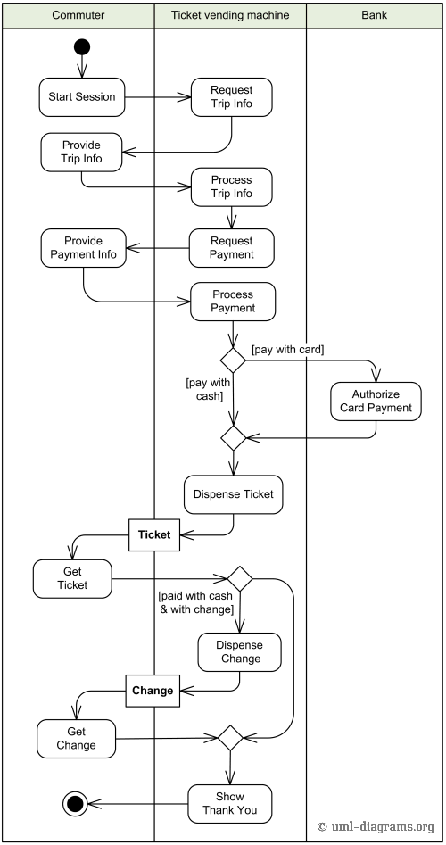
Example of Purchase Ticket use case behavior described using activity diagram.

An execution of a use case is an occurrence of emergent behavior. Every instance of a classifier realizing a use case must behave in the manner described by the use case.

## Relationships Between Use Cases

Use cases could be organized using following relationships:

*   [generalization](https://www.uml-diagrams.org/use-case.html#generalization)
*   [association](https://www.uml-diagrams.org/use-case.html#association)
*   [extend](https://www.uml-diagrams.org/use-case-extend.html)
*   [include](https://www.uml-diagrams.org/use-case-include.html)

### Generalization Between Use Cases

[Generalization](https://www.uml-diagrams.org/generalization.html) between use cases is similar to generalization between classes – child use case inherits properties and behavior of the parent use case and may override the behavior of the parent.

Generalization is shown as a solid directed line with a large hollow triangle arrowhead, the same as for [generalization](https://www.uml-diagrams.org/generalization.html) between classifiers, directed from the more specific use case to the general use case.

Web User Authentication use case is [abstract use case](https://www.uml-diagrams.org/use-case.html#abstract-use-case)  
 specialized by Login, Remember Me and Single Sign-On use cases.

### Association Between Use Cases

Use cases can only be involved in [binary associations](https://www.uml-diagrams.org/association.html#binary-association).

Two use cases specifying the same [subject](https://www.uml-diagrams.org/use-case-subject.html) cannot be associated since each of them individually describes a complete usage of the system.

[Use Case Extend](https://www.uml-diagrams.org/use-case-extend.html "UML use case extend")

This document describes **UML 2.5** and is based on **OMG™ Unified Modeling Language™ (OMG UML®) 2.5** specification [[UML 2.5 RTF - Beta 2]](https://www.uml-diagrams.org/references.html#ref-uml-25-b2 "UML 2.5 Specification RTF Beta 2"). All UML diagrams were created in **Microsoft Visio** 2007-2016 using [UML 2.2 stencils](http://softwarestencils.com/uml/index.html "Visio Stencil and Template for UML 2.2"). You can send your comments and suggestions to [webmaster](mailto:webmaster@uml-diagrams.org). [Privacy policy](https://www.uml-diagrams.org/privacy-policy.html).

_Copyright © 2009-2026 uml-diagrams.org. All rights reserved. Authored by Kirill Fakhroutdinov._

[Ski the French Alps this Winter OnTheSnow Magazine | [Sponsored](https://popup.taboola.com/en/?template=colorbox&utm_source=uml-diagrams&utm_medium=referral&utm_content=next-up-a-delta:Next%20Up:)[Sponsored](https://popup.taboola.com/en/?template=colorbox&utm_source=uml-diagrams&utm_medium=referral&utm_content=next-up-a-delta:Next%20Up:) Read Next Story](https://www.onthesnow.com/news/alpe-dhuez-and-les-2-alpes-the-french-resorts-to-discover-this-winter "Ski the French Alps this Winter")
