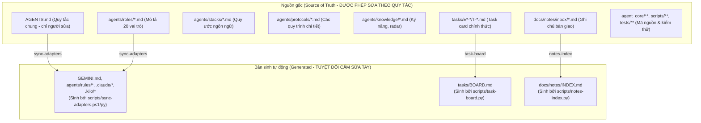

> Task: T-17 · Epic: E2 · Vai: writer

# Bản đồ điều hướng tài liệu và mã nguồn (CODEMAP)

Tài liệu này cung cấp bản đồ định hướng nhanh cho tác tử và lập trình viên: *"Cần biết gì → Đọc file nào → Tìm gì"*, giúp nạp đúng ngữ cảnh tối thiểu mà không cần đọc tràn lan toàn bộ repo.

---

## 1. Sơ đồ cấu trúc tổng thể: Nguồn gốc vs Bản sinh

---

## 2. Bản đồ tra cứu: "Cần biết gì → Đọc file nào → Tìm gì"

| # | Cần biết gì | Đọc file nào | Lệnh tìm / Grep mẫu |
|---|---|---|---|
| 1 | Quy tắc ứng xử cốt lõi, luật cứng, cỡ việc | `AGENTS.md` | `Select-String "LUẬT CỨNG" AGENTS.md` |
| 2 | Cấu hình, lệnh test/lint/build của repo này | `PROJECT.md` | `Select-String "Lệnh vận hành" PROJECT.md` |
| 3 | Nhiệm vụ, quyền hạn và checklist của từng vai trò | `agents/roles/<vai>.md` | `Get-Content agents/roles/dev.md` |
| 4 | Tiến độ toàn bộ các task và epic hiện hành | `tasks/BOARD.md` | `Select-String "Làm được ngay" tasks/BOARD.md` |
| 5 | Danh mục epic của dự án và mã phase | `tasks/EPICS.md` | `Get-Content tasks/EPICS.md` |
| 6 | Ghi chú kinh nghiệm, bẫy lỗi từ các agent trước | `docs/PROJECT-NOTES.md` | `Select-String "Lưu ý và bẫy" docs/PROJECT-NOTES.md` |
| 7 | Hộp thư ghi chú bàn giao chưa gộp | `docs/notes/INDEX.md` | `Select-String "T-<n>" docs/notes/INDEX.md` |
| 8 | Quy trình phê duyệt bằng file và thẩm quyền người - AI | `agents/protocols/approval.md` | `Select-String "Chỉ con người" agents/protocols/approval.md` |
| 9 | Khuôn mẫu prompt giao việc cho mô hình khác | `agents/protocols/delegation-prompt.md` | `Select-String "Bảy thành phần" agents/protocols/delegation-prompt.md` |
| 10 | Thứ tự giải quyết khi tài liệu mâu thuẫn | `agents/protocols/source-precedence.md` | `Select-String "Bảng thứ tự ưu tiên" agents/protocols/source-precedence.md` |
| 11 | Tiêu chuẩn văn phong đặc tả và bộ 3 file chức năng | `agents/protocols/spec-writing.md` | `Select-String "Tám nguyên tắc" agents/protocols/spec-writing.md` |
| 12 | Cách viết task card, phạm vi `scope_edit` và subtask | `agents/protocols/task-card.md` | `Select-String "Phân Rã Subtasks" agents/protocols/task-card.md` |
| 13 | Tiêu chuẩn bàn giao và độ dài ghi chú (<= 80 dòng) | `agents/protocols/handoff-note.md` | `Select-String "Giới hạn độ dài" agents/protocols/handoff-note.md` |
| 14 | Quy tắc quản lý nhánh và commit theo GitFlow | `agents/protocols/git-rules.md` | `Select-String "Quy tắc commit" agents/protocols/git-rules.md` |
| 15 | Quy trình thẩm định rủi ro và phiếu RK | `agents/protocols/risk-gate.md` | `Select-String "Lập phiếu" agents/protocols/risk-gate.md` |
| 16 | Danh sách 31 kỹ năng tích hợp sẵn trong repo | `agents/knowledge/skills.md` | `Select-String "skills" agents/knowledge/skills.md` |

---

## 3. Thứ tự ưu tiên nguồn khi có mâu thuẫn

Chi tiết xem tại [agents/protocols/source-precedence.md](../agents/protocols/source-precedence.md):
1. **Dấu phê duyệt của con người** (trong task card, phiếu RK, `docs/approvals/`).
2. **Đặc tả kiến trúc & ADR đã duyệt** (`docs/adr/`, `docs/spec/`).
3. **Yêu cầu chức năng chi tiết** (`docs/requirements/`).
4. **Mã nguồn đang chạy thật & bộ unit test xanh** (`agent_core/`, `tests/`).
5. **Tài liệu chuyển đổi từ bên ngoài** (`docs/converted/`).
6. **Bản thảo phân tích / đề xuất (Draft)** (`docs/analysis/`, `docs/notes/inbox/`).

*Nguyên tắc*: Khi gặp mâu thuẫn, ghi nhận vào câu hỏi mở cho người dùng, **tuyệt đối cấm âm thầm chọn một bên**.

---

## 4. Danh mục bản sinh tự động (CẤM SỬA TAY)

Các tệp dưới đây được sinh tự động bởi script công cụ; mọi sửa đổi trực tiếp bằng tay sẽ bị ghi đè hoặc gây lỗi CI:

| Tệp / Thư mục bản sinh | Script sinh tự động | Lệnh kiểm tra tính đồng bộ |
|---|---|---|
| `GEMINI.md` | `scripts/sync-adapters.py` (hoặc `.ps1`) | `python scripts/sync-adapters.py --check` |
| `.agents/rules/**` | `scripts/sync-adapters.py` | `python scripts/sync-adapters.py --check` |
| `.claude/**` | `scripts/sync-adapters.py` | `python scripts/sync-adapters.py --check` |
| `.kilo/**` | `scripts/sync-adapters.py` | `python scripts/sync-adapters.py --check` |
| `tasks/BOARD.md` | `scripts/task-board.py` | `python scripts/task-board.py --check` |
| `docs/notes/INDEX.md` | `scripts/notes-index.py` | `python scripts/notes-index.py --check` |
| `.claude/skills`, `.qoder/skills` | `scripts/link-skills.py` | `python scripts/link-skills.py --check` |
