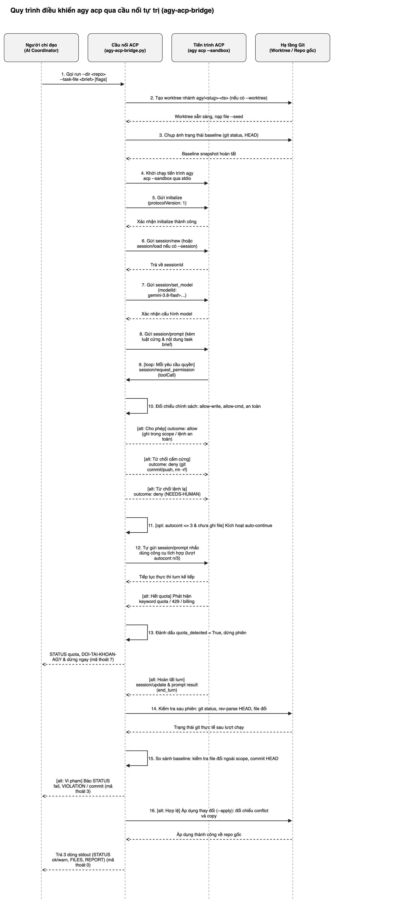

# Cầu nối tự trị Antigravity ACP (agy-acp-bridge)

Cầu nối điều khiển `agy acp --sandbox` (Agent Client Protocol qua JSON-RPC stdio) cho phép AI chỉ đạo ủy thác tác vụ tự trị, tự duyệt quyền an toàn, hỗ trợ hội thoại nhiều lượt và kiểm toán toàn diện.

## 1. Lệnh mẫu một dòng
```bash
python3 scripts/agy-acp-bridge.py run --dir <repo> --task-file <brief.md> --allow-write <path>... [--allow-cmd <regex>...] [--model <m>] [--session <id>] [--worktree --seed <file>... --apply]
```

## 2. Ý nghĩa 3 dòng stdout & Mã thoát
- **Dòng 1 (`STATUS`)**: `<ok|warn|fail|quota> session=<id> tokens=<t> denied=<d> [autocont=<n>] [DOI-TAI-KHOAN-AGY]`
- **Dòng 2 (`FILES`)**: `<n> changed [<files>] [[VIOLATION: <viols>]] [[CONFLICT: <confs>]] [wt=<path>] [applied=<k>]`
- **Dòng 3 (`REPORT`)**: Đường dẫn tuyệt đối đến file markdown báo cáo kiểm toán chi tiết.
- **Mã thoát**: `0`: Thành công (`ok` hoặc `warn` khi có lệnh lạ); `2`: agy thất bại (init/session lỗi, prompt_error, timeout, thiếu binary); `3`: Vi phạm ghi ngoài `--allow-write` hoặc phát hiện commit (HEAD đổi); `4`: Xung đột file khóa lock; `5`: Xung đột áp dụng (`--apply CONFLICT`); `6`: Lỗi tạo git worktree; `7`: Hết hạn mức quota (`quota_detected`).

## 3. Chính sách quyền (cho / cấm)
- **Cho phép**: Ghi file khớp phạm vi `--allow-write` (cấm glob `*`); lệnh đọc/an toàn mặc định (`ls`, `cat`, `git status/diff/log/show`, `python3 scripts/*.py`...) hoặc regex khớp `--allow-cmd`.
- **Cấm tuyệt đối**: `git commit/push/add/reset/clean/rebase/restore`, `rm -rf`, `sudo`, `curl`, `wget`, `npm install`, `--dangerously-skip-permissions`.
- **Tự động từ chối & Tự tiếp tục**: Lệnh lạ hoặc có chuyển hướng ghi (`>`, `tee`, `$()`) bị từ chối `NEEDS-HUMAN` (trả `warn`). Nếu bị từ chối mà chưa ghi file, cầu nối tự gửi prompt nhắc dùng công cụ tích hợp tối đa 3 lần (`autocont`).

## 4. Worktree, Seed, Apply & Quản lý phiên (--session)
- `--worktree`: Tạo thư mục git worktree độc lập (`agy/<task>-<ts>`), cách ly hoàn toàn với các phiên khác.
- `--seed <path>`: Sao chép file chưa commit từ repo gốc vào worktree trước khi chạy.
- `--apply`: Chép file an toàn từ worktree về repo gốc khi hoàn tất (từ chối mã 5 nếu repo gốc có sửa đổi).
- `--session <id>`: Tái kết nối phiên cũ bằng `session/load`, giữ ngữ cảnh chat nhiều lượt mà không nhân đôi token.

## 5. Hết quota & Xử lý sự cố ngắn
- **Hết quota (mã 7 / `DOI-TAI-KHOAN-AGY`)**: Dừng ngay lập tức, báo người dùng đổi tài khoản `agy` rồi chạy lại phiên mới.
- **Xung đột lock (mã 4)**: Kiểm tra tiến trình cũ; nếu đã tắt, xóa file lock trong `--report-dir` (mặc định `$TMPDIR/agy-acp-bridge`).
- **Lệnh bị từ chối (STATUS `warn`)**: Tra cứu bảng kiểm toán trong file `REPORT`, thêm regex an toàn vào `--allow-cmd`.
- **Vi phạm phạm vi (mã 3)**: Mở rộng đường dẫn trong `--allow-write` hoặc dặn agent không tự ý commit git.

## 6. Sơ đồ tuần tự điều khiển
Sơ đồ mô tả chi tiết: khởi tạo phiên, vòng lặp yêu cầu quyền (`loop`), các nhánh rẽ (`alt`: cho phép, cấm cứng, lệnh lạ `NEEDS-HUMAN` kèm `autocont` tối đa 3 lần), nhánh hết quota (mã 7), nhánh VIOLATION/HEAD đổi (mã 3) và áp dụng thay đổi (`--apply`).


*Sơ đồ nguồn:* [agy-bridge.drawio](agy-bridge.drawio)
