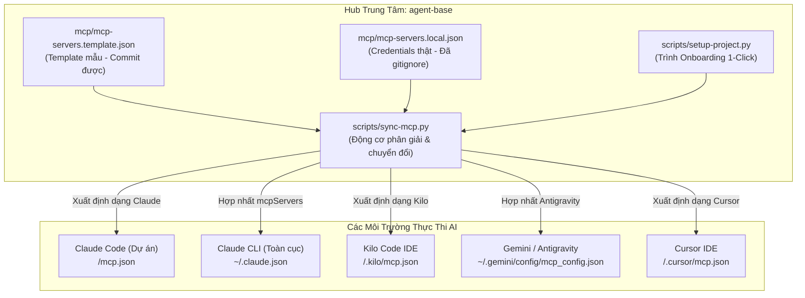

# Quy Chuẩn Khởi Tạo Dự Án & Đồng Bộ Cấu Hình MCP (Universal AI Onboarding Runbook)

> **Phạm vi áp dụng:** Toàn bộ các dự án liên kết với `agent-base` (ví dụ: `gdt-workspace`, các dự án Monorepo hoặc Multi-Service).  
> **Người chịu trách nhiệm kỹ thuật:** `[AI-ENG] Victor`  
> **Phiên bản:** 2.0 (SSOT - Single Source of Truth Architecture)

---

## 1. Mục Đích & Nguyên Tắc Cốt Lõi

Khi tích hợp `agent-base` vào bất kỳ dự án phần mềm nào, hệ thống phải tuân thủ nghiêm ngặt 4 nguyên tắc bất di bất dịch:

1. **Nguyên Tắc Nguồn Sự Thật Duy Nhất (SSOT):**
   - Toàn bộ danh mục cấu hình MCP Servers, AI Rules, Skills và Hooks được quản lý tập trung tại kho lưu trữ `agent-base`.
   - Các dự án con chỉ nhận bản xuất chuẩn hóa thông qua các bộ sinh tự động (`setup-project.py`, `sync-mcp.py`, `sync-adapters.py`).
2. **Nguyên Tắc Giữ Sạch Repository Con (Zero Pollution in Sub-services):**
   - Đối với các dự án dạng Monorepo hoặc Multi-Repo Workspace (như `gdt-workspace` chứa `business/accounting-service`, `business/ws-iam`, `frontend/ws-acct-frontend`...):
     + **Cấu hình AI (.agents, .claude, mcp.json, .kilo, .cursor) CHỈ ĐƯỢC PHÉP ĐẶT TẠI THƯ MỤC GỐC WORKSPACE.**
     + **TUYỆT ĐỐI KHÔNG TẠO** bất kỳ file cấu hình AI hay sửa đổi `.gitignore` trong từng repository của service con. Điều này ngăn ngừa xung đột Git và làm bẩn lịch sử commit của các service độc lập.
3. **Nguyên Tắc Bảo Mật & Phân Tách Secret (Security & Secret Isolation):**
   - Không bao giờ commit credential, token, chuỗi kết nối database vào Git.
   - `agent-base/mcp/mcp-servers.template.json`: File mẫu an toàn, commit được.
   - `agent-base/mcp/mcp-servers.local.json`: File chứa credential thật trên máy cá nhân, được `.gitignore` chặn 100%.
   - Mọi file `mcp.json`, `.kilo/mcp.json` sinh ra tại dự án đích đều được `.gitignore` của dự án đích bảo vệ tự động.
4. **Khởi Tạo 1-Click (Zero-Friction 1-Click Onboarding):**
   - Một lệnh duy nhất thiết lập toàn diện: Cấu trúc thư mục Enterprise `doc/`, Bảng công việc `BOARD.md`, File liên kết `.agentbase.json`, Luật AI đa công cụ (`AGENTS.md`, `CLAUDE.md`, `GEMINI.md`), và cấu hình MCP cho 4 nền tảng AI.

---

## 2. Kiến Trúc Đồng Bộ MCP Đa Nền Tảng (Universal MCP Hub)



---

## 3. Danh Mục MCP Servers Tiêu Chuẩn

Hiện tại, hệ thống hỗ trợ 10 MCP Servers chuẩn chia làm 2 nhóm:

### 3.1. Nhóm 6 Active Servers (Dùng Chung Cho Mọi AI)
1. **GitLab MCP Server (`gitlab`):** Tích hợp GitLab API nội bộ (`git.gdttech.net`), tra cứu repo, commit, merge request.
2. **NotebookLM MCP Server (`notebooklm`):** Tích hợp sổ tay nghiên cứu và tổng hợp tri thức tự động.
3. **Chrome DevTools MCP Server (`chrome-devtools`):** Điều khiển trình duyệt không đầu (Headless Browser), kiểm tra giao diện CDP, bắt lỗi Console, Network và khả năng tiếp cận a11y.
4. **PostgreSQL DEV Ads System (`db-dev-ads-system`):** Tra cứu trực tiếp CSDL Ads System DEV (chỉ đọc).
5. **PostgreSQL DEV IAM (`db-dev-ads-iam`):** Tra cứu trực tiếp CSDL IAM DEV (chỉ đọc).
6. **PostgreSQL DEV Staging (`db-dev-staging`):** Tra cứu CSDL môi trường Staging (chỉ đọc).

### 3.2. Nhóm Servers UAT / Mở Rộng (Kilo Code Profile)
- `db-uat-accounting`: CSDL UAT Kế toán
- `db-uat-iam`: CSDL UAT IAM
- `db-uat-ads-system`: CSDL UAT Ads System
- `db-uat-report`: CSDL UAT Báo cáo

---

## 4. Hướng Dẫn Thao Tác Chuẩn

### 4.1. Khởi Tạo Dự Án Mới Bằng 1-Click (Khuyến Nghị)

Khi mở một dự án mới tinh hoặc kết nối một workspace lớn với `agent-base`:

```bash
# Cú pháp chạy từ thư mục agent-base:
python3 scripts/setup-project.py --target /duong-dan/den/du-an

# Hoặc chạy từ bất kỳ đâu (thay <agent-base-path>):
python3 <agent-base-path>/scripts/setup-project.py --target <du-an-path>
```

**Các bước script tự động thực hiện:**
1. Khởi tạo cây tài liệu Enterprise Global chuẩn 5 nhóm trong `doc/` (`features/`, `architecture/`, `references/`, `governance/`, `delivery/`).
2. Khởi tạo `doc/delivery/tasks/BOARD.md` nếu chưa có.
3. Tạo file dấu ấn định danh `.agentbase.json` và đăng ký dự án vào Multi-Project Dashboard (`agent-base/projects.json`).
4. Khởi tạo `AGENTS.md`, `CLAUDE.md` (`@AGENTS.md`), `GEMINI.md` tại thư mục gốc dự án.
5. Tạo symlink adapter nhẹ nhàng (`.agents`, `.claude`, `.codex`, `.qoder`).
6. Đồng bộ toàn bộ MCP Servers cho Claude, Kilo, Cursor và cập nhật `.gitignore` tại gốc dự án.
7. Kiểm tra động cơ Harness² sẵn sàng.

---

### 4.2. Đồng Bộ Lại Hoặc Cập Nhật Cấu Hình MCP

Khi có thêm server mới, thay đổi port database hoặc cập nhật token:

1. **Sửa file cấu hình master tại `agent-base`:**
   - Mở `mcp/mcp-servers.local.json` (tạo từ `mcp/mcp-servers.template.json`) và chỉnh sửa tham số.
2. **Chạy lệnh đồng bộ toàn cục & dự án:**

```bash
# Đồng bộ cấu hình toàn cục (Antigravity & Claude Global):
python3 scripts/sync-mcp.py --global

# Đồng bộ cho dự án cụ thể:
python3 scripts/sync-mcp.py --target /duong-dan/den/du-an

# Hoặc đồng bộ một lần cho tất cả các dự án trong hệ thống:
python3 scripts/sync-mcp.py --all-projects
```

---

### 4.3. Kiểm Tra Kết Nối (Healthcheck)

- **Claude Code CLI:**
  ```bash
  claude mcp list
  # Kết quả mong muốn: Cả 6 servers đều hiển thị "✔ Connected"
  ```
- **Gemini / Antigravity:**
  Kiểm tra file `~/.gemini/config/mcp_config.json` có đủ 6 active servers.
- **Kilo Code:**
  Mở Kilo Code Settings $\rightarrow$ MCP Servers $\rightarrow$ Kiểm tra danh sách trạng thái màu xanh.

---

## 5. Bảng Đối Soát Vị Trí Lưu Trữ Cấu Hình (Storage Map)

| Thành Phần | Vị Trí Chuẩn | Phạm Vi | Mục Đích |
|---|---|---|---|
| **Master Templates** | `agent-base/mcp/mcp-servers.template.json` | Hub | Bản mẫu cấu hình không secret |
| **Master Local Secret** | `agent-base/mcp/mcp-servers.local.json` | Hub | Secret thật trên máy dev (.gitignored) |
| **Claude Project** | `<workspace-root>/mcp.json` | Thư mục gốc | Claude Code đọc khi mở workspace |
| **Claude Global** | `~/.claude.json` | Máy cá nhân | Claude CLI đọc khi chạy ngoài workspace |
| **Kilo Code** | `<workspace-root>/.kilo/mcp.json` | Thư mục gốc | Kilo Code IDE đọc trong workspace |
| **Antigravity** | `~/.gemini/config/mcp_config.json` | Máy cá nhân | Google Antigravity / Gemini CLI đọc |
| **Cursor IDE** | `<workspace-root>/.cursor/mcp.json` | Thư mục gốc | Cursor IDE đọc cấu hình |
| **Service Con** | *(Trống - Không có bất kỳ file nào)* | Sub-services | **Bảo vệ sạch sẽ 100% từng repo con** |
